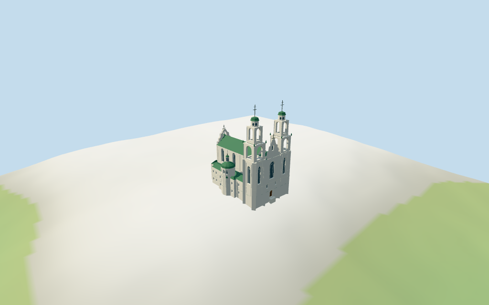

# saint_sophia_cathedral_in_polotsk — Saint Sophia Cathedral in Polotsk review

Reviewed 2026-10-15 against current source/runtime bytes. Accepted for medium-fi exterior and approximate geographic/terrain scope. All vertical architecture is estimated; the raw map height is retained separately.

## Built result

Inspected all 11 current portable/source-terrain frames. Individual Polotsk Saint Sophia has off-white Baroque twin towers with two actual open arched belfry tiers each, narrow round-window attics, green caps and estimated 55 m crosses. Front shaped gable, central arched glazing/wood portal and smaller lower windows connect to the long green-roof nave. Rounded side chapels have upper windows, lower blind arches, green domical roofs and small lanterns; tall rounded rear apse/lantern and shaped rear gable complete the body. Low side ranges carry two rows of small rectangular service windows. Pilasters, layered bands, selected finials and simple fan glazing are merged details. Added thickness/reveals to gable openings; both gable backs remain solid around the glass. All heights, internal roof/chamber divisions and fine ornament remain picture estimates.

Medium-fi exterior from two actually inspected Commons2025 front and2006 reverse-side pictures plus standard viewer PMTiles/DEM. No bespoke plans/surveys researched and no reference pictures redistributed. Individual white twin open towers, shaped gables, green metal roofs, round side/rear chapels, tall glazing/wood portal and low service ranges are authored. All vertical architecture and internal divisions are estimates; no survey accuracy is claimed. Fine stucco figures/iron scrollwork/inscriptions, full interiors/bells and exact hidden facade/roof/threshold joins are approximate or excluded. Current rear finish remains limited by the older reverse view. Physical phone/laptop measurements pending.

## Shared materials and placement

Inspected all 11 current shared/geographic frames. Four existing cached 256-square lime-plaster, limestone, standing-seam metal and plain-wood graphs serve six merged groups. Linear off-white/green/wood tints, metric UVs and flat architectural normals; glass/ironwork use geometric PBR colors. No embedded images or unique facade maps. Each graph reads once; unloading disposes geometry and leaves zero live model geometries. Close views show green metal seam rhythm, open two-tier belfries, recessed tall windows/wood portal and low service glazing. Top placement matches front paired corners, rounded rear and side projections. Whole views include the full envelope and estimated 55 m tips; detail crops intentionally exclude other sections. Flat diagnostic ground does not establish surveyed hilltop paving.

Retained exact-QID OSM way 502489243/Q2465016 matches current main 35184874578075. Anchor [28.75858498,55.486289303], heading -1.486221584761 rad signs native+X paired tower front versus rounded-X rear apse. All 51 raw whole-outline vertices/tags reproduce by rigid rotation without rescale; earlier multilingual identity, white plaster/green metal roof and building:levels1 remain intact. PMTiles height5m conflicts with the pictured multi-tier cathedral; original OSM/facts supply no measured height. The value is retained as cartographic metadata, while every modeled height and internal partition is explicitly estimated: nave23/29m, front25m/gable36m/cross38.8m; open tower tiers25.8..35m and36..44m, attic47m/green cap49m/cross55m; side chapels17/20m/lantern23m/cross25m, rear apse23/24.2m/lantern28m/cross30.5m and low ranges11/12.5m. No independent component map controls are fabricated. All30 actual viewer footprint checks cover the whole and retain three neighbors plus the front plaza across six outputs. Standard DEM datum133.974217m, floor0.4m, perimeter-2.26..0.00m; footings extend below coarse terrain and short local steps approach a threshold0.3m above model floor. Exact hilltop paving/door joins, absolute altitude and walking remain unverified. No global flattening or road replacement.

Inspected all 27 current Earth-lighting frames: Economy/High, noon/late, three distances, texture-free silhouette, six details, four matched whole LODs and four transitions. Skyline uses a separate simplified silhouette with full map base, stepped twin towers/green caps/crosses, shaped gables, nave and rounded side/rear forms; belfry openings and small windows are omitted at this distance. District preserves actual open belfries, shared surfaces and flat window fields. Street adds real wall/gable recesses, rectangular service glazing and simple surrounds; closeup/master refine fan heads/finials. Simplified skyline removes small roof slivers/trim to stay at 793 triangles. All matched whole views contain the full envelope/tips; changes in windows/openings are deliberate. Synthetic cottages and coarse source terrain are fixtures; physical motion/device timings pending.

## Browser budgets

| Level | Triangles | Bytes | Draws |
| --- | ---: | ---: | ---: |
| skyline | 793 | 81436 | 1 |
| district | 3680 | 315868 | 6 |
| street | 12517 | 1037624 | 6 |
| closeup | 15369 | 1311320 | 6 |

Initial skyline plus district: **397304 bytes** of geometry. Master: **1847948 bytes / 15369 triangles**. Four cached shared 256-square graphs; zero embedded images. Bytes exclude graph definitions/texture generation. Split POSITION/NORMAL views have equal CPU/GPU totals. Physical device timing pending.

## Verification

- Targeted byte reproduction and current source/import/LOD/input/report bindings; source/recipe inventory/schema match.
- Six Khronos validations: zero errors, warnings or images. Four browser budgets pass.
- All51 raw map vertices/tags, retained identity/metadata, explicit estimates and standard DEM match.
- **1,202 actual geometry probes** and **30 current viewer footprint checks** pass.
- Shared graph read-once/unload and hash-bound geographic/medium-fi reviews pass.
- Scene validation and 30-tick simulation: sha256:f89e82b79fdc1675b804df9a4aa5ed4ca74c9b401f72b4dfb366b81be0f9e8eb.
- Inspected **49 current frames**:11 portable,11 shared/placement,27 medium-fi. Cameras/paths/hashes retained; bulk images ignored.

Source hash: sha256:46d9afe9f5959d12307033afb23e4029bb87d06e77895536118ba3e7d211621e. Runtime hash: sha256:ad15dec155cda0af0f312d3f56d85e6575597b9405ac990ce1e8230a7158f321. Input hash: sha256:bbf2cc398cfe619d1724d37695061c4985cdf815b8d4cd5e6c860e09da8892b5.

Commands: targeted generate/import/LOD/register-landmark-previews --ids=saint_sophia_cathedral_in_polotsk; generate-additional-landmarks.mjs --ids=saint_sophia_cathedral_in_polotsk --check; capture-structure-models.mjs --ids=saint_sophia_cathedral_in_polotsk --reflections --antialias --fit-shadows; capture-landmark-library.mjs --ids=saint_sophia_cathedral_in_polotsk --reflections --adaptive-clipping --bounded-placement; capture-medium-fi.mjs --ids=saint_sophia_cathedral_in_polotsk --reflections; molen validate; molen sim run --ticks30 --hash. Full source checkpoint ljubljana_cathedral–saint_sophia_cathedral_in_polotsk follows this targeted round.

## Limits

- Retained exact-QID OSM way502489243/Q2465016 matches current main35184874578075. All51 current whole-outline vertices and raw tags reproduce by rigid rotation without rescale. Earlier multilingual tags, white plaster/green metal roof and building:levels1 remain retained. Current PMTiles emits height5m, conflicting with the pictured multi-tier cathedral; original OSM control and retained facts provide no measured height, so5m remains cartographic metadata and every modeled height is a picture estimate. Native+X paired tower front contrasts with-X rounded rear apse. Internal Boolean clips and side circular partitions, nave wall23m/roof29m, front wall25m/shaped central gable36m/cross38.8m, twin tower lower25m/open lower belfry25.8..35m/open upper36..44m/round attic44..47m/green caps49m/cross55m, round side chapels17m/green roofs20m/lanterns23m/cross25m, rear apse23m/green roof24.2m/lantern28m/cross30.5m and low ranges11m/12.5m are estimated. Exact ornament, fenestration, hidden roof joins, measured heights and engineering accuracy are unverified.
- Standard viewer DEM datum 133.974217m; display floor0.4m, raw whole perimeter -2.26..-0.00m. Footings extend below coarse terrain; short local entrance steps approach a threshold0.3m above model floor. Exact hilltop paving/door joins, absolute altitude and walking remain unverified. No global flattening or road replacement.
- Medium-fi exterior from two inspected2025 front/2006 reverse-side pictures and standard viewer PMTiles/DEM only. Cartographic5m height is retained but is not a measured cathedral height; all modeled vertical levels and internal partitions are estimated. Fine stucco/iron scrollwork, inscriptions, exact hidden rear/door details, full interiors/bells and surveyed paving/thresholds remain approximate or excluded. Physical phone/laptop timings pending.
- Skyline retains white stepped twin towers/green caps/crosses, shaped central gable, nave and rounded apse/side chapels. District adds shared textures, flat arched fields and actual open belfries. Street adds recessed glazing/wood portal, simple pilasters and blind arches; closeup/master refine frames/finials. Synthetic cottages are fixtures.

Readiness accepts this exterior scope. The full1,000-candidate goal remains incomplete.
