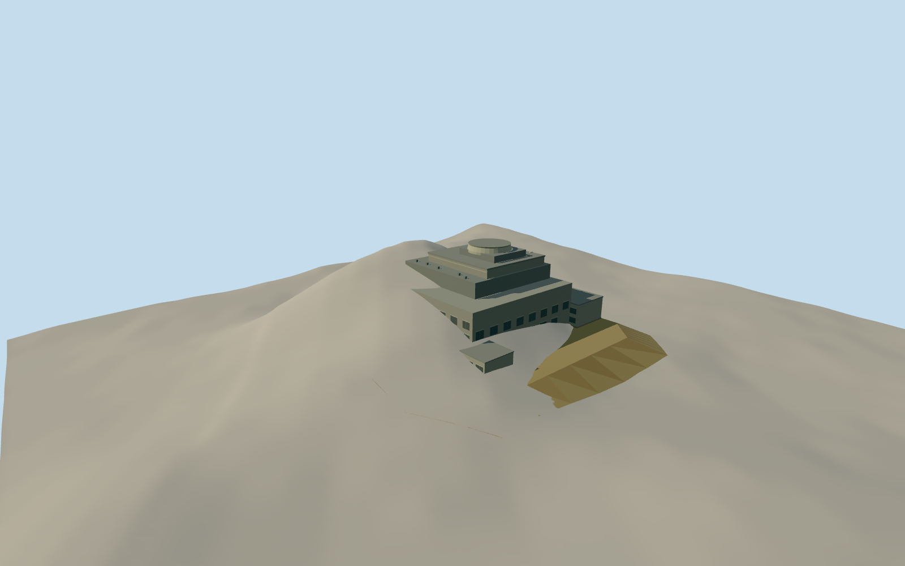

# Crimean Nuclear Power Station, 1999

The unfinished 1999 exterior of the former Crimean Nuclear Power Station, with its tall central concrete mass and long adjacent ranges.

Authoring state: **review-in-qa.json**. Current completion evidence is in [qa.json](qa.json) and the [completion ledger](../../../../qualla-structures/batches/qualla-003.PROGRESS.md).

- [Crimean Nuclear Power Station](https://qualla.com/crimean-atomic-energy-station/)

Only the documented 1999 historical view shows this exterior. The architecture represents the unfinished shell as a visual landmark, with an empty central silhouette and low adjoining range.

The raw DEM has a localized elevation rise at the mapped shell. The historical placement uses an estimated local grade inside that source feature. The original surrounding field is retained. Open bay counts, roof height and concrete tone are estimates.

The model covers the silhouette of the buildings in the source photograph. The surrounding grounds and construction equipment are outside the modeled area.

Build: `node content/worldgen/source/places/ub/ub1/crimean_nuclear_power_station/models/generate-crimean-nuclear-power-station.mjs`. Add `--check` to verify exact regeneration. 1468 triangles; 6 materials; no embedded photographs.
