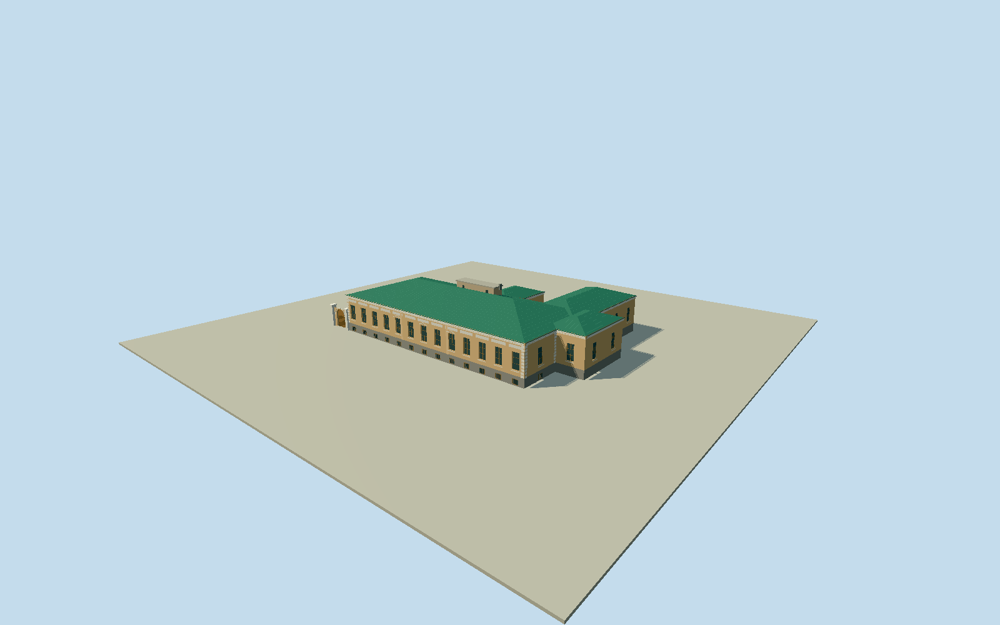

# Alexander I Palace

Whole surviving Alexander I Palace/House of the Mayor (Papkov house), Grecheskaya40, Taganrog: full 14-vertex native main block and attached rear returns/fingers, raised basement/single principal floor, 13-window street elevation, shallow central risalit, white rusticated corners/cornice/dentils/recess panels/window hoods, green hipped metal roofs/chimneys, modest intrinsic side pedestrian gate. No Tsarskoye Selo palace, surrounding sanatorium campus/independent neighbors, grounds/street/trees/temporary scaffolding/cars/people/interiors. Preserve recessed individual windows with deep reveals, wooden frames/sashes, basement lights/grilles, projecting white sills/pedimented hoods, shallow risalit, rusticated corner strips and full hip-roof/rear-return silhouette. Avoid generic palace portico or unrelated monumental palace architecture. Heights/roof pitches/hidden rear details estimates independent of frozen terrain.

Authoring state: **review-in-qa.json**. Current completion evidence is in [qa.json](qa.json) and the [completion ledger](../../../../qualla-structures/batches/qualla-002.PROGRESS.md).

- [Alexander I Palace](https://qualla.com/alexander-i-palace/)

Native one-storey historic way335749889 at Qualla Taganrog coordinate, all14 vertices retained, front long edge0=33.73m faces Grecheskaya street and fits photographed raised-basement 13-window house between neighboring42 and36 parcels. Fixed14-vertex mean anchor and native longest-edge heading before terrain/geometry. Full concave main/rear-return outline, not a front-only box or surrounding sanatorium parcel. Address/identity confirmed by Rostov heritage society VOOPIiK primary record Grecheskaya40; map has historic/building:levels1 tags but lacks name/number. This is approximate independent-map registration, not a surveyed footprint. Rear asymmetry retained from map; roof subdivisions and unphotographed window census estimated.

Full14-vertex single-storey historic palace and attached rear returns, raised basement and13-window street front; green hipped metal roof/standing seams/chimney box, white rusticated corners/dentil cornice/upper panels/three pedimented hoods, wooden sashes/basement grilles and intrinsic attached pedestrian gate. Small painted moldings/window grille pattern simplified. Gate placement/dimensions, rear window census and low return hip profiles bounded estimates; full native outline retained, not surrounding campus.

Two published ISasha PD originals exactly native-SHA1-bound and individually inspected. 2010 ochre/white/green repaint selected without temporary scaffolding;2008 photo supplies proportions, no mixed original1825restoration claim. Current exact finish/condition/rear arrangement unverified; hidden facades/roof subdivisions/chimney heights interpreted from complete native geometry and visible front. No attribution/unknown photo textures or generated bitmap.

Original public independent256m129-square2m field/all16641values/one originalTerrariumtile/PNG frozen before geometry unchanged; provider-relative datum41.2232m/sourcepixel3.24534m, not survey accuracy. No terrain flattening/fit/reacquisition; actual host-grade contact unverified. All architecture localY0, slight internal basement/approach variations unsurveyed. Flat capture fixtures are separate.

No TsarskoyeSeloAlexanderPalace, independent sanatorium campus/neighbor buildings, trees/yard/street/temporary renovation/cars/visitors/interiors or plaque inscriptions. Ordinary geographic preview, replacement disabled.

Build: `node packages/worldgen/scripts/generate-authored-places.mjs --ids=alexander_i_palace`. Add `--check` to verify exact regeneration. 10248 triangles; 5 materials; no embedded photographs.
