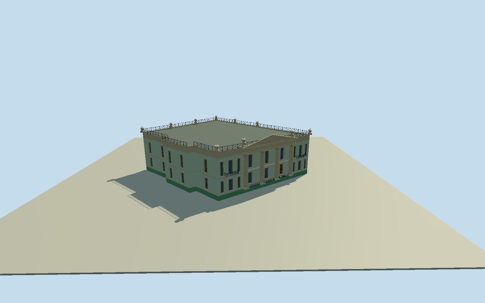

# Alferaki Palace

Whole actual ten-control Alferaki Palace: current pale mint/cream-white facades/green raised basement, four giant fluted Corinthian columns and real recessed front/closed window-door backs, layered entablature/triangular relief-abstracted pediment, wing triplewindow banks/two upper balconies/actual pierced metal rails, complete irregular side/rear/native roof outline/low hidden roof/open roofperimeter rail and vase finials. One different2024Fargohown/selfCC0 exactoriginal after Qualla-first search/published-source exclusions, no oldunboundsourceuse or repair. Fine relief/heraldry/leaf/curl patterns original geometric abstractions; hidden roof/elevations/window census/heights/entry inferred. No copied pixels/inscriptions/artwork/neighborannexe/roads/trees/poles/wires/people/interiors.

Authoring state: **review-in-qa.json**. Current completion evidence is in [qa.json](qa.json) and the [completion ledger](../../../../qualla-structures/batches/qualla-002.PROGRESS.md).

- [Alferaki Palace](https://qualla.com/alferaki-palace/)

Whole actual named palace99407522/Q4721899 native11closedpoint ring/tencontrols. Exact bbox anchor/+Xeast/+Zsouth/heading0; no rectangle substitutes for actual irregular whole envelope. Main giant-order facade interpreted on native6to5 northwestern31.82m edge, with nearby corner streets/photo camera orientation. NativeNEedge stepped projections and complete side/rear retained. No separate mapped portico/roof parts: original geometric subplans/photo proportions to be selected only after independentfieldfreeze.

All source floors/sections/geometry follow original400m129x12916641sample independent sourcefield/two rawtiles/fixedNWapproach44m datum freeze. Nativewhole tencontrol palace envelope remains exact, NWnative6to5 giantorderfront31.82m inferred from photo camera/street orientation; portico subplan/hiddenroof not separatelysurveyed. Original2024creatorCC0photo proportions select basement1.35m/lowerwall5.7m/upper10.7m/cornice12.3m/lowhiddenroof12.04m/triangularpediment14.35m/roofrail13.35m/vasesup to14.65m. Fourflutedcolumns1.8..10.02m/capital10.7m are independent originalsections, centralbackwall .9m inside nativefront/columnaxis .28m outside, real exterior gap retained. Primaryfront18tallwindow/doorfields atnear levels/wingtriplebanks/twoupperpiercedbalconies. Currentmintcream-whitefacade/greenbasement/woodframes/openironrails from only accepted2024Fargohown/selfCC0. Hidden elevation/roof/census/finefinish/ornament/entry positions conservative estimates; oldunboundpublishedphotos notused. No terrainfit/flatten/reacquire/modelraising; preview/replacementfalse/exactsourcegradecontact unresolved.

Qualla-first22families/zero conflicts; older published creatorPD2008/derivative unused after unchanged inventory/native-primary guard did not bind missing local basis/legacyfirst-release syntax. Different2024Fargohown/selfCC0 original alone individually inspected/nativeSHA1 matched/passed unchanged supplementalinventory. No sameimage reclassification/Quallasource repairs. Current mint-white/greenfinish from accepted2024photo only. Fine sculptural relief/heraldry/capitalleaves/iron curls original abstractions, exact ornament/hidden roof/elevations/windowcensus/entry/sections estimated. Neighbor annexe/street/trees/people/poles/wires/signs/interiors/sourcepixels/text excluded.

Original400m129x12916641sample field/two rawtiles/fixedNWapproach44m datum frozen before all floor/section/geometry choices. No terrainfit/flatten/reacquire/modelraising. Preview/replacementfalse/exactgroundcontact unresolved. Flat isolated ground/synthetic neighbor fixtures only.

Build: `node content/worldgen/source/places/ub/ub7/alferaki_palace/models/generate-alferaki-palace.mjs`. Add `--check` to verify exact regeneration. 29706 triangles; 6 materials; no embedded photographs.
