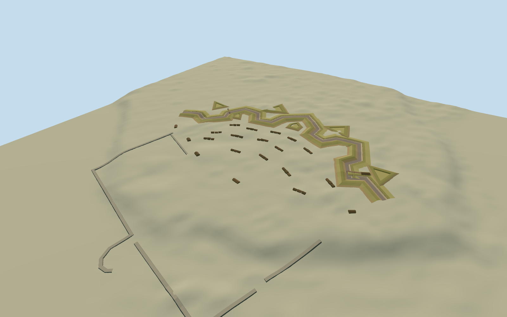

# Taganrog Fortress

The 1704 Taganrog Fortress as shown by its as-built survey, with earth fronts, four ravelins, low town buildings, timber bridges and stone harbor moles.

Authoring state: **review-in-qa.json**. Current completion evidence is in [qa.json](qa.json) and the [local 100 ledger](../../../../qualla-structures/batches/PROGRESS.md).

- [Taganrog Fortress](https://qualla.com/taganrog-fortress/)

The representation centers on the December 1704 archival survey. Display dates cover the following year as an approximate appearance interval.

The absolute historical outline and elevations are approximate. Fit uses a known landward bastion site, the historic compass and Rute scale. Present-day port reclamation, roads and surviving cut slopes change the terrain around the cape.

The dry ditch is a shallow channel between modelled banks resting on independently sampled modern terrain. Harbor moles remain visible above the existing surface through reclaimed areas, where their present surface height is an estimate.

Townspeople’s buildings, gates, timber work and roof details are restrained reconstructions. The 1704 plan documents street blocks and some raised structures. The individual roof forms are estimates, and the church and permanent fort facilities that opened in later years are outside this appearance.

Build: `node content/worldgen/source/places/ub/ub7/taganrog_fortress/models/generate-taganrog-fortress.mjs`. Add `--check` to verify exact regeneration. 9040 triangles; 6 materials; no embedded photographs.
