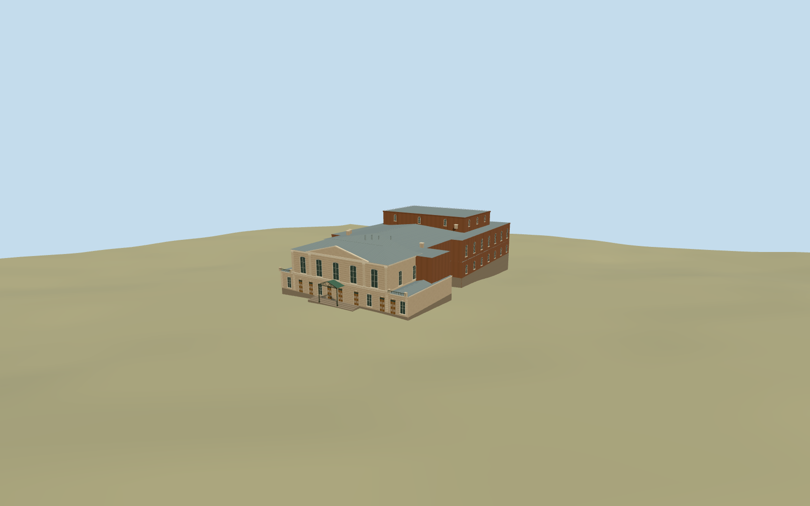

# Taganrog Theatre

The cream 1866 Chekhov Theatre with five tall windows, a shallow triangular pediment, green gabled canopy and deep red-brick backstage section.

Authoring state: **review-in-qa.json**. Current completion evidence is in [qa.json](qa.json) and the [completion ledger](../../../../qualla-structures/batches/qualla-003.PROGRESS.md).

- [Taganrog Theatre](https://qualla.com/taganrog-theatre/)

The named outline controls the perimeter. The model follows the 2007 front elevation and standing theater’s documented continuity. Rear stages and side windows, roof pitch, exact heights, small railing metalwork and minor door differences are approximate.

The stage machinery, auditorium interiors, neighboring buildings, streets and overhead wires are outside the modeled exterior.

Build: `node content/worldgen/source/places/ub/ub7/taganrog_theatre/models/generate-taganrog-theatre.mjs`. Add `--check` to verify exact regeneration. 5998 triangles; 7 materials; no embedded photographs.
