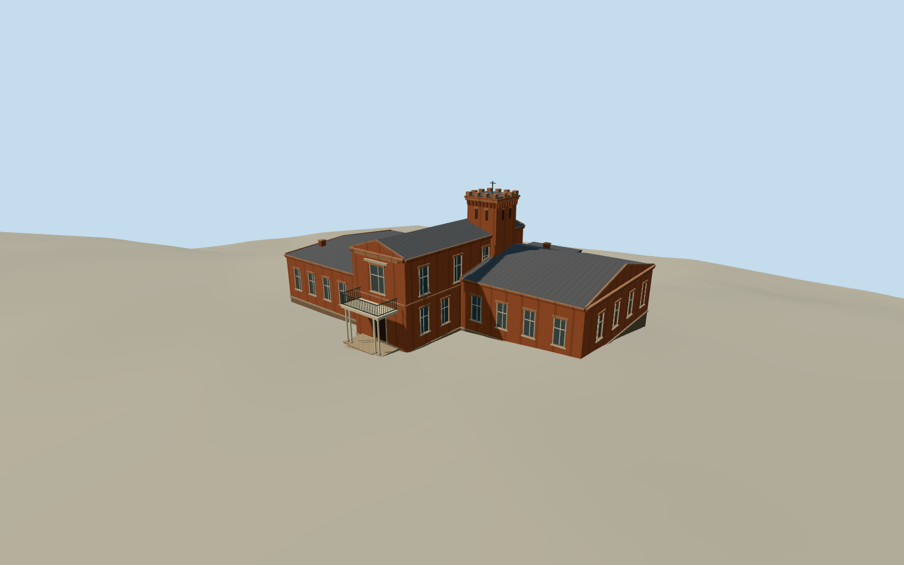

# Tchaikovsky House in Taganrog

Red-brick house with staggered wings, a pedimented central entry, white porch posts and a square crenellated belvedere.

Authoring state: **review-in-qa.json**. Current completion evidence is in [qa.json](qa.json) and the [completion ledger](../../../../qualla-structures/batches/qualla-003.PROGRESS.md).

- [Tchaikovsky House in Taganrog](https://qualla.com/tchaikovsky-house-in-taganrog/)

The model represents the photographed March 2008 exterior. Building heights, unseen rear windows, roof slopes and small ornament require interpretation.

The source terrain is unchanged. The connection between rear foundation and ground follows its approximate local slope.

Build: `node content/worldgen/source/places/ub/ub7/tchaikovsky_house_in_taganrog/models/generate-taganrog-house.mjs`. Add `--check` to verify exact regeneration. 5592 triangles; 6 materials; no embedded photographs.
