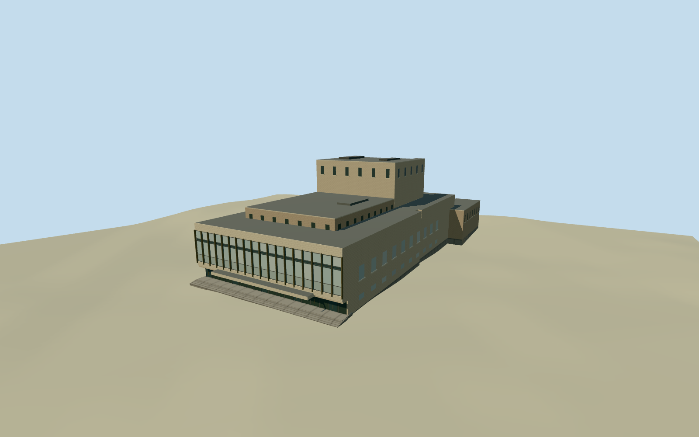

# Dnipro Opera and Ballet Theatre

Dnipro’s 1974 theatre with its overhanging glazed gallery, horizontal stone cladding and taller stage house.

Authoring state: **review-in-qa.json**. Current completion evidence is in [qa.json](qa.json) and the [completion ledger](../../../../qualla-structures/batches/qualla-004.PROGRESS.md).

- [Dnipro Opera and Ballet Theatre](https://qualla.com/dnipro-opera-and-ballet-theatre/)

The exterior depicts the standing building. The fountain sculpture, plaza fixtures and theatre interiors are outside scope.

Mapped level differences establish the taller stage volume. Exterior heights, upper facade detail and the service-wing window spacing are estimated.

Build: `node content/worldgen/source/places/ub/ub8/dnipro_opera_and_ballet_theatre/models/generate-dnipro-opera-and-ballet-theatre.mjs`. Add `--check` to verify exact regeneration. 2809 triangles; 5 materials; no embedded photographs.
