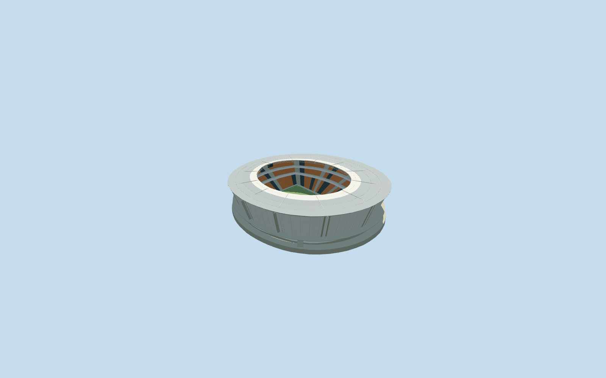
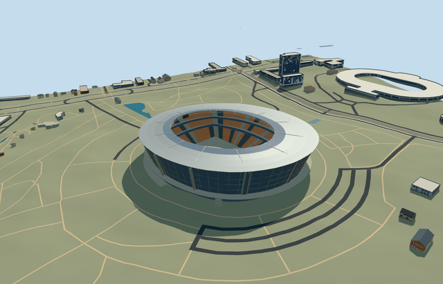

# donbass_arena — Donbass Arena

Reviewed2026-10-20 in one author/build/inspect/fix pass.

## Appearance

Inspected48 final current views: source turntable/details, shared-surface placement, noon/late economy/high, all four LODs, original native terrain/context and failed load. Specific south-inclined saucer roof/inner glazed strip/open central aperture/closed backs/deep radial main trusses and circumferential inner lattice, outward-leaning continuous glazed facade/pale framed service-core approximations/recessed lower retail/services/concourse/four entry flights, three orange-dark seating tiers/two closed hospitality belts/pale aisles/neutral football field/goals/supported end displays. Closed the initially one-sided outer glazing so it remains present from inside the bowl, using the same explicit diagonal for both faces. No blue event lighting, seat lettering, copied brand graphics or furnished hidden rooms. Fine framing/core/step inventory remains approximate.

## Shared surfaces and browser budgets

Five existing shared256px graphs: concrete_plain, metal_painted, metal_corrugated, fabric_canvas and window_grid. Zero embedded images or private texture atlas. Runtime loads each required graph once; five near draws and one skyline draw. Separate POSITION/NORMAL GPU streams and equal CPU/GPU byte accounting. Neutral daylight/reflected sky/shadows checked. Glass and the inner roof strip are opaque shared-material approximations, not exact optical transmission.

| Level | Triangles | Bytes | Draws |
| --- | ---: | ---: | ---: |
| skyline | 920 | 89540 | 1 |
| district | 3758 | 368596 | 5 |
| street | 12966 | 1244140 | 5 |
| closeup | 42222 | 4104968 | 5 |

Four authored levels preserve the own envelope/roof incline/central field, flared facade and three seating banks. Far levels merge seating rows/lattice and simplify cores/services/entry steps. Levels920/3758/12966/42222triangles; initial skyline plus district458136bytes is below3MB phone/6MB laptop asset targets. Physical ordinary-laptop/phone/tablet and dense-city timings remain pending.

## Approximate native placement

RetainedQ180479 and named native stadiumPOI52776559857932 identify own roof52776559857931 and bowl52776559857932. Separate pitch35184499483392 supplies109.962252x74.358805m field-surround axis. Both parents have the same70-point exterior; roof has38-point aperture and bowl a separate four-point lower opening. Approximately257x230m outer body/162x131m roof aperture; playing field is not the roof opening. Own anchor[37.81018853187561,48.02102852533376]/heading0/native east-south/internal X[0.3616572176931073,0.9323111373841247]/Z[-0.9323111373841247,0.3616572176931073]. Existing retained relation/axis is approximate; the native pitch is used here. Independent neighboring buildings and landscape remain unchanged. Fine20degree/2m facing and service-core/module inventory are picture-led estimates. Production helper removes only own roof52776559857931 and bowl52776559857932. All70 independent resident inputs of72 originals/all237 wider independent records remain unchanged. Original6m grid/roads/398297.1762319613m2 water retained. Six actual PMTiles13/14/15 cases pass; lower-zoom merged complexes are clipped only within the owned mask. Failure keeps72 originals; every level unload restores ground/water/zero live geometry. Original standard6m Mapzen grid/roads/water/independent context remain unchanged. Original anchor datum197.31343976443213m defines modelY0 and field. Own retaining floor extends below minimum original boundary grade and bounded opening remains inside all-level occupied floor. Original boundary range approximately-6.35..8.68m reflects coarse surface sampling; lower services/column feet and four entry flights adapt locally, with no claim of surveyed field or plaza elevation. Only the two own roof/bowl records are replaced using99.5percent occupied-area coverage; lower-zoom merged complexes use bounded clipping. No whole-park platform, exterior terrain edit or water removal. Failure/unload preserves or restores original context.

## Limits

Three primary ordinary project photographs plus one supplemental distant night exterior were actually viewed: detailed exterior, occupied bowl and empty bowl establish the reference form. No bespoke survey/archive research or copied pixels/event/crowd/seat lettering. No qualified native architectural height. ENKA describes a south-inclined roof at50m altitude without a qualified ground/pitch datum. Working field at original anchor datum; roof46m above field at its outer center plane with geographic north-south slope0.045, inner strip raised2.5m and approximate1m sag. Three tiers1.4..14m/18..23.5m/approximately27..34m with an upper north-south height variation, two belts14..18m/23.5..27m, concourse12m and galleries/core profiles/roof4m depth are picture-led. Twelve primary roof carriers follow the builder description; twelve simplified pale facade cores are an approximation, not a verified core inventory. Working core/row/frame/step counts and20degree/2m facing are not engineering/access/surveyed claims. Completed-reference appearance from undated project pictures; no statement of subsequent or current condition. Shared opaque glazing/roof strip approximate optical transparency. Original standard6m Mapzen grid/roads/water/independent context remain unchanged. Original anchor datum197.31343976443213m defines modelY0 and field. Own retaining floor extends below minimum original boundary grade and bounded opening remains inside all-level occupied floor. Original boundary range approximately-6.35..8.68m reflects coarse surface sampling; lower services/column feet and four entry flights adapt locally, with no claim of surveyed field or plaza elevation. Only the two own roof/bowl records are replaced using99.5percent occupied-area coverage; lower-zoom merged complexes use bounded clipping. No whole-park platform, exterior terrain edit or water removal. Failure/unload preserves or restores original context.

## Selected checks

Six Khronos files: zero errors/warnings.10484 actual geometry/material/contact checks,48 current inspected views,six actual native map-level cases. Selected source/import/placement/strict medium-fi/scene validation pass. Sim30 hash96ae7b985a54a2a5667fc7d0fa6bf64d96baa88858ff9095afb96289358e8afc.

Source sha256:bdc414127ea4035a2da0679d392cb02eabe815d01ab797297c2ac83a3b34ea21

Runtime sha256:2bb7d2bb61b3e600ba95eff1b3492eebbdcd17a66b34f55ec929bc0cf2b95720

Input sha256:279eb43c28bf40e6e839219d39223c5dc9ea957a9af846a65c844357a5f69232

Rebuild: node packages/worldgen/scripts/generate-additional-landmarks.mjs --ids=donbass_arena; node packages/worldgen/scripts/import-structure-models.mjs --ids=donbass_arena; node packages/tooling/scripts/generate-landmark-lods.mjs --ids=donbass_arena --force.

## Ordinary picture references

https://www.enka.com/portfolio-item/fc-shakhtar-donetsk-stadium-donbass-arena/ — https://www.enka.com/wp-content/uploads/SHAKHTAR_STADIUM_017.jpg.webp; ENKA project gallery; individual frame photographer not separately verified; Copyright retained; viewed only/no copied pixels. Viewed only/no copied pixels.

https://www.enka.com/portfolio-item/fc-shakhtar-donetsk-stadium-donbass-arena/ — https://www.enka.com/wp-content/uploads/SHAKHTAR_STADIUM_018.jpg.webp; ENKA project gallery; individual frame photographer not separately verified; Copyright retained; viewed only/no copied pixels. Viewed only/no copied pixels.

https://www.enka.com/portfolio-item/fc-shakhtar-donetsk-stadium-donbass-arena/ — https://www.enka.com/wp-content/uploads/SHAKHTAR_STADIUM_023.jpg.webp; ENKA project gallery; individual frame photographer not separately verified; Copyright retained; viewed only/no copied pixels. Viewed only/no copied pixels.

https://www.enka.com/portfolio-item/fc-shakhtar-donetsk-stadium-donbass-arena/ — https://www.enka.com/wp-content/uploads/SHAKHTAR_STADIUM_001.jpg.webp; ENKA project gallery; individual frame photographer not separately verified; Copyright retained; viewed only/no copied pixels. Viewed only/no copied pixels.
