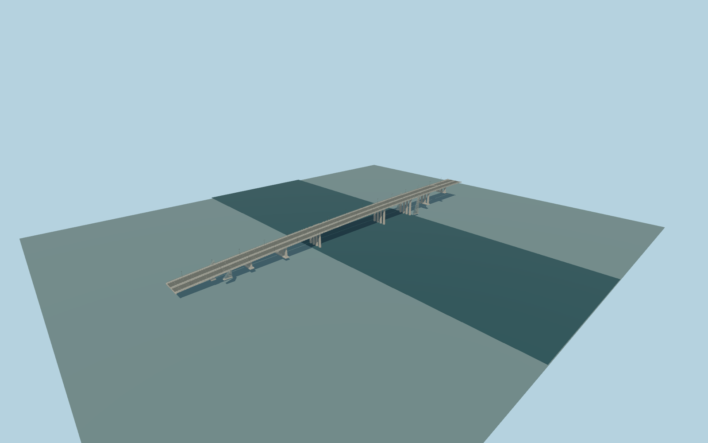

# Voroshilovsky Bridge

Modern paired three-lane decks over the Don, with a real median gap, steel I-girders/haunches, open four-legged concrete river piers, outer pedestrian walks and four triangular glazed bank access enclosures.

Original deterministic source: models/voroshilovsky-model.mjs, alignment.json, ordinary-picture observations and retained standard viewer map/terrain controls. Rebuild with `node packages/worldgen/scripts/generate-voroshilovsky-bridge.mjs`; append `--check` for exact bytes. Targeted import and LOD commands select `--ids=voroshilovsky_bridge`. GLBs are ignored build outputs.

Three existing shared256px graphs, palette paint and clear untextured glass; no private texture copies. Modern643.6m paired corridor, outer footpaths and four separate bank access connectors are retained. Source/master and four browser tiers are separate. Native terrain is unmodified; river clearance, original grades, pier and lift construction remain approximate. The water rectangle is a review fixture. See model-brief.json and qa.json for scope and current visual acceptance.

Original geometry uses the repository license. Map controls: © OpenStreetMap contributors, ODbL-1.0;Protomaps basemap. Global terrain attribution and raw tile hashes are in terrain-grid.json. Linked pictures are references, not redistributed or used as textures.
