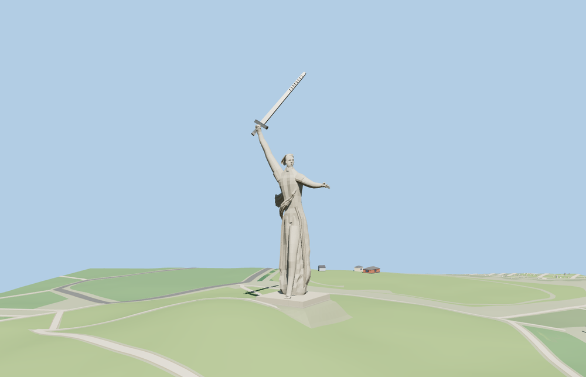

# The Motherland Calls

The model uses the published 85 m height from the feet to the sword tip. It includes the raised hilt, open blade vents, spread fingers, turned face, sweeping robe and low concrete plinth. The face and drapery are reconstructed from photographs. [Sculpture dimensions](https://volsu.ru/upload/medialibrary/ece/EN_welcome_vog_for_web.pdf)

The named PMTiles point and the mapped rectangular plinth fix the placement. A geotagged view confirms the east-southeast-facing side. Standard terrain at the summit supplies the 113 m datum. The embedded foundation and graded apron keep the exposed plinth low against the hill. [Geotagged view of the summit](https://commons.wikimedia.org/wiki/File:Mamayev_Kurgan_Volgograd.jpg)

The native viewer replaces the single mapped plinth and retains 10 neighboring building features and 92 roads. It preserves surrounding terrain, water and land cover through loading and eviction. The load failure case retains the original map footprint.

The 13,640-triangle source master rebuilds from the model recipe. The skyline and district GLBs total 292,332 bytes. Six GLBs passed validation. The native and portable reviews covered 38 views.
