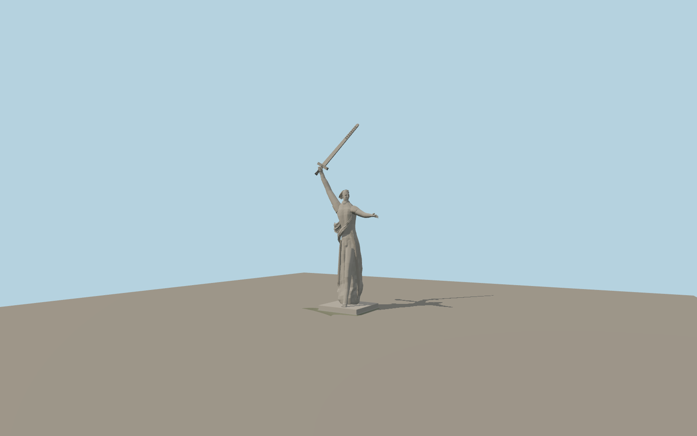

# The Motherland Calls

The concrete figure turns toward her outstretched left hand, raising a long sword with her right. The modeled folds of the windblown robe and sash carry the forward stride down to the two bare feet and the low summit plinth.

Run `node packages/worldgen/scripts/generate-the-motherland-calls.mjs` to rebuild the source master. Append `--check` to compare the exact bytes. Use `--ids=the_motherland_calls` for targeted import, LOD generation and placement.

The model uses the published 85 m sculpture height including the sword and a roughly 2 m exposed plinth. The figure proportions, hand pose, folds and sword openings are reconstructed from photographs.

The named map point and mapped plinth fix placement. The geotagged hilltop view confirms the signed east-southeast face. Standard Terrarium supplies the summit datum and the apron grades.

The compact apron transitions to coarse surrounding terrain and leaves the mapped paths in place. The rest of the memorial complex is outside this asset.

Original geometry follows the repository license. Map data is © OpenStreetMap contributors under ODbL-1.0 via Protomaps. Terrain samples are described in terrain-grid.json. Ordinary pictures stay local and are not redistributed or used as textures. Current acceptance is recorded in qa.json.
