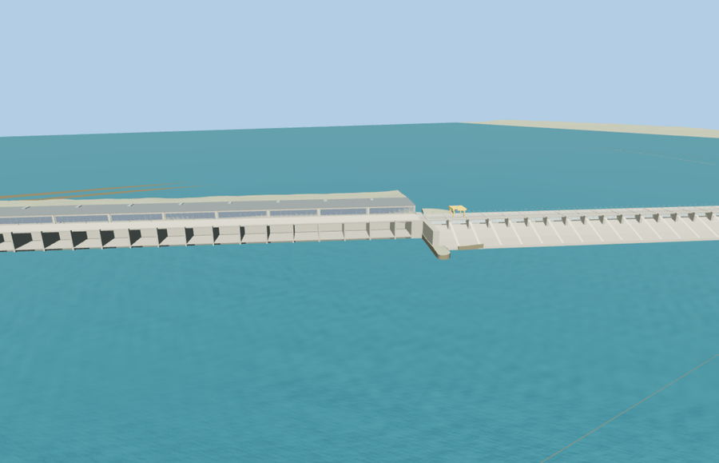

# Volga Hydroelectric Station

The exterior includes the 725 m spillway and 27 recessed gate bays, the long glazed powerhouse, both traveling cranes, the crest road and overhead rail, the approach embankments, and navigation locks 30 and 31 with open chambers and gate towers.

The viewer fixes the inland tailwater at −8.4 m and retains the 7.96 m upstream pool. The lower stage exposes the apron and generating hall outlets. Both authored lock chambers have separate illustrative levels. The focused fixture replaces two owned building records and nine mapped crest road and rail fragments, keeps the other 108 buildings and 193 road records, and retains the separate lock crossing.

Failed loading preserves the native layers. Eviction restores the ground and releases model geometry.

| Detail level | Triangles | Download bytes | Draws |
| --- | ---: | ---: | ---: |
| skyline | 868 | 67,048 | 1 |
| district | 3,728 | 316,728 | 6 |
| street | 6,602 | 555,456 | 6 |
| closeup | 10,718 | 912,224 | 6 |

Skyline and district total 383,776 bytes. Six GLBs pass Khronos validation and contain zero embedded images. Six shared material graphs bind in the viewer. The review covers 71 renders and 60 geographic samples.

Static water stages and lock hardware represent the retained standard terrain and map evidence. Actual operating levels vary. Some bank and embankment contacts remain approximate.

The exterior includes the station, main spillway and twin navigation locks. Remote dikes and the separate lock crossing retain native geometry.

[Mapped site frame](map-frame.json) · [Terrain and water fit](site-fit.json) · [QA evidence](qa.json)
