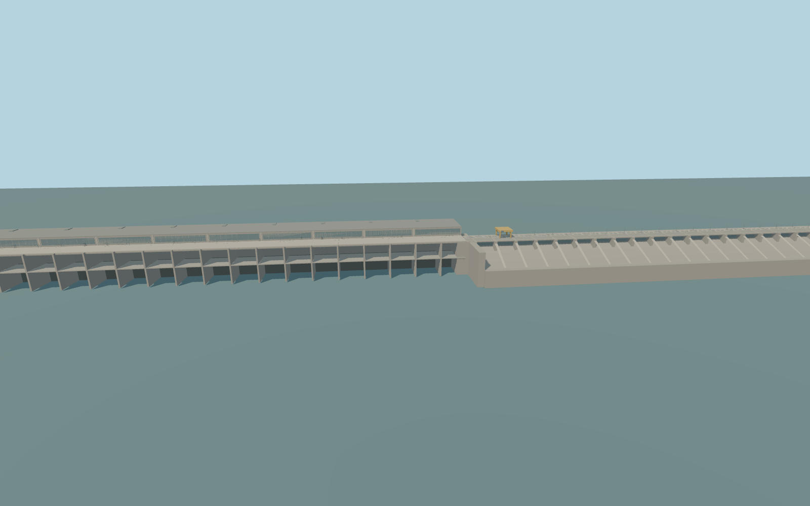

# Volga Hydroelectric Station

The concrete Volga crossing with 27 spillway bays, the generating hall, two traveling cranes, the immediate crest approaches, and twin lock chambers 30 and 31.

Rebuild: `node packages/worldgen/scripts/generate-volga-hydroelectric-station.mjs`;append `--check` for exact source bytes. Select import/LOD/placement with `--ids=volga_hydroelectric_station`. Detailed source and four browser tiers are separate ignored GLB outputs.

Standard Terrarium gives a 7.96 m reservoir reference and about −8.4 m in the main tailwater. The live sampler returns 8.29–9.03 m on the reservoir and 2.15 m on the tailwater and lock outlet.

The 725 m concrete spillway and neighboring powerhouse use the signed road and rail corridor. Both navigation chambers use their mapped axes. Gate machinery and some approach grades are interpreted.

The review includes the raw terrain approximation and the production water sample. The 10.55 m tailwater discrepancy obscures the lower spillway and the powerhouse outlets in the latter condition. Runtime site readiness is pending.

The separate road and rail crossing at the locks remains native. Remote dikes, lock approach channels and unrelated site infrastructure use the native world map.

Original geometry:repository license. Map:© OpenStreetMap contributors,ODbL-1.0;Protomaps. Standard terrain:terrain-grid.json. Ordinary pictures stay local and are not redistributed or used as textures. Current acceptance:qa.json.
