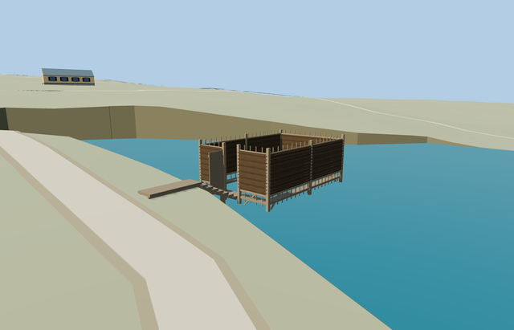

# Bathing Enclosure — Yasnaya Polyana

Reviewed2026-10-25. **Complete medium-fi exterior interpretation with corrected point-based placement. The estate remains incomplete because service inventory is outstanding.**

## Built and inspected

Inspected 48 current portable/shared/medium-fi/native frames, including full-resolution pool, woven screens, braces, open leaf, descending approach and perimeter deck views. The enclosure is genuinely roofless and has no central floor. The flat standalone display floor was removed because it obscured the low deck; native terrain/water provides the geographic fit evidence.

## Shared materials and LODs

Three surface roles reuse two existing 256px material graphs: thatch and wood_plain. Metric UVs, linear tints, separate vertex streams and equal CPU/GPU geometry accounting. No embedded images, private atlas or new texture graph; each graph loads once and unloading releases all model geometry.

| Level | Triangles | Bytes | Draws |
| --- | ---: | ---: | ---: |
| skyline | 528 | 50540 | 1 |
| district | 1188 | 98460 | 2 |
| street | 4008 | 318444 | 2 |
| closeup | 5880 | 464464 | 2 |

Four authored levels 528/1188/4008/5880 triangles; initial skyline+district 149000 bytes. Skyline keeps the complete enclosure, bank landing, seven steps and open doorway under1000triangles. District adds stakes/ladder/braces; near levels add restrained weave/plank joints. Mode/distance/lighting frames are synthetic style checks; physical laptop/phone measurements remain pending.

## Geographic fit and limitations

Named bathing point node/302670091 (Заброшенная купальня), anchor [37.52922177314758,54.07446706598759]. A.Savin’s viewed pond photograph has public camera coordinates 10.67m from this point and 171.32m from the rejected bank-side way/676929139. Camera position establishes vicinity only. No building footprint supplies scale or heading here. The 7.4x4.8m enclosure and northeast long axis are photo-led approximations, oriented with a bank-facing southwest short-end entrance. Keep the unrelated bank-side building and all other native buildings. Retained Protomaps 20261020 / standard Mapzen 201x201 grid at 6m; outside-bank provider [-3,0] supplies 209.66014442236218m datum. Native pond 208.23155921915782m; model water -1.4285852032043636m and deck -1.0285852032043636m. Preserve the original DEM samples and native water/road geometry. Native hydrology clears coarse ground that obscures the mapped pond; model cuts cover only its flooded body and stair, not the dry bank landing or unrelated buildings. The seven steps reconcile the coarse bank height with the photo-led .4m water clearance. The nearby native path stops about 2m from the landing; no invented final path is supplied. Inspected the corrected native pool, wattle screens, open leaf, seven descending treads and bank landing. Model is seated on its outside-bank attachment; no ground covers the central pool. The original mapped water, DEM samples and all243 resident buildings remain. Coarse native shoreline banks are visibly steep; bathymetry, approach reconstruction, dimensions and facing remain approximate. No native building is owned or removed. All243 resident/295 wider independent buildings remain, including the rejected bank-side building. Native water area40070.675497m² and original roads/DEM samples remain unchanged. Failed model loading preserves native context; unloading restores ground after water unload.

Complete roofless wattle bathing enclosure on timber piles: four privacy screens with exposed upper/lower stakes, real shore-side short-end doorway and open timber leaf, narrow inner perimeter deck, flat bank landing, seven supported approach steps, braces and bathing ladder. Original pond remains visible through the genuinely open center and roof. Reuse shared thatch and wood_plain graphs with original geometry, no copied photo pixels. Body size, facing, concealed interior, underwater pile depth and reconstructed approach remain approximate. Photo-led approximate scale: privacy weave .4..2.35m above deck, open lattice to 2.65m, deck .4m above the native pond. Eight main stakes/piles, narrow .45m perimeter walk, open wooden doorway leaf and a short bathing ladder. A flat bank landing and seven reconstructed steps adapt to the coarse native terrain. Exact dimensions, facing, underwater depth, historical levels, hidden joinery and accessibility are not surveyed. Exact historic levels, point-based scale/facing, underwater supports and twig census remain approximate. Native coarse shore banks are steep; the approach stair is a terrain adaptation, not a surveyed historical reconstruction. The mapped path ends about2m from the landing. Estate service inventory remains incomplete.

## Rebuild and checks

Own3deterministic source-local modules are inventoried in source.json/asset-build.json. Targeted generation/import, four derivatives, source reproducibility, scene validation,30-tick simulation and strict medium-fi checks passed. Six GLBs have zero Khronos errors/warnings;210mesh/contact probes and48current inspected frames. Pins and review hashes: [qa.json](qa.json). Binding evidence: [identity-review.json](identity-review.json).

## References

- [Celest,2023-07-16,CC BY4.0](https://commons.wikimedia.org/wiki/File:Bath_in_Yasnaya_Polyana.jpg), viewed only.
- [A.Savin,2019-09-13,FAL1.3](https://commons.wikimedia.org/wiki/File:Tula_YasnayaPolyana_asv2019-09_img19_Middle_Pond.jpg), viewed only; public camera position supports vicinity, not structure center.
- [Named bathing point](https://www.openstreetmap.org/node/302670091), OpenStreetMap contributors,ODbL-1.0. No copied photo pixels or invented mapped footprint.
