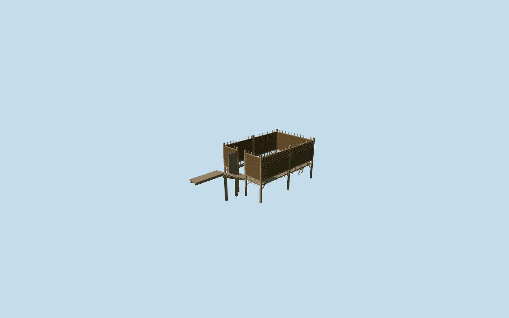

# Bathing Enclosure — Yasnaya Polyana

Complete roofless wattle bathing enclosure on timber piles: four privacy screens with exposed upper/lower stakes, real shore-side short-end doorway and open timber leaf, narrow inner perimeter deck, flat bank landing, seven supported approach steps, braces and bathing ladder. Original pond remains visible through the genuinely open center and roof. Reuse shared thatch and wood_plain graphs with original geometry, no copied photo pixels. Body size, facing, concealed interior, underwater pile depth and reconstructed approach remain approximate.

## Evidence and reconstruction

Published dimensions and reconstructed details are separated in spec.json. Primary references:

- [Reference](https://commons.wikimedia.org/wiki/File:Bath_in_Yasnaya_Polyana.jpg)
- [Reference](https://commons.wikimedia.org/wiki/File:Tula_YasnayaPolyana_asv2019-09_img19_Middle_Pond.jpg)

Complete roofless wattle bathing enclosure on timber piles: four privacy screens with exposed upper/lower stakes, real shore-side short-end doorway and open timber leaf, narrow inner perimeter deck, flat bank landing, seven supported approach steps, braces and bathing ladder. Original pond remains visible through the genuinely open center and roof. Reuse shared thatch and wood_plain graphs with original geometry, no copied photo pixels. Body size, facing, concealed interior, underwater pile depth and reconstructed approach remain approximate.

## Model and axes

5,880 triangles; 11,848 vertices; 2 material groups; 499,092 bytes. Native bounds: -2.155, -2.729, -9.074 to 7.650, 1.621, 2.673. Source hash: `sha256:ecf3560d330845c46aa181be5846d414dd48aa6fd3e4c09e3a71e89681f12fd8`.

{"x":"east","y":"up","z":"south"}

The geographic proposal uses exact-QID OpenStreetMap evidence. Map-derived orientation and estimated architectural details require real-site visual review; preview eligibility is distinct from geographic/fidelity approval. Map attribution: © OpenStreetMap contributors, ODbL-1.0.

## Reproduce

Run `node content/worldgen/source/places/uc/ucd/bathhouse_yasnaya_polyana/models/generate-bathhouse-yasnaya-polyana.mjs --ids=bathhouse_yasnaya_polyana` (or add `--check`). The generator preserves manually edited masters by checking their baseline hashes. Import through the standard authored-model workflow with optimization disabled; then capture all QA cameras, including shared-surface views.

## Pending work

- Complete roofless wattle bathing enclosure on timber piles: four privacy screens with exposed upper/lower stakes, real shore-side short-end doorway and open timber leaf, narrow inner perimeter deck, flat bank landing, seven supported approach steps, braces and bathing ladder. Original pond remains visible through the genuinely open center and roof. Reuse shared thatch and wood_plain graphs with original geometry, no copied photo pixels. Body size, facing, concealed interior, underwater pile depth and reconstructed approach remain approximate.
- Named bathing point node/302670091 (Заброшенная купальня), anchor [37.52922177314758,54.07446706598759]. A.Savin’s viewed pond photograph has public camera coordinates 10.67m from this point and 171.32m from the rejected bank-side way/676929139. Camera position establishes vicinity only. No building footprint supplies scale or heading here. The 7.4x4.8m enclosure and northeast long axis are photo-led approximations, oriented with a bank-facing southwest short-end entrance. Keep the unrelated bank-side building and all other native buildings.
- Photo-led approximate scale: privacy weave .4..2.35m above deck, open lattice to 2.65m, deck .4m above the native pond. Eight main stakes/piles, narrow .45m perimeter walk, open wooden doorway leaf and a short bathing ladder. A flat bank landing and seven reconstructed steps adapt to the coarse native terrain. Exact dimensions, facing, underwater depth, historical levels, hidden joinery and accessibility are not surveyed.
- Retained Protomaps 20261020 / standard Mapzen 201x201 grid at 6m; outside-bank provider [-3,0] supplies 209.66014442236218m datum. Native pond 208.23155921915782m; model water -1.4285852032043636m and deck -1.0285852032043636m. Preserve the original DEM samples and native water/road geometry. Native hydrology clears coarse ground that obscures the mapped pond; model cuts cover only its flooded body and stair, not the dry bank landing or unrelated buildings. The seven steps reconcile the coarse bank height with the photo-led .4m water clearance. The nearby native path stops about 2m from the landing; no invented final path is supplied.

This bundle follows the medium-fi standard. Medium-fi appearance and geographic fit are reviewed separately. Hash-bound visual acceptance is recorded separately after capture inspection.
