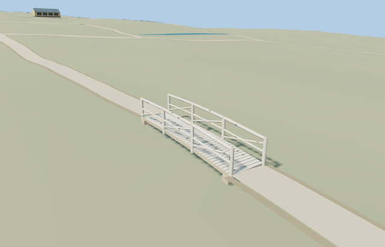

# Birch Bridge — Yasnaya Polyana

Reviewed2026-10-25. **Complete medium-fi exterior with approximate native fit. The estate remains incomplete; bathhouse shoreline approval and tower gazebo remain outstanding.**

## Built and inspected

Inspected48 current frames:9 portable,9 shared-material,21 medium-fi and9 native/failed-load, plus full-resolution deck/rail/bank-join views during authoring. Complete small birch roundwood bridge with a flattened cross-log walking deck, two stringers, four posts on each side, two round rails and diagonal branch braces across three bays, and two grounded bank sills. Near LODs add restrained original dark bark patches and lightly irregular log sections. The continuous pass flattened excessively scalloped deck logs and aligned both ends with Molen’s actual painted path lift. Synthetic ground is context, not source geometry.

## Shared materials and LODs

Three roles—birch, bark and cutwood—reuse one existing256px wood_plain graph with pale birch, restrained dark bark and exposed wood tints. No embedded bitmap, private atlas or new graph. Metric projection, linear tints, separate POSITION/NORMAL streams and equal CPU/GPU accounting. Each used graph reads once; unload releases model geometry.

| Level | Triangles | Bytes | Draws |
| --- | ---: | ---: | ---: |
| skyline | 700 | 67984 | 1 |
| district | 1106 | 89748 | 1 |
| street | 3596 | 270404 | 1 |
| closeup | 7320 | 520852 | 1 |

Four authored LODs 700/1106/3596/7320triangles. Initial skyline+district157732bytes; closeup520852bytes. Skyline retains full bridge deck, both braced railings/stringers and bank supports below the1k structure ceiling; district adds separate transverse logs, while street/closeup add coarse bark patches and log facets. At most1nearby draws. Physical laptop/phone and dense-city measurements remain pending.

## Geographic fit and limits

Named Берёзовый мостик POI node6338741863 and retained bridge way220075404/native35184592164236. Keep assigned catalog anchor[37.529629489862515,54.07371484837336]; model center follows the actual named bridge line, not the offset POI. Its7.19130507498251m span controls scale; local +X points southeast along the crossing, +Z southwest. Geographic heading-0.976052820930474rad rotates bridge-aligned model coordinates. The crossing center is3.6093086519670456m from the assigned POI. Width1.7m, upright height1.02m and gentle camber are photo-led approximations. Both path connections remain at original mapped endpoints. Retained standard Protomaps20261020 and Mapzen201x201/6m field; outside path control[-6.895367313634742,2.7818017351262614]sets datum204.78745102461338m. Original terrain/pond heights remain unchanged; the two solid bank sills seat into the original terrain without ground cutouts. Deck end tops align with shipped PATH_SURFACE_LIFT0.43m plus0.02m clearance, so the approach paths join the walking surface. Supports extend from that deck down into original ground. The narrow brook/ravine is not resolved by this coarse grid: under-deck ground may be close to the deck. Do not excavate or add water to imply unverified bathymetry. Native visual acceptance must check deck clearance and both bank joins. Replace only loaded bridge-tagged road segments in the exact deck outline; untagged paths and failed-load fallback remain. Inspected native whole bridge, clear walking route and both supported bank ends. Actual rendered path joins differ from deck ends by-0.0203/+0.0161m. The named bridge road segment is removed only after actual model load; all independent paths/buildings remain. Flattened cross-log walking faces remove deep artificial scallops between deck logs. The standard grid does not resolve the small brook/ravine; this is an explicit approximate site fit, not verified bathymetry. Actual bank joins differ from rendered path heights by-0.0203/+0.0161m. Loading removes only the named bridge-tagged segment; all other path geometry,243 resident/295 wider independent buildings and40070.675m² original pond water remain unchanged. Solid bank sills seat into original ground without cutouts; all ground remains under the span, supports and both approaches. Failed loading preserves the map bridge and all buildings; unload restores all terrain/water and releases geometry.

Complete small birch roundwood footbridge: transverse pale-log deck, two longitudinal stringers, paired four-post railings with two round rails and diagonal branch braces, two bank sills and coarse dark bark patches. Original geometry and shared wood_plain material graph, with four authored LODs. No private texture atlas, copied photo pixels, invented pond or excavated channel. Hidden joinery and support sizes are reconstructed. Deck end tops follow the shipped path painter lift0.43m plus0.02m clearance above the original standard terrain; end heights relative to bank datum are[0.40270173368444945,0.0452890245445417]m with0.12m gentle central camber. Cross logs have flattened walking faces, round lower sections and shared pale wood with restrained bark patches. Four posts per side, two rails and diagonal branch braces form three bays. Two end sills extend0.22m into original ground. Clear walking width about1.45m. Exact log census, bark inventory, joinery, width and historical levels/accessibility remain approximate. Retained standard Protomaps20261020 and Mapzen201x201/6m field; outside path control[-6.895367313634742,2.7818017351262614]sets datum204.78745102461338m. Original terrain/pond heights remain unchanged; the two solid bank sills seat into the original terrain without ground cutouts. Deck end tops align with shipped PATH_SURFACE_LIFT0.43m plus0.02m clearance, so the approach paths join the walking surface. Supports extend from that deck down into original ground. The narrow brook/ravine is not resolved by this coarse grid: under-deck ground may be close to the deck. Do not excavate or add water to imply unverified bathymetry. Native visual acceptance must check deck clearance and both bank joins. Replace only loaded bridge-tagged road segments in the exact deck outline; untagged paths and failed-load fallback remain. Ordinary close photograph establishes pale birch bark, roundwood deck/rails/posts and diagonal branch braces; source center/axis/span follow the named mapped crossing. Coarse standard terrain does not resolve the narrow brook/ravine, so its precise channel, bathymetry, under-deck clearance and bank cross-slope are not survey verified. Shared wood grain approximates bark; sparse geometry carries identity markings. Exact width, log/brace census, hidden joinery and historic levels/accessibility remain reconstructed. Native placement is an explicitly approximate fit, not a channel reconstruction. Other estate structures remain procedural context in the isolated fixture.

## Rebuild and checks

Own three source-local deterministic modules inventoried in source.json and registered in asset-build.json. Targeted generation/import, forced derivatives, recipe lint, source/hash/style checks, scene validation and30-tick simulation pass. Six clean GLBs;210 actual mesh/contact probes and48 inspected frames. Actual road subtraction removes the retained named bridge segment; native rendered-road telemetry verifies independent paths/fallback. Exact pins: [qa.json](qa.json).

## Reference

[Березовый мостик.JPG](https://commons.wikimedia.org/wiki/File:Березовый_мостик.JPG), Печкина,2015-09-17,CC BY-SA4.0; viewed only. [Mapped POI](https://www.openstreetmap.org/node/6338741863) and [named bridge way](https://www.openstreetmap.org/way/220075404), OpenStreetMap contributors,ODbL-1.0. No copied pixels.
