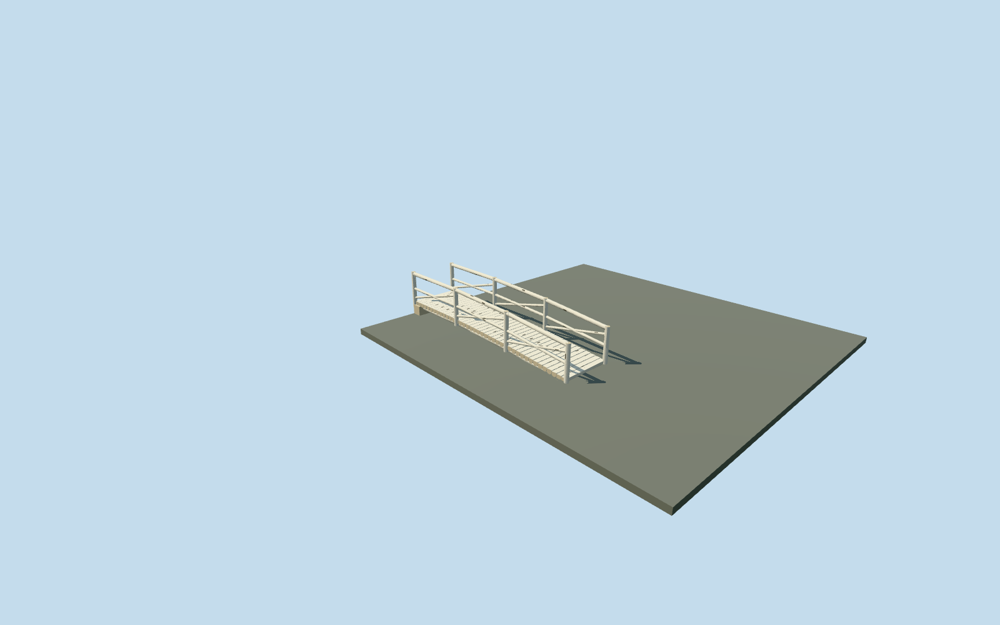

# Birch Bridge — Yasnaya Polyana

Complete small birch roundwood footbridge: transverse pale-log deck, two longitudinal stringers, paired four-post railings with two round rails and diagonal branch braces, two bank sills and coarse dark bark patches. Original geometry and shared wood_plain material graph, with four authored LODs. No private texture atlas, copied photo pixels, invented pond or excavated channel. Hidden joinery and support sizes are reconstructed.

## Evidence and reconstruction

Published dimensions and reconstructed details are separated in spec.json. Primary references:

- [Reference](https://commons.wikimedia.org/wiki/File:Березовый_мостик.JPG)

Complete small birch roundwood footbridge: transverse pale-log deck, two longitudinal stringers, paired four-post railings with two round rails and diagonal branch braces, two bank sills and coarse dark bark patches. Original geometry and shared wood_plain material graph, with four authored LODs. No private texture atlas, copied photo pixels, invented pond or excavated channel. Hidden joinery and support sizes are reconstructed.

## Model and axes

7,320 triangles; 15,728 vertices; 1 material groups; 655,596 bytes. Native bounds: -5.972, -0.693, 1.842 to 1.373, 1.489, 3.722. Source hash: `sha256:82ecfc2efef19a13c857792887a6a4db64288831821abbee396036e76872419a`.

{"x":"along mapped bridge southeast","y":"up","z":"cross bridge southwest"}

The geographic proposal uses exact-QID OpenStreetMap evidence. Map-derived orientation and estimated architectural details require real-site visual review; preview eligibility is distinct from geographic/fidelity approval. Map attribution: © OpenStreetMap contributors, ODbL-1.0.

## Reproduce

Run `node content/worldgen/source/places/uc/ucd/birch_bridge_yasnaya_polyana/models/generate-birch-bridge-yasnaya-polyana.mjs --ids=birch_bridge_yasnaya_polyana` (or add `--check`). The generator preserves manually edited masters by checking their baseline hashes. Import through the standard authored-model workflow with optimization disabled; then capture all QA cameras, including shared-surface views.

## Pending work

- Complete small birch roundwood footbridge: transverse pale-log deck, two longitudinal stringers, paired four-post railings with two round rails and diagonal branch braces, two bank sills and coarse dark bark patches. Original geometry and shared wood_plain material graph, with four authored LODs. No private texture atlas, copied photo pixels, invented pond or excavated channel. Hidden joinery and support sizes are reconstructed.
- Named Берёзовый мостик POI node6338741863 and retained bridge way220075404/native35184592164236. Keep assigned catalog anchor[37.529629489862515,54.07371484837336]; model center follows the actual named bridge line, not the offset POI. Its7.19130507498251m span controls scale; local +X points southeast along the crossing, +Z southwest. Geographic heading-0.976052820930474rad rotates bridge-aligned model coordinates. The crossing center is3.6093086519670456m from the assigned POI. Width1.7m, upright height1.02m and gentle camber are photo-led approximations. Both path connections remain at original mapped endpoints.
- Deck end tops follow the shipped path painter lift0.43m plus0.02m clearance above the original standard terrain; end heights relative to bank datum are[0.40270173368444945,0.0452890245445417]m with0.12m gentle central camber. Cross logs have flattened walking faces, round lower sections and shared pale wood with restrained bark patches. Four posts per side, two rails and diagonal branch braces form three bays. Two end sills extend0.22m into original ground. Clear walking width about1.45m. Exact log census, bark inventory, joinery, width and historical levels/accessibility remain approximate.
- Retained standard Protomaps20261020 and Mapzen201x201/6m field; outside path control[-6.895367313634742,2.7818017351262614]sets datum204.78745102461338m. Original terrain/pond heights remain unchanged; the two solid bank sills seat into the original terrain without ground cutouts. Deck end tops align with shipped PATH_SURFACE_LIFT0.43m plus0.02m clearance, so the approach paths join the walking surface. Supports extend from that deck down into original ground. The narrow brook/ravine is not resolved by this coarse grid: under-deck ground may be close to the deck. Do not excavate or add water to imply unverified bathymetry. Native visual acceptance must check deck clearance and both bank joins. Replace only loaded bridge-tagged road segments in the exact deck outline; untagged paths and failed-load fallback remain.

This bundle follows the medium-fi standard. Medium-fi appearance and geographic fit are reviewed separately. Hash-bound visual acceptance is recorded separately after capture inspection.
