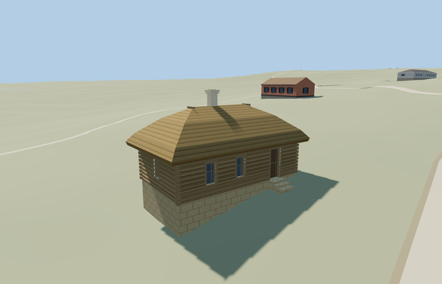

# Coachman’s House — Yasnaya Polyana

Reviewed2026-10-25. **Complete medium-fi exterior with approximate native fit. The estate remains incomplete; three main houses are independently complete, while service/garden structures and bridge need their own models and visitor-map inventory reconciliation.**

## Built and inspected

Inspected all48 current portable/shared/medium-fi/native frames in labeled contact sheets plus full-resolution native front, recessed doorway and rear/low-side foundation views. The squat log envelope, broad thick thatched hip, single pale chimney, two front windows, one short-side window, recessed wooden door and supported threshold read coherently. Coarse log courses/corner ends and low front edging remain simple shared-material proxies. The original slope exposes the downhill plinth more than the pictures; hidden rear faces and front assignment remain approximate.

## Shared materials and LODs

Seven roles reuse six existing256px graphs: wood_log, thatch, wood_plain, stone_limestone, storefront and stucco. The darker recessed door shares the trim’s wood_plain graph. Metric UVs, linear tints, six nearby draws/one skyline, separate POSITION/NORMAL streams and matching CPU/GPU geometry accounting. No embedded image, private atlas or new graph. Each used graph reads once; unload releases every model geometry.

| Level | Triangles | Bytes | Draws |
| --- | ---: | ---: | ---: |
| skyline | 128 | 12864 | 1 |
| district | 260 | 26888 | 6 |
| street | 870 | 77864 | 6 |
| closeup | 1290 | 111784 | 6 |

Four authored LODs 128/260/870/1290 triangles. Initial skyline+district 39752bytes; closeup 111784bytes. Skyline preserves the complete log-house mass, broad thatched hip, capped chimney, recessed entrance and supported apron/treads, without tiny window modules. District adds the three recessed shared glazed windows; street/closeup add coarse log courses, corner ends, ridge hold-downs, frame bars and edging. Synthetic contexts check style/LOD/tier coherence; native views establish approximate geographic fit.

## Native location and limits

Coachman’s hut/Кучерская изба, way167382256, remains independent from Volkonsky House and the other estate houses. The exact mapped9.7m by5.5m four-sided outline fixes the axes: X northwest along the long face, Z northeast toward the photographed front approach. Native east/up/south axes are baked with heading0, using the unchanged assigned collection coordinate as model origin. Ordinary oblique pictures guide the two-window/one-door long front and one glazed short end; rear faces and absolute front assignment remain an approximate photo/map interpretation, not a survey. Retained Protomaps20261020 and Mapzen201x201/6m terrain; outside northeast approach provider[2.5,6] supplies215.68442192541778m datum. Original boundary grades-1.644..0.348m, floor+0.5m and closed foundation-1.85m. Coarse terrain falls about2m along this small footprint: the downhill plinth is therefore more exposed than in the photographs. The datum and broad supported foundation provide an explicitly approximate fit; no flattening or bespoke terrain. Original approach, independent neighbors, roads and ponds remain. Historic levels, thresholds and accessibility are not surveyed. Inspected native front, doorway and rear/low-side views: the whole log body, hip roof, chimney and supported entrance align with the mapped outline; the coarse slope exposes a high downhill plinth compared with the photographs. One owned map record is replaced,242 resident independent buildings and original roads/pond water remain. This explicitly approximate fit retains the unmodified standard ground. One owned map record is replaced while242 resident/294 wider independent buildings, original paths/lawn, roads and40070.675m² pond water remain. Failure retains all243 originals; every LOD/failure/unload case restores ground/water and releases geometry.

Complete mapped coachman’s hut exterior at Yasnaya Polyana: single-storey log cabin with broad thick thatched hip roof, short ridge, one pale capped chimney, two front windows, one short-side window and one physically recessed wooden front door. Nearby levels add coarse log courses/corner ends, simple window bars, ridge hold-down poles and low garden edging interrupted at the supported entrance. All four actual mapped edges are retained. Hidden rear faces, chimney inventory, thatch profile and historic levels remain approximate. No interiors, copied signs, inscriptions, plaques, people, photograph pixels or surrounding plantings. Photo-led medium-fi scale:2.5m log eaves, thick2.55m thatched hip rise and one pale chimney to about6.13m above floor. Map nominal5m is a scale cue. Roof thickness, doorway/window dimensions, hold-down poles, threshold and low garden edging approximate. Retained Protomaps20261020 and Mapzen201x201/6m terrain; outside northeast approach provider[2.5,6] supplies215.68442192541778m datum. Original boundary grades-1.644..0.348m, floor+0.5m and closed foundation-1.85m. Coarse terrain falls about2m along this small footprint: the downhill plinth is therefore more exposed than in the photographs. The datum and broad supported foundation provide an explicitly approximate fit; no flattening or bespoke terrain. Original approach, independent neighbors, roads and ponds remain. Historic levels, thresholds and accessibility are not surveyed. Exact historic levels, rear bays, front assignment, thresholds and accessibility are not surveyed. Some fixed shared/style detail views crop the opposite edge; flat synthetic ground can bury grade-specific bases/treads. Whole/turntable/native views cover the envelope. The other estate models remain independent procedural context in this isolated fixture. Physical phone/laptop and dense-city timings remain pending.

## Rebuild and checks

Source-local recipes are inventoried in source.json and registered in asset-build.json. Run `node content/worldgen/source/places/uc/ucd/coachmans_house_yasnaya_polyana/models/generate-coachmans-house-yasnaya-polyana.mjs --check`. Selected import/placement, strict medium-fi, scene/sim30 and geometry checks pass. Six GLBs have zero Khronos errors/warnings; 123 actual mesh/contact probes and 1 overlapping PMTiles cases cover the owned house. Exact pins and concise evidence: [qa.json](qa.json).

## References

The retained zoom13/14 map tiles contain no building feature overlapping this small hut. The overlapping zoom15 case covers its complete owned way; native viewer LOD/failure checks use the retained detailed surrounding buildings.

- [Complete hut photograph](https://commons.wikimedia.org/wiki/File:Tula_YasnayaPolyana_asv2019-09_img06_Coachmans_hut.jpg), A.Savin,2019-09-13,Free Art License; viewed only.
- [Reverse front oblique](https://commons.wikimedia.org/wiki/File:Yasnaya_Polyana_8.JPG), Celest.ru,2011-05-22,CC BY-SA3.0; viewed only.
- [Museum visitor map](https://ypmuseum.ru/map), estate context.
- [Mapped house](https://www.openstreetmap.org/way/167382256), ©OpenStreetMap contributors,ODbL-1.0. Controls: [map-frame.json](map-frame.json).
