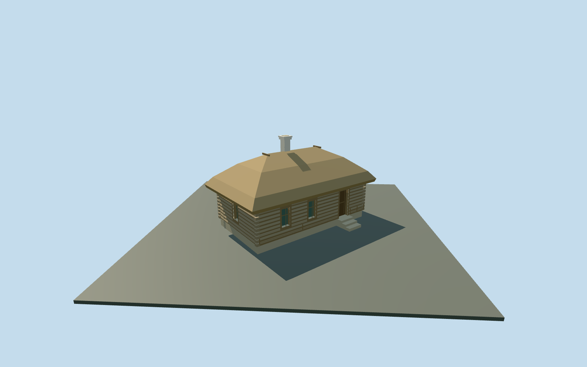

# Coachman’s House — Yasnaya Polyana

Complete mapped coachman’s hut exterior at Yasnaya Polyana: single-storey log cabin with broad thick thatched hip roof, short ridge, one pale capped chimney, two front windows, one short-side window and one physically recessed wooden front door. Nearby levels add coarse log courses/corner ends, simple window bars, ridge hold-down poles and low garden edging interrupted at the supported entrance. All four actual mapped edges are retained. Hidden rear faces, chimney inventory, thatch profile and historic levels remain approximate. No interiors, copied signs, inscriptions, plaques, people, photograph pixels or surrounding plantings.

## Evidence and reconstruction

Published dimensions and reconstructed details are separated in spec.json. Primary references:

- [Reference](https://commons.wikimedia.org/wiki/File:Tula_YasnayaPolyana_asv2019-09_img06_Coachmans_hut.jpg)
- [Reference](https://commons.wikimedia.org/wiki/File:Yasnaya_Polyana_8.JPG)

Complete mapped coachman’s hut exterior at Yasnaya Polyana: single-storey log cabin with broad thick thatched hip roof, short ridge, one pale capped chimney, two front windows, one short-side window and one physically recessed wooden front door. Nearby levels add coarse log courses/corner ends, simple window bars, ridge hold-down poles and low garden edging interrupted at the supported entrance. All four actual mapped edges are retained. Hidden rear faces, chimney inventory, thatch profile and historic levels remain approximate. No interiors, copied signs, inscriptions, plaques, people, photograph pixels or surrounding plantings.

## Model and axes

1,290 triangles; 2,816 vertices; 6 material groups; 120,680 bytes. Native bounds: -6.217, -1.850, -6.338 to 6.148, 6.630, 6.425. Source hash: `sha256:25ded326d20c40d42e738318d90954eb0d7c23e2866c78e73db1695e925543c0`.

{"x":"east","y":"up","z":"south"}

The geographic proposal uses exact-QID OpenStreetMap evidence. Map-derived orientation and estimated architectural details require real-site visual review; preview eligibility is distinct from geographic/fidelity approval. Map attribution: © OpenStreetMap contributors, ODbL-1.0.

## Reproduce

Run `node content/worldgen/source/places/uc/ucd/coachmans_house_yasnaya_polyana/models/generate-coachmans-house-yasnaya-polyana.mjs --ids=coachmans_house_yasnaya_polyana` (or add `--check`). The generator preserves manually edited masters by checking their baseline hashes. Import through the standard authored-model workflow with optimization disabled; then capture all QA cameras, including shared-surface views.

## Pending work

- Complete mapped coachman’s hut exterior at Yasnaya Polyana: single-storey log cabin with broad thick thatched hip roof, short ridge, one pale capped chimney, two front windows, one short-side window and one physically recessed wooden front door. Nearby levels add coarse log courses/corner ends, simple window bars, ridge hold-down poles and low garden edging interrupted at the supported entrance. All four actual mapped edges are retained. Hidden rear faces, chimney inventory, thatch profile and historic levels remain approximate. No interiors, copied signs, inscriptions, plaques, people, photograph pixels or surrounding plantings.
- Coachman’s hut/Кучерская изба, way167382256, remains independent from Volkonsky House and the other estate houses. The exact mapped9.7m by5.5m four-sided outline fixes the axes: X northwest along the long face, Z northeast toward the photographed front approach. Native east/up/south axes are baked with heading0, using the unchanged assigned collection coordinate as model origin. Ordinary oblique pictures guide the two-window/one-door long front and one glazed short end; rear faces and absolute front assignment remain an approximate photo/map interpretation, not a survey.
- Photo-led medium-fi scale:2.5m log eaves, thick2.55m thatched hip rise and one pale chimney to about6.13m above floor. Map nominal5m is a scale cue. Roof thickness, doorway/window dimensions, hold-down poles, threshold and low garden edging approximate.
- Retained Protomaps20261020 and Mapzen201x201/6m terrain; outside northeast approach provider[2.5,6] supplies215.68442192541778m datum. Original boundary grades-1.644..0.348m, floor+0.5m and closed foundation-1.85m. Coarse terrain falls about2m along this small footprint: the downhill plinth is therefore more exposed than in the photographs. The datum and broad supported foundation provide an explicitly approximate fit; no flattening or bespoke terrain. Original approach, independent neighbors, roads and ponds remain. Historic levels, thresholds and accessibility are not surveyed.

This bundle follows the medium-fi standard. Medium-fi appearance and geographic fit are reviewed separately. Hash-bound visual acceptance is recorded separately after capture inspection.
