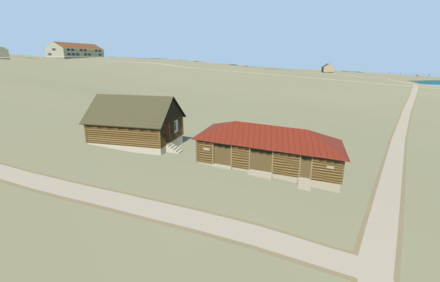

# Equipment Shed — Yasnaya Polyana

Reviewed2026-10-25. **Complete medium-fi equipment-shed interpretation with paired placement and explicit coarse-terrain grade adaptation. The estate remains incomplete.**

## Built and inspected

Inspected 48 current portable/shared/medium-fi/native frames during the continuous author/inspect/fix pass. The paired whole-site view shows two independent buildings. The equipment shed has a complete low log shell, red hipped metal roof, three genuinely recessed wooden doors, small unlettered end plaques, restrained corner logs and seven supported apron treads. Native close views cover the door recesses, hip/eaves, blank rear and grade/plinth contact.

## Shared materials and LODs

Six existing 256px graphs serve the shed: wood_log, wood_vertical, wood_plain, metal_standing_seam, plaster_lime and metal_painted. Metric UVs and restrained linear tints keep it coherent with procedural neighbors. No embedded images, private atlas or new material graph. The paired native scene loads eight distinct graphs for both structures, with each read once; shared wood and plaster are reused. Separate vertex streams prevent duplicate GPU attribute uploads; near levels use six draws.

| Level | Triangles | Bytes | Draws |
| --- | ---: | ---: | ---: |
| skyline | 186 | 17876 | 1 |
| district | 228 | 25776 | 6 |
| street | 712 | 67672 | 6 |
| closeup | 1016 | 93688 | 6 |

Four authored LODs use 186/228/712/1016 triangles; initial skyline+district 43652 bytes. Skyline retains the complete low hip, three door recesses and supported thresholds. District adds metal/wood bindings; near levels add coarse log relief and restrained corner ends. Synthetic distance/lighting comparisons pass; physical laptop/phone timings remain pending.

## Native placement and limits

Two adjacent retained one-story shed footprints are candidates for the small gray-gabled poultry house and longer red-hipped equipment shed shown together in the ordinary museum photograph. Sizes and separation support this assignment. The retained long axes are nearly parallel; the photograph may show different faces through perspective/parallax, and no camera position is known. Specific poultry/equipment function and absolute front assignment remain explicit photo/relative-context inferences; the public map names both only as sheds. Use the photographed gray roof on the small building despite the generic map red-roof tag. The larger12.72x6.10m footprint is kept separate from the small gabled poultry house. LocalX southeast is its mapped long axis, with the three-door face inferred at local+Z southwest. Native axes are baked east/up/south, heading0. Retained Protomaps20261020 and standard Mapzen201x201/6m. Outside garden control[0,5.5774795481570365] gives215.1551128071785m datum. Floor intercept0.3556289698292119m and foundation intercept-0.8778526227228269m, with explicit long-axis grade-.06. Replace only building35184539471090; preserve the independent poultry hut, native courtyard/roads, DEM samples and all ponds. Only the occupied footprint cuts ground; supported aprons seat into original soil. No custom terrain or broad yard flattening. Inspected the actual paired native view, all three recessed door bays, red hip/eaves, log corners, pale plinth and supported aprons. Both independent models load together, the garden passage and original ground/roads/water remain, and shared graph reads are reused. The bounded long-axis visualization grade and exposed plinth remain explicit coarse-DEM approximations, not surveyed historical levels. The shed owns native building35184539471090. The paired test separately loads the poultry hut at35184539471089, preserving all241resident/293wider independent buildings and the garden passage, original roads, DEM samples and40070.675m²native water. Both render at their own terrain attachment datums; their root-height difference is0.555912m. Disjoint 8m/6m matching ranges avoid cross-matching. Failed loading retains all243original buildings and ground; unload releases both models and restores ground after water unload.

Complete independent equipment-shed interpretation: mapped log walls, low red metal hipped roof, three recessed weathered timber door bays, log corner ends, pale grounded plinth and supported threshold aprons. Plain small plaques retain the placement of the photo panels without copied lettering. Reuse wood_log, wood_vertical, wood_plain, metal_standing_seam, plaster_lime and metal_painted graphs. The neighboring poultry house remains a separate model; no trees, people, copied signs or photo pixels are baked in. Photo-led low log shed: wall2.25m, red hip ridge3.6m above local floor, three genuinely recessed timber door bays, restrained eaves, small plain end plaques and supported threshold aprons. Native ground changes about1.6m across this footprint. The source applies a bounded -.06m/m long-axis visualization grade; this reduces the exposed plinth while retaining one-story proportions, and is not a surveyed historic floor/roof. Exact pitch, door census, panel details and thresholds remain reconstructed. Equipment-shed identity and the southwest three-door face are inferred from the paired museum photograph, relative estate context and larger mapped shed footprint. Both public map names are only sheds. Hidden rear details, door proportions, blank plaques and historic levels remain reconstructed. The retained coarse DEM changes about1.6m across this footprint; a bounded-.06m/m long-axis visualization grade reduces exposed plinth without changing the original terrain. The sloping floor/roof and thresholds are not surveyed historical geometry. The estate service inventory remains unfinished.

## Rebuild and checks

Three deterministic source-local programs are registered in source.json and asset-build.json. Targeted generation/import, four derivatives, generator --check, strict medium-fi, scene validation and30-tick simulation passed. Six GLBs: zero Khronos errors/warnings;112 mesh probes and48 inspected frames. Its owned map footprint passes at detailed level15; no overlapping building case occurs at13/14. Exact pins: [qa.json](qa.json).

## References

[Museum poultry-house/equipment-shed photograph](https://www.ypmuseum.ru/object/ptichnik-i-inventarnyy-saray), photographer/date unstated, viewed only. No photograph pixels retained or used as texture. [Mapped independent footprint](https://www.openstreetmap.org/way/167382258), OpenStreetMap contributors,ODbL-1.0. Standard Mapzen terrain retained.
