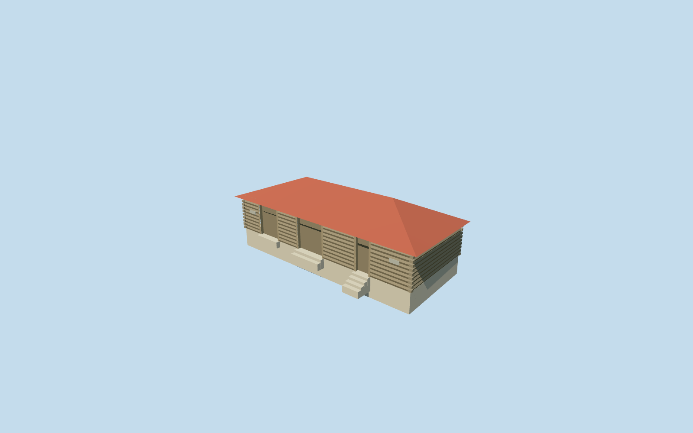

# Equipment Shed — Yasnaya Polyana

Complete independent equipment-shed interpretation: mapped log walls, low red metal hipped roof, three recessed weathered timber door bays, log corner ends, pale grounded plinth and supported threshold aprons. Plain small plaques retain the placement of the photo panels without copied lettering. Reuse wood_log, wood_vertical, wood_plain, metal_standing_seam, plaster_lime and metal_painted graphs. The neighboring poultry house remains a separate model; no trees, people, copied signs or photo pixels are baked in.

## Evidence and reconstruction

Published dimensions and reconstructed details are separated in spec.json. Primary references:

- [Reference](https://www.ypmuseum.ru/object/ptichnik-i-inventarnyy-saray)

Complete independent equipment-shed interpretation: mapped log walls, low red metal hipped roof, three recessed weathered timber door bays, log corner ends, pale grounded plinth and supported threshold aprons. Plain small plaques retain the placement of the photo panels without copied lettering. Reuse wood_log, wood_vertical, wood_plain, metal_standing_seam, plaster_lime and metal_painted graphs. The neighboring poultry house remains a separate model; no trees, people, copied signs or photo pixels are baked in.

## Model and axes

1,016 triangles; 2,254 vertices; 6 material groups; 97,208 bytes. Native bounds: -6.888, -1.259, -7.407 to 6.829, 4.158, 7.421. Source hash: `sha256:464e7458d7210376629cd663fce8b424445de66b8352612f22536f7992653be9`.

{"x":"east","y":"up","z":"south"}

The geographic proposal uses exact-QID OpenStreetMap evidence. Map-derived orientation and estimated architectural details require real-site visual review; preview eligibility is distinct from geographic/fidelity approval. Map attribution: © OpenStreetMap contributors, ODbL-1.0.

## Reproduce

Run `node content/worldgen/source/places/uc/ucd/equipment_shed_yasnaya_polyana/models/generate-equipment-shed-yasnaya-polyana.mjs --ids=equipment_shed_yasnaya_polyana` (or add `--check`). The generator preserves manually edited masters by checking their baseline hashes. Import through the standard authored-model workflow with optimization disabled; then capture all QA cameras, including shared-surface views.

## Pending work

- Complete independent equipment-shed interpretation: mapped log walls, low red metal hipped roof, three recessed weathered timber door bays, log corner ends, pale grounded plinth and supported threshold aprons. Plain small plaques retain the placement of the photo panels without copied lettering. Reuse wood_log, wood_vertical, wood_plain, metal_standing_seam, plaster_lime and metal_painted graphs. The neighboring poultry house remains a separate model; no trees, people, copied signs or photo pixels are baked in.
- Two adjacent retained one-story shed footprints are candidates for the small gray-gabled poultry house and longer red-hipped equipment shed shown together in the ordinary museum photograph. Sizes and separation support this assignment. The retained long axes are nearly parallel; the photograph may show different faces through perspective/parallax, and no camera position is known. Specific poultry/equipment function and absolute front assignment remain explicit photo/relative-context inferences; the public map names both only as sheds. Use the photographed gray roof on the small building despite the generic map red-roof tag. The larger12.72x6.10m footprint is kept separate from the small gabled poultry house. LocalX southeast is its mapped long axis, with the three-door face inferred at local+Z southwest. Native axes are baked east/up/south, heading0.
- Photo-led low log shed: wall2.25m, red hip ridge3.6m above local floor, three genuinely recessed timber door bays, restrained eaves, small plain end plaques and supported threshold aprons. Native ground changes about1.6m across this footprint. The source applies a bounded -.06m/m long-axis visualization grade; this reduces the exposed plinth while retaining one-story proportions, and is not a surveyed historic floor/roof. Exact pitch, door census, panel details and thresholds remain reconstructed.
- Retained Protomaps20261020 and standard Mapzen201x201/6m. Outside garden control[0,5.5774795481570365] gives215.1551128071785m datum. Floor intercept0.3556289698292119m and foundation intercept-0.8778526227228269m, with explicit long-axis grade-.06. Replace only building35184539471090; preserve the independent poultry hut, native courtyard/roads, DEM samples and all ponds. Only the occupied footprint cuts ground; supported aprons seat into original soil. No custom terrain or broad yard flattening.

This bundle follows the medium-fi standard. Medium-fi appearance and geographic fit are reviewed separately. Hash-bound visual acceptance is recorded separately after capture inspection.
