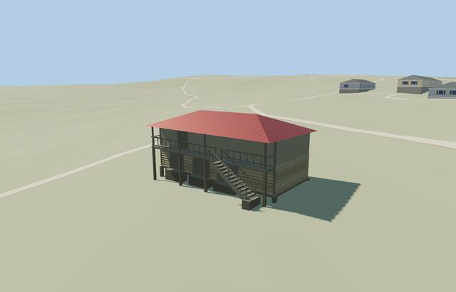

# Garden House — Yasnaya Polyana

Reviewed2026-10-25. **Complete medium-fi exterior interpretation with approximate native fit and hidden-bay reconstruction. Seven other declared members are complete; estate remains incomplete.**

## Exterior and inspection

Inspected all48 current portable/shared/medium-fi/native frames in labeled sheets and full-resolution gallery/stair/gate views. Complete two-level garden-house interpretation: pale log lower walls, weathered boarded upper room, broad red metal hip roof, three physical lower gate recesses, upper gallery entrance, open supported gallery, rails, external twelve-tread stair and eight ground-seated timber piers. Continuous authoring moved gallery posts between openings and clear of the stair head. All LODs retain the roof/gallery support hierarchy. Photo obscuration, hidden rear and coarse support exposure remain explicit limitations.

## Shared materials and LODs

Six roles reuse four existing256px graphs: wood_log, wood_vertical, metal_standing_seam and wood_plain. Timber supports, rails, doors and aprons share wood_plain with separate linear tints. Metric UVs, separate POSITION/NORMAL streams, equal CPU/GPU geometry accounting and four nearby draws/one skyline. No embedded image, private atlas or new graph. Every used graph reads once; failure keeps original building and unload releases model geometry.

| Level | Triangles | Bytes | Draws |
| --- | ---: | ---: | ---: |
| skyline | 394 | 38772 | 1 |
| district | 678 | 63336 | 4 |
| street | 1134 | 102600 | 4 |
| closeup | 1274 | 113520 | 4 |

Four authored LODs keep the whole envelope, three lower gates and upper door, full roof, supported gallery and external stair. Skyline uses a closed thin stair slope, simple open rails and all floor/gallery supports under the1k authored-structure ceiling. District adds actual treads and simple door trim; street/closeup add restrained log courses/ends, railing infill/braces and door bands. Initial skyline+district geometry remains below3MB phone/6MB laptop targets. Synthetic views compare style/LOD/modes; native views establish approximate geographic fit.

Initial skyline+district: **102108 bytes**.

## Location and limits

Named Садовый домик node13324187201 lies in building way220075410, independently mapped south of Житня/way220075392. The13.5x6.8m envelope and nominal5m height anchor the complete building; room front is set back1.1m within the envelope for the photo-led upper gallery. X northeast along long facade, Z southeast toward the interpreted approach, baked native axes with heading0 at the unchanged assigned garden-house anchor. The labeled garden-house photograph in the ordinary2012 estate walk guides log/board hierarchy, red hip roof, multiple lower gates, upper gallery and right-descending stair. Similar historic storage typology is shared by the nearby granary; this model has its own location, footprint, gate layout, access and roof. Trees hide exact bay inventory and absolute front assignment remains approximate. Retained Protomaps20261020 and Mapzen201x201/6m ground; outside southeast provider[0,7] supplies218.56964118057482m datum. Boundary grades-0.265..0.781m, floor+0.95m and timber pier bottoms-0.45m. Coarse slope exposes up to1.22m beneath the downhill floor, greater than the pictured footing. Original ground remains under raised rooms, gallery and stair; only eight pier feet and four supported aprons cut it. No flattening or bespoke survey. Independent neighbors, approaches, roads and ponds remain. One owned footprint is replaced while242 resident/294 wider independent buildings, original approaches/roads and40070.675m² pond water remain. Original ground stays under raised rooms, gallery and external stair; only eight pier feet and four apron footprints cut it. Failure retains all243 original buildings; every LOD/failure/unload restores ground/water with zero live model geometry.

Complete mapped garden-house exterior interpretation: two-level apple storehouse with pale log lower room, weathered vertical-board upper room, broad red standing-seam hip roof, open front gallery and external twelve-tread stair. Three lower wooden gate openings and one upper gallery entrance are physically recessed; timber piers, railings, stringers and supported aprons complete the exterior. The independent named garden-house POI and its own mapped footprint remain distinct from the nearby granary. No copied signs, inscriptions, people, merchandise, furnishings or photograph pixels. Hidden rear inventory and precise historical levels remain reconstructed. Approximate photo-led scale:2.25m log lower room,2.05m boarded upper room and1.5m hip rise, gallery at2.25m with.92m open rails and12 stair treads. Nominal map5m is a scale cue; all historical heights, timber sections, roof condition, hidden rear openings, thresholds and accessibility remain reconstructed. Retained Protomaps20261020 and Mapzen201x201/6m ground; outside southeast provider[0,7] supplies218.56964118057482m datum. Boundary grades-0.265..0.781m, floor+0.95m and timber pier bottoms-0.45m. Coarse slope exposes up to1.22m beneath the downhill floor, greater than the pictured footing. Original ground remains under raised rooms, gallery and stair; only eight pier feet and four supported aprons cut it. No flattening or bespoke survey. Independent neighbors, approaches, roads and ponds remain. Named mapped POI and independent envelope establish placement. The ordinary walk photograph labeled Садовый домик guides architecture; adjacent granary has a similar storage typology. Tree-hidden lower gate count, exact bay positions, rear openings, roof condition and absolute southeast front assignment remain reconstructed. No exact historical or survey claim. Synthetic flat planes partly bury grade-specific supports/aprons; native views expose the original slope. Other estate models remain procedural context in this isolated fixture. Physical phone/laptop and dense-city timing measurements remain pending.

## Rebuild and checks

Source-local recipes are inventoried in source.json and asset-build.json. Targeted generation/import, forced derivatives, source/hash checks, strict medium-fi, scene/sim30 and placement checks pass. Six clean GLBs;252 actual mesh/contact probes;48 inspected frames. One overlapping zoom15 case covers the building; zoom13/14 have no overlapping feature. Exact pins: [qa.json](qa.json).

## References

- [Ordinary estate walk, photo56](https://vadimrazumov.ru/30977.html), published Vadim Razumov2012-10-10, walk dated2012-09-15. Image watermarked dead0key.livejournal.com; photographer not independently confirmed. Viewed only.
- [Museum orchard/garden-house membership](https://ypmuseum.ru/object/sady).
- [Named garden house](https://www.openstreetmap.org/node/13324187201) and [mapped envelope](https://www.openstreetmap.org/way/220075410), OpenStreetMap contributors,ODbL-1.0.
