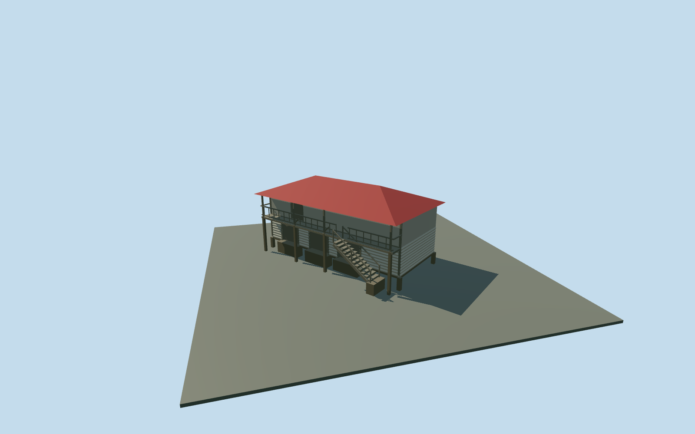

# Garden House — Yasnaya Polyana

Complete mapped garden-house exterior interpretation: two-level apple storehouse with pale log lower room, weathered vertical-board upper room, broad red standing-seam hip roof, open front gallery and external twelve-tread stair. Three lower wooden gate openings and one upper gallery entrance are physically recessed; timber piers, railings, stringers and supported aprons complete the exterior. The independent named garden-house POI and its own mapped footprint remain distinct from the nearby granary. No copied signs, inscriptions, people, merchandise, furnishings or photograph pixels. Hidden rear inventory and precise historical levels remain reconstructed.

## Evidence and reconstruction

Published dimensions and reconstructed details are separated in spec.json. Primary references:

- [Reference](https://vadimrazumov.ru/30977.html)

Complete mapped garden-house exterior interpretation: two-level apple storehouse with pale log lower room, weathered vertical-board upper room, broad red standing-seam hip roof, open front gallery and external twelve-tread stair. Three lower wooden gate openings and one upper gallery entrance are physically recessed; timber piers, railings, stringers and supported aprons complete the exterior. The independent named garden-house POI and its own mapped footprint remain distinct from the nearby granary. No copied signs, inscriptions, people, merchandise, furnishings or photograph pixels. Hidden rear inventory and precise historical levels remain reconstructed.

## Model and axes

1,274 triangles; 2,810 vertices; 4 material groups; 119,364 bytes. Native bounds: -9.358, -0.450, -6.046 to 6.640, 6.750, 8.566. Source hash: `sha256:aa6fade7108086b8e32cb200cdfe7f473862f359b3862ae9beca894ac4d78343`.

{"x":"east","y":"up","z":"south"}

The geographic proposal uses exact-QID OpenStreetMap evidence. Map-derived orientation and estimated architectural details require real-site visual review; preview eligibility is distinct from geographic/fidelity approval. Map attribution: © OpenStreetMap contributors, ODbL-1.0.

## Reproduce

Run `node content/worldgen/source/places/uc/ucd/garden_house_yasnaya_polyana/models/generate-garden-house-yasnaya-polyana.mjs --ids=garden_house_yasnaya_polyana` (or add `--check`). The generator preserves manually edited masters by checking their baseline hashes. Import through the standard authored-model workflow with optimization disabled; then capture all QA cameras, including shared-surface views.

## Pending work

- Complete mapped garden-house exterior interpretation: two-level apple storehouse with pale log lower room, weathered vertical-board upper room, broad red standing-seam hip roof, open front gallery and external twelve-tread stair. Three lower wooden gate openings and one upper gallery entrance are physically recessed; timber piers, railings, stringers and supported aprons complete the exterior. The independent named garden-house POI and its own mapped footprint remain distinct from the nearby granary. No copied signs, inscriptions, people, merchandise, furnishings or photograph pixels. Hidden rear inventory and precise historical levels remain reconstructed.
- Named Садовый домик node13324187201 lies in building way220075410, independently mapped south of Житня/way220075392. The13.5x6.8m envelope and nominal5m height anchor the complete building; room front is set back1.1m within the envelope for the photo-led upper gallery. X northeast along long facade, Z southeast toward the interpreted approach, baked native axes with heading0 at the unchanged assigned garden-house anchor. The labeled garden-house photograph in the ordinary2012 estate walk guides log/board hierarchy, red hip roof, multiple lower gates, upper gallery and right-descending stair. Similar historic storage typology is shared by the nearby granary; this model has its own location, footprint, gate layout, access and roof. Trees hide exact bay inventory and absolute front assignment remains approximate.
- Approximate photo-led scale:2.25m log lower room,2.05m boarded upper room and1.5m hip rise, gallery at2.25m with.92m open rails and12 stair treads. Nominal map5m is a scale cue; all historical heights, timber sections, roof condition, hidden rear openings, thresholds and accessibility remain reconstructed.
- Retained Protomaps20261020 and Mapzen201x201/6m ground; outside southeast provider[0,7] supplies218.56964118057482m datum. Boundary grades-0.265..0.781m, floor+0.95m and timber pier bottoms-0.45m. Coarse slope exposes up to1.22m beneath the downhill floor, greater than the pictured footing. Original ground remains under raised rooms, gallery and stair; only eight pier feet and four supported aprons cut it. No flattening or bespoke survey. Independent neighbors, approaches, roads and ponds remain.

This bundle follows the medium-fi standard. Medium-fi appearance and geographic fit are reviewed separately. Hash-bound visual acceptance is recorded separately after capture inspection.
