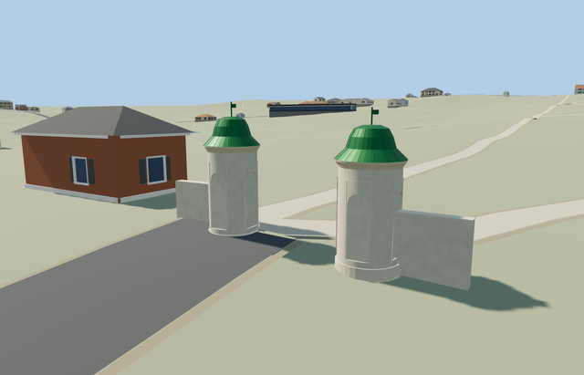

# Entrance Gate Towers — Yasnaya Polyana

Reviewed2026-10-25. **Complete paired medium-fi exterior interpretation with approximate native fit and explicit map/photo width reconciliation. Eight other declared members are complete; estate remains incomplete.**

## Exterior and inspection

Inspected all48 current portable/shared/medium-fi/native frames and full-resolution outside/inside arch/roof views. Both white round towers, curved green bell roofs, circular cornices, finial vanes, blind arched recesses, estate-side green arched doors and outward low wing walls form a complete exterior ensemble with an open central passage. The continuous pass replaced creased curved recess backs with planar arch panels, seated hardware on the recessed doors and embedded wing roots into the curved bodies. All LODs retain both bodies, roofs, doors, plinths and separate outward walls; district/street/closeup add blind recesses, shallow framing and roof seams.

## Shared materials and LODs

Five roles reuse three existing256px graphs: stucco, metal_standing_seam and wood_plain. Wall/cornice/plinth/wings share stucco; roof, seams and vane share painted metal; door uses wood_plain. Metric projection, linear tints, separate POSITION/NORMAL streams and equal CPU/GPU geometry accounting. Five nearby draws/one skyline. No embedded image, private atlas or new graph. Every shared graph reads once and unload releases all model geometry.

| Level | Triangles | Bytes | Draws |
| --- | ---: | ---: | ---: |
| skyline | 688 | 66508 | 1 |
| district | 2444 | 187240 | 5 |
| street | 3724 | 292288 | 5 |
| closeup | 5340 | 424032 | 5 |

Four authored LODs retain the full paired silhouette and open passage. Skyline uses twelve-sided round bodies and five-point bell profiles, actual arched estate doors and outward walls below the1k structure ceiling. District adds three blind arched recesses and shallow framing per tower; street/closeup increase curve resolution and add restrained radial roof seams and door hardware. Initial skyline+district253748bytes; closeup424032bytes. Synthetic views compare style/LOD/modes; native views establish approximate geographic fit.

## Location and limits

Paired independent ways361503808 and361503809 identify the entrance to Yasnaya Polyana. Retained mapped centers are5.229m apart along northeast/southwest; X northeast across the pair, Z southeast toward the outside approach, baked native axes with heading0 at the unchanged assigned collection anchor in the passage. Outside and inside photos establish green bell roofs, white cylinders and estate-facing northwest arched doors. PMTiles envelopes are broad relative to the photographed spacing: preserve both centers/ownership outlines while using photo-led slim bodies at60% of equivalent map radius, about1.8..1.92m diameter. This is an explicit map/photo reconciliation, not an exact surveyed footprint. Wing walls extend only outward, preserving the passage. Retained Protomaps20261020 and Mapzen201x201/6m ground; passage provider[0,0] supplies202.90528695999353m datum. Boundary grades-0.279..0.222m; northeast base+.05m/foundation-.5m and southwest base+.3m/foundation-.2m. Original ground remains between and around both towers. Only actual slim circular feet and two outward wing-wall feet cut it; never bridge their masks across the road. Coarse ground leaves some exposed plinth and unequal bases. No flattening or bespoke survey; independent neighbors, roads and ponds remain. Two owned map records replaced,241 resident/293 wider independent buildings retained. All original roads, passage ground and40070.675m² pond water remain. Actual model feet and outward walls alone cut the ground; the two circular masks remain separate. Failure retains all243 originals; every LOD/failure/unload restores ground/water with zero live model geometry. Three explicit passage probes and all outside approaches retain their original terrain. Mesh checks establish more than3m clear between the bodies.

Both entrance gate towers as one geographically anchored ensemble: slim white round masonry bodies, low plinths, projecting circular cornices, curved green bell roofs, small finial vanes, physically recessed blind arched panels and arched green wooden doors on the estate side. Two short attached low white wing walls complete the historic exterior interpretation. The central entrance and original road ground stay open. Temporary visitor barriers, signs, people and interiors are omitted; exact door/wing inventory, levels and roof seam details remain reconstructed. No photograph pixels or inscription artwork copied. Photo-led approximate dimensions: white body3.05m above individual base, stepped cornice to3.23m, bell roof to4.24m and finial/vane to4.76m. Door opening.7m wide with1.95m spring and2.3m arched top; blind niches use a similar arch. Individual model radii.895/.962m derive from60% of equivalent cartographic radii; hidden seams, door hardware, absolute vertical scale and historical levels remain approximate. Retained Protomaps20261020 and Mapzen201x201/6m ground; passage provider[0,0] supplies202.90528695999353m datum. Boundary grades-0.279..0.222m; northeast base+.05m/foundation-.5m and southwest base+.3m/foundation-.2m. Original ground remains between and around both towers. Only actual slim circular feet and two outward wing-wall feet cut it; never bridge their masks across the road. Coarse ground leaves some exposed plinth and unequal bases. No flattening or bespoke survey; independent neighbors, roads and ponds remain. Ordinary outside/inside photographs establish the architecture and estate-facing doors. Map centers/ownership stay fixed; slimmer photo-led bodies reconcile broad cartographic envelopes with photographed spacing. That width reconciliation and the unsurveyed vertical scale are explicit approximations. Low wing extents, historical levels, threshold accessibility, seam count and vane direction remain reconstructed. Modern visitor barriers/signs and interior use are omitted. Native roads approach slightly asymmetrically and coarse ground partly hides the threshold/plinth; their source geometry is preserved. Other estate buildings remain procedural context in the isolated fixture. Physical phone/laptop measurements remain pending.

## Rebuild and checks

Source-local recipes inventoried in source.json and asset-build.json. Targeted generation/import, forced derivatives, source/hash checks, strict medium-fi, scene/sim30 and placement checks pass. Six clean GLBs;168 actual mesh/contact probes;48 inspected frames. Two overlapping zoom15 cases cover both owned footprints; zoom13/14 have no overlapping feature. Exact pins: [qa.json](qa.json).

## References

- [Outside view](https://commons.wikimedia.org/wiki/File:Tula_YasnayaPolyana_asv2019-09_img01_gate_towers.jpg), A.Savin, Wikipedia,2019-09-13,Free Art License1.3; viewed only.
- [Inside view](https://commons.wikimedia.org/wiki/File:Yasnaya_Polyana_Museum_Entrance.jpg), Karel x,2014-08-10,CC0-1.0; viewed only.
- [Northeast tower](https://www.openstreetmap.org/way/361503808) and [southwest tower](https://www.openstreetmap.org/way/361503809), OpenStreetMap contributors,ODbL-1.0.
