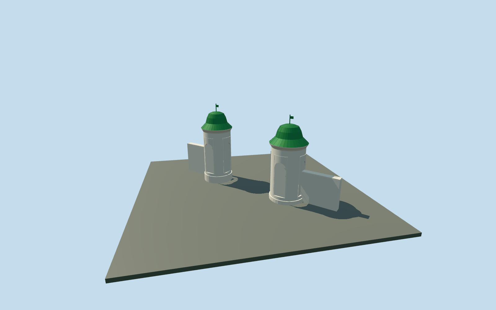

# Entrance Gate Towers — Yasnaya Polyana

Both entrance gate towers as one geographically anchored ensemble: slim white round masonry bodies, low plinths, projecting circular cornices, curved green bell roofs, small finial vanes, physically recessed blind arched panels and arched green wooden doors on the estate side. Two short attached low white wing walls complete the historic exterior interpretation. The central entrance and original road ground stay open. Temporary visitor barriers, signs, people and interiors are omitted; exact door/wing inventory, levels and roof seam details remain reconstructed. No photograph pixels or inscription artwork copied.

## Evidence and reconstruction

Published dimensions and reconstructed details are separated in spec.json. Primary references:

- [Reference](https://commons.wikimedia.org/wiki/File:Tula_YasnayaPolyana_asv2019-09_img01_gate_towers.jpg)
- [Reference](https://commons.wikimedia.org/wiki/File:Yasnaya_Polyana_Museum_Entrance.jpg)

Both entrance gate towers as one geographically anchored ensemble: slim white round masonry bodies, low plinths, projecting circular cornices, curved green bell roofs, small finial vanes, physically recessed blind arched panels and arched green wooden doors on the estate side. Two short attached low white wing walls complete the historic exterior interpretation. The central entrance and original road ground stay open. Temporary visitor barriers, signs, people and interiors are omitted; exact door/wing inventory, levels and roof seam details remain reconstructed. No photograph pixels or inscription artwork copied.

## Model and axes

5,340 triangles; 12,268 vertices; 5 material groups; 509,140 bytes. Native bounds: -4.284, -0.600, -4.152 to 4.085, 5.060, 3.654. Source hash: `sha256:129dcbb87f6c9312ca8dc94bdf099c72d70bb05ca4be2940abaef71fb2fdbedd`.

{"x":"east","y":"up","z":"south"}

The geographic proposal uses exact-QID OpenStreetMap evidence. Map-derived orientation and estimated architectural details require real-site visual review; preview eligibility is distinct from geographic/fidelity approval. Map attribution: © OpenStreetMap contributors, ODbL-1.0.

## Reproduce

Run `node content/worldgen/source/places/uc/ucd/gate_towers_yasnaya_polyana/models/generate-gate-towers-yasnaya-polyana.mjs --ids=gate_towers_yasnaya_polyana` (or add `--check`). The generator preserves manually edited masters by checking their baseline hashes. Import through the standard authored-model workflow with optimization disabled; then capture all QA cameras, including shared-surface views.

## Pending work

- Both entrance gate towers as one geographically anchored ensemble: slim white round masonry bodies, low plinths, projecting circular cornices, curved green bell roofs, small finial vanes, physically recessed blind arched panels and arched green wooden doors on the estate side. Two short attached low white wing walls complete the historic exterior interpretation. The central entrance and original road ground stay open. Temporary visitor barriers, signs, people and interiors are omitted; exact door/wing inventory, levels and roof seam details remain reconstructed. No photograph pixels or inscription artwork copied.
- Paired independent ways361503808 and361503809 identify the entrance to Yasnaya Polyana. Retained mapped centers are5.229m apart along northeast/southwest; X northeast across the pair, Z southeast toward the outside approach, baked native axes with heading0 at the unchanged assigned collection anchor in the passage. Outside and inside photos establish green bell roofs, white cylinders and estate-facing northwest arched doors. PMTiles envelopes are broad relative to the photographed spacing: preserve both centers/ownership outlines while using photo-led slim bodies at60% of equivalent map radius, about1.8..1.92m diameter. This is an explicit map/photo reconciliation, not an exact surveyed footprint. Wing walls extend only outward, preserving the passage.
- Photo-led approximate dimensions: white body3.05m above individual base, stepped cornice to3.23m, bell roof to4.24m and finial/vane to4.76m. Door opening.7m wide with1.95m spring and2.3m arched top; blind niches use a similar arch. Individual model radii.895/.962m derive from60% of equivalent cartographic radii; hidden seams, door hardware, absolute vertical scale and historical levels remain approximate.
- Retained Protomaps20261020 and Mapzen201x201/6m ground; passage provider[0,0] supplies202.90528695999353m datum. Boundary grades-0.279..0.222m; northeast base+.05m/foundation-.5m and southwest base+.3m/foundation-.2m. Original ground remains between and around both towers. Only actual slim circular feet and two outward wing-wall feet cut it; never bridge their masks across the road. Coarse ground leaves some exposed plinth and unequal bases. No flattening or bespoke survey; independent neighbors, roads and ponds remain.

This bundle follows the medium-fi standard. Medium-fi appearance and geographic fit are reviewed separately. Hash-bound visual acceptance is recorded separately after capture inspection.
