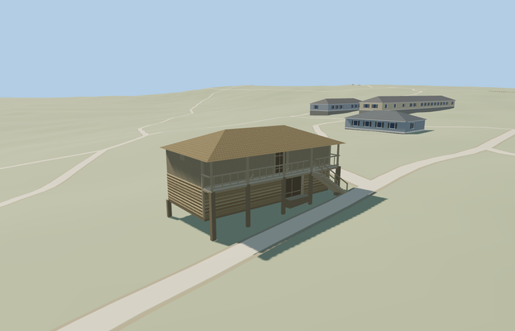

# Granary — Yasnaya Polyana

Reviewed2026-10-25. **Complete medium-fi exterior with approximate native fit. The estate remains incomplete; four other declared members are independently complete, while service/garden structures and bridge need their own models and visitor-map inventory reconciliation.**

## Built and inspected

Inspected all48 current portable/shared/medium-fi/native frames in labeled contact sheets, plus full-resolution native whole-front, gallery/stair and rear/raised-floor views. The complete log lower room, vertical-board upper room, low hip, open timber gallery, recessed lower gate and upper doorway, short-side vent and supported external stair read coherently. Gallery fronts and the space beneath the stair remain genuinely open. Seven piers remain present in every LOD so their ground masks never leave an empty hole. The coarse downhill support exposure and hidden rear inventory remain approximate.

## Shared materials and LODs

Six roles reuse four existing256px graphs: wood_log, wood_vertical, shingle_cedar and wood_plain. Frame, supports and darker doors share the same wood_plain graph. Metric UVs, linear tints, separate POSITION/NORMAL streams, matching CPU/GPU geometry accounting and at most4 nearby draws/one skyline. No embedded image, private atlas or new graph. Each used graph reads once; unload releases every model geometry.

| Level | Triangles | Bytes | Draws |
| --- | ---: | ---: | ---: |
| skyline | 278 | 26564 | 1 |
| district | 636 | 57032 | 4 |
| street | 1028 | 89280 | 4 |
| closeup | 1128 | 97088 | 4 |

Four authored LODs 278/636/1028/1128 triangles. Initial skyline+district 83596bytes; closeup 97088bytes. Skyline retains the full raised room/roof envelope, all seven timber supports, genuinely open gallery, two recessed doors, rails and a thin inclined stair proxy with open space beneath. Nearby levels add12 separate treads, stringers, handrails/posts, short-side vent, door boards, coarse log courses and gallery balusters. The skyline remains below the1k authored-structure ceiling; its gallery/stair/support silhouette is more involved than a plain small-building box. Synthetic contexts check style/LOD/mode coherence; native views establish approximate fit.

## Native location and limits

Museum granary/Житня corresponds to way220075392, independent of the other estate houses and the separate riga. Exact13m by6.9m map outline anchors the envelope; the enclosed front wall is set back1.1m to leave the photo-visible gallery inside that outline. X northwest along the long front, Z northeast toward the approach; native east/up/south axes baked with heading0 at the unchanged assigned member anchor. Autumn end/front and winter front museum photos guide the open gallery, external stair and timber wall hierarchy; hidden faces and absolute front assignment remain an approximate map/photo interpretation. Retained Protomaps20261020 and Mapzen201x201/6m ground; outside northeast approach provider[0,7] supplies224.57842704651677m datum. Boundary grades-0.993..0.254m, floor+0.5m and timber pier bottoms-1.2m. The coarse slope leaves up to about1.5m below the downhill floor; the original ground remains beneath the raised rooms, gallery and stair. Only occupied pier feet and the two supported aprons cut the ground. Historic support exposure/levels and accessibility approximate; no flattening or bespoke terrain. Independent neighbors, approaches, roads and ponds remain. Inspected current native front/gallery/stair and rear views: the complete mapped envelope, low hip roof, open timber gallery, recessed doors and external stair read coherently. Ground remains beneath both rooms, gallery and stair; only pier feet and two aprons are cut. One owned record is replaced while242 resident independent buildings, roads and40070.675m² pond water remain. Coarse downhill pier exposure and inferred roof material remain explicit approximations. One owned map record is replaced while242 resident/294 wider independent buildings, original approaches, roads and40070.675m² pond water remain. Ground remains beneath the raised rooms, gallery and external stair; only seven pier feet and two occupied aprons are cut. Failure retains all243 originals; every LOD/failure/unload restores ground/water and releases geometry.

Complete mapped granary/Житня exterior at Yasnaya Polyana: timber-supported two-storey storehouse with log lower walls, weathered vertical-board upper room, broad low hip roof over an open front gallery and an external stair descending along the front. Lower double wooden gate and upper doorway are physically recessed; short-side vent, timber posts, open rails, stringers and supported entrance/foot aprons remain simple original proxies. All four mapped outer edges anchor the house/gallery envelope. Hidden rear inventory, roof material and historic levels remain approximate. No copied signs, merchandise, inscriptions, artworks, furnishings, people, snow or photograph pixels. Photo-led approximate medium-fi scale: lower room2.25m, upper room2.05m, low hip roof1.5m rise. Gallery at2.25m has simple.92m open rails;12 treads descend along the front. Map nominal5m is a scale cue. Rear bays, historical cladding/roof state, timber frame sections, doors, treads, thresholds and accessibility are not surveyed. Retained Protomaps20261020 and Mapzen201x201/6m ground; outside northeast approach provider[0,7] supplies224.57842704651677m datum. Boundary grades-0.993..0.254m, floor+0.5m and timber pier bottoms-1.2m. The coarse slope leaves up to about1.5m below the downhill floor; the original ground remains beneath the raised rooms, gallery and stair. Only occupied pier feet and the two supported aprons cut the ground. Historic support exposure/levels and accessibility approximate; no flattening or bespoke terrain. Independent neighbors, approaches, roads and ponds remain. The photographs partly obscure the roof and footings with trees/snow. A shared weathered cedar-shingle graph approximates the unresolved roof finish; no snow or photograph pixels are copied. Hidden rear inventory and absolute front assignment remain a photo/map interpretation. Fixed synthetic planes partly bury the grade-specific supports/aprons; whole native/turntable views cover the envelope. Other estate structures remain procedural context in this isolated fixture. Physical phone/laptop and dense-city timings remain pending.

## Rebuild and checks

Source-local recipes are inventoried in source.json and registered in asset-build.json. Run `node content/worldgen/source/places/uc/ucd/granary_yasnaya_polyana/models/generate-granary-yasnaya-polyana.mjs --check`. Targeted import/placement, forced derivative generation, strict medium-fi, scene/sim30 and recipe checks pass. Six GLBs: zero Khronos errors/warnings,198 actual mesh/contact probes. The one overlapping PMTiles15 case covers the owned granary; the retained zoom13/14 tiles have no overlapping building feature. Exact pins and concise evidence: [qa.json](qa.json).

## References

- [Museum granary page](https://ypmuseum.ru/object/jitnya): undated autumn and winter exterior pictures, photographer unspecified; viewed only. No images were downloaded or embedded.
- [Autumn picture](https://ypmuseum.ru/data/objects/23/objectsi_38_ghl0.jpg), end/front and timber hierarchy.
- [Winter picture](https://ypmuseum.ru/data/objects/23/objectsi_71_cjb1.jpg), gallery and stair.
- [Mapped granary](https://www.openstreetmap.org/way/220075392), ©OpenStreetMap contributors,ODbL-1.0. Controls: [map-frame.json](map-frame.json).
