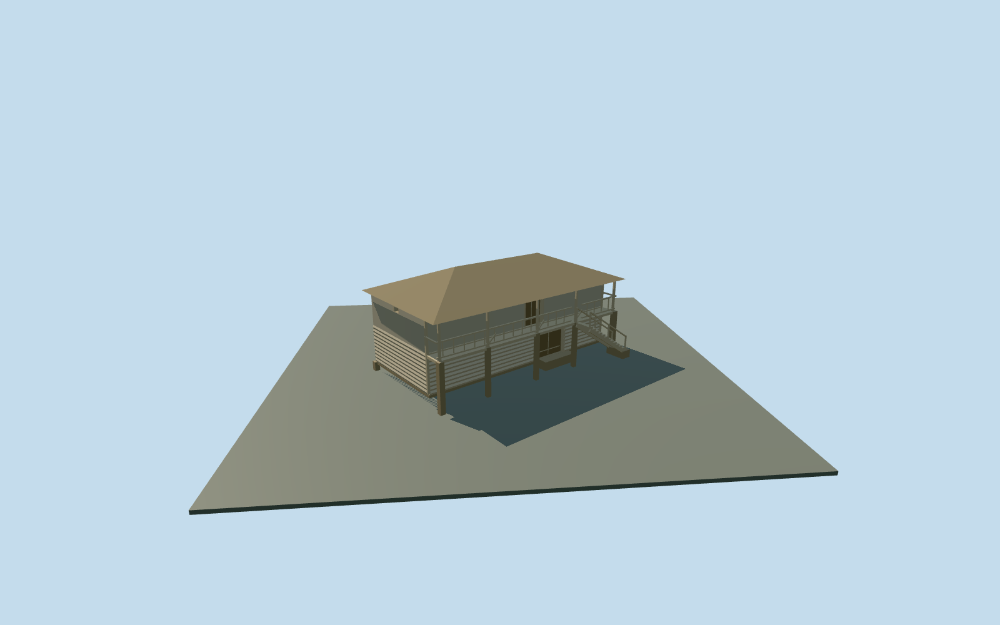

# Granary — Yasnaya Polyana

Complete mapped granary/Житня exterior at Yasnaya Polyana: timber-supported two-storey storehouse with log lower walls, weathered vertical-board upper room, broad low hip roof over an open front gallery and an external stair descending along the front. Lower double wooden gate and upper doorway are physically recessed; short-side vent, timber posts, open rails, stringers and supported entrance/foot aprons remain simple original proxies. All four mapped outer edges anchor the house/gallery envelope. Hidden rear inventory, roof material and historic levels remain approximate. No copied signs, merchandise, inscriptions, artworks, furnishings, people, snow or photograph pixels.

## Evidence and reconstruction

Published dimensions and reconstructed details are separated in spec.json. Primary references:

- [Reference](https://ypmuseum.ru/object/jitnya)

Complete mapped granary/Житня exterior at Yasnaya Polyana: timber-supported two-storey storehouse with log lower walls, weathered vertical-board upper room, broad low hip roof over an open front gallery and an external stair descending along the front. Lower double wooden gate and upper doorway are physically recessed; short-side vent, timber posts, open rails, stringers and supported entrance/foot aprons remain simple original proxies. All four mapped outer edges anchor the house/gallery envelope. Hidden rear inventory, roof material and historic levels remain approximate. No copied signs, merchandise, inscriptions, artworks, furnishings, people, snow or photograph pixels.

## Model and axes

1,128 triangles; 2,502 vertices; 4 material groups; 106,516 bytes. Native bounds: -7.008, -1.200, -8.040 to 6.823, 6.300, 7.887. Source hash: `sha256:f65e8f061f54f760687f7d8a758d43b7d22d0ed353ec44a752d002f2da6cc9f0`.

{"x":"east","y":"up","z":"south"}

The geographic proposal uses exact-QID OpenStreetMap evidence. Map-derived orientation and estimated architectural details require real-site visual review; preview eligibility is distinct from geographic/fidelity approval. Map attribution: © OpenStreetMap contributors, ODbL-1.0.

## Reproduce

Run `node content/worldgen/source/places/uc/ucd/granary_yasnaya_polyana/models/generate-granary-yasnaya-polyana.mjs --ids=granary_yasnaya_polyana` (or add `--check`). The generator preserves manually edited masters by checking their baseline hashes. Import through the standard authored-model workflow with optimization disabled; then capture all QA cameras, including shared-surface views.

## Pending work

- Complete mapped granary/Житня exterior at Yasnaya Polyana: timber-supported two-storey storehouse with log lower walls, weathered vertical-board upper room, broad low hip roof over an open front gallery and an external stair descending along the front. Lower double wooden gate and upper doorway are physically recessed; short-side vent, timber posts, open rails, stringers and supported entrance/foot aprons remain simple original proxies. All four mapped outer edges anchor the house/gallery envelope. Hidden rear inventory, roof material and historic levels remain approximate. No copied signs, merchandise, inscriptions, artworks, furnishings, people, snow or photograph pixels.
- Museum granary/Житня corresponds to way220075392, independent of the other estate houses and the separate riga. Exact13m by6.9m map outline anchors the envelope; the enclosed front wall is set back1.1m to leave the photo-visible gallery inside that outline. X northwest along the long front, Z northeast toward the approach; native east/up/south axes baked with heading0 at the unchanged assigned member anchor. Autumn end/front and winter front museum photos guide the open gallery, external stair and timber wall hierarchy; hidden faces and absolute front assignment remain an approximate map/photo interpretation.
- Photo-led approximate medium-fi scale: lower room2.25m, upper room2.05m, low hip roof1.5m rise. Gallery at2.25m has simple.92m open rails;12 treads descend along the front. Map nominal5m is a scale cue. Rear bays, historical cladding/roof state, timber frame sections, doors, treads, thresholds and accessibility are not surveyed.
- Retained Protomaps20261020 and Mapzen201x201/6m ground; outside northeast approach provider[0,7] supplies224.57842704651677m datum. Boundary grades-0.993..0.254m, floor+0.5m and timber pier bottoms-1.2m. The coarse slope leaves up to about1.5m below the downhill floor; the original ground remains beneath the raised rooms, gallery and stair. Only occupied pier feet and the two supported aprons cut the ground. Historic support exposure/levels and accessibility approximate; no flattening or bespoke terrain. Independent neighbors, approaches, roads and ponds remain.

This bundle follows the medium-fi standard. Medium-fi appearance and geographic fit are reviewed separately. Hash-bound visual acceptance is recorded separately after capture inspection.
