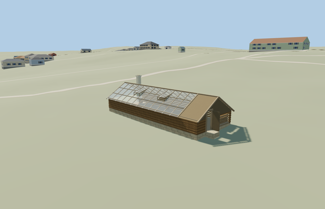

# Greenhouse — Yasnaya Polyana

Reviewed2026-10-25. **Complete medium-fi greenhouse interpretation with explicit photo-led roof/entry details and approximate native terrain fit. The estate remains incomplete.**

## Built and inspected

Inspected48 current portable/shared/medium-fi/native frames in one author/inspect/fix pass, including full-resolution glazing, timber gable/entry, fuel alcove, plinth and roof-light views. Complete log base, clear pitched panes/end gable, rafters/purlins, two fixed-open roof lights, boarded entry bay with open leaf, coarse fuel stack and opposite-end pale chimney. Corrected the small clipped-gable gap and the coplanar floor/plinth top before final capture. Interior floor/benches are reconstructed; flower beds, trees, pots and people stay separate.

## Shared materials and LODs

Five existing256px graphs cover log walls, plain/boarded timber, pale plaster and stone plinth. Transparent glass uses a texture-free PBR material with alpha.52 and two-sided panes; its district/street/closeup exports preserve alpha. Metric UVs, linear tints, separate vertex streams and at most6draws; no embedded image, private atlas or new texture graph. Each shared graph reads once; unload releases all geometry.

| Level | Triangles | Bytes | Draws |
| --- | ---: | ---: | ---: |
| skyline | 344 | 35172 | 1 |
| district | 596 | 57040 | 6 |
| street | 1644 | 136456 | 6 |
| closeup | 1644 | 136456 | 6 |

Four authored LODs 344/596/1644/1644 triangles; initial skyline+district 92212 bytes. Skyline retains low glazed-gable silhouette, entry bay and chimney below1000triangles, with an opaque distance fallback. District adds rafters and transparent glazing; near levels add fixed-open roof lights, benches, coarse fuel ends and log relief. Mode/distance/lighting frames are synthetic comparisons; physical laptop/phone measurements remain pending.

## Native placement and limits

Retained independent15.05x5.72m PMTiles outline matches the public mapped way220075398, visibly named Теплица with building=greenhouse and building:levels=1. Four ordinary museum photos show long log base, glazed gable roof, timber entry/fuel bay at one end and pale chimney at the other. No visitor-map schematic coordinate is used as WGS84. Native X northeast follows the mapped long axis; source axes are baked with heading0. Long glazed garden face assigned local+Z southeast, entry bay at+X northeast and chimney at-X southwest; this absolute photo-side assignment is approximate. Retained Protomaps20261020 / standard Mapzen201x201 at6m; outside garden control[0,5.8] supplies216.7855550974413m datum. Preserve all DEM samples and native roads/water. Replace only building35184592164230; cut only its occupied footprint. A supported apron meets the end door. Absolute historic levels, ground contact and approach accessibility remain approximate; no custom terrain or whole-garden cut. Inspected the native greenhouse, floor/plinth, end doorway/threshold, chimney and clear-roof structure. All242 resident/294 wider independent buildings, original garden approaches/roads, water and DEM samples remain. Final geometry closes the clipped timber gable and removes the coplanar floor/plinth surface. Exact historic thresholds, hidden benches and absolute entry/chimney-side assignment remain approximate. Only native building35184592164230 is replaced. All242resident/294wider independent buildings, native garden approaches/roads, original DEM samples and40070.675m²water remain. Failure retains all243original buildings; unload restores ground after water unload. Mapped long-axis orientation is retained; the photo-side assignment of entry/chimney remains approximate.

Complete original medium-fi greenhouse exterior: log base on pale plinth, genuinely transparent gable panes and glazed end, timber rafters/purlins, two opening roof lights, boarded entry/fuel bay with open wooden door, coarse split-log alcove, opposite-end pale chimney and supported threshold. Simple inner benches are reconstructed for the clear-roof view. Reuse existing wood_log, wood_plain, wood_vertical, plaster_lime and stone_limestone graphs plus a texture-free clear-glass material; no private atlas, copied photograph pixels, flowers, trees or people baked into the building. Photo-led one-story scale: low log body1.25m above floor, glazed gable ridge3.15m, chimney4.12m, timber entry/fuel bay2.2m long, real .88x1.95m doorway with leaf open90degrees. Floor 0.7182087492670064m above outside datum; original corner grades 0.568/0.230/0.165/0.465m. Floor is.15m above highest sampled corner; small plinth/foundation follows the standard terrain. Bay widths, roof pitch, vent positions, fuel census and inner benches remain reconstructed. The mapped greenhouse name/type and footprint support identity/scale. Exact historic roof pitch, chimney/threshold heights, end-bay orientation, vent count/placement, hidden benches/floor, fuel census and glazing schedule remain photo-led approximations. The glass is a simple browser PBR approximation, not physical refraction. Estate service inventory remains incomplete.

## Rebuild and checks

Three deterministic source-local programs are registered in source.json and asset-build.json. Targeted generation/import, four derivatives, generator --check, strict medium-fi, scene validation and30-tick simulation passed. Six GLBs: zero Khronos errors/warnings;87 mesh probes and48 inspected frames. Its owned map footprint passes at detailed level15; no overlapping building case occurs at13/14. Exact pins: [qa.json](qa.json).

## References

[Museum greenhouse and garden photographs](https://www.ypmuseum.ru/object/teplica), photographer/date unstated, viewed only. No photograph pixels retained or used as texture. [Mapped independent footprint](https://www.openstreetmap.org/way/220075398), OpenStreetMap contributors,ODbL-1.0. Standard Mapzen terrain retained.
