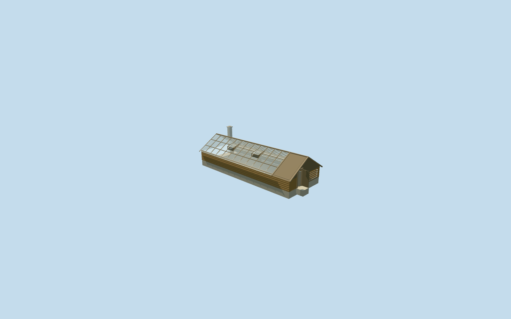

# Greenhouse — Yasnaya Polyana

Complete original medium-fi greenhouse exterior: log base on pale plinth, genuinely transparent gable panes and glazed end, timber rafters/purlins, two opening roof lights, boarded entry/fuel bay with open wooden door, coarse split-log alcove, opposite-end pale chimney and supported threshold. Simple inner benches are reconstructed for the clear-roof view. Reuse existing wood_log, wood_plain, wood_vertical, plaster_lime and stone_limestone graphs plus a texture-free clear-glass material; no private atlas, copied photograph pixels, flowers, trees or people baked into the building.

## Evidence and reconstruction

Published dimensions and reconstructed details are separated in spec.json. Primary references:

- [Reference](https://www.ypmuseum.ru/object/teplica)

Complete original medium-fi greenhouse exterior: log base on pale plinth, genuinely transparent gable panes and glazed end, timber rafters/purlins, two opening roof lights, boarded entry/fuel bay with open wooden door, coarse split-log alcove, opposite-end pale chimney and supported threshold. Simple inner benches are reconstructed for the clear-roof view. Reuse existing wood_log, wood_plain, wood_vertical, plaster_lime and stone_limestone graphs plus a texture-free clear-glass material; no private atlas, copied photograph pixels, flowers, trees or people baked into the building.

## Model and axes

1,644 triangles; 3,660 vertices; 6 material groups; 155,236 bytes. Native bounds: -7.954, -0.085, -7.381 to 7.981, 4.838, 7.356. Source hash: `sha256:1b1da655b920d2bb7f519ae3667235c29854bdbc306bebc8a690179818a370de`.

{"x":"east","y":"up","z":"south"}

The geographic proposal uses exact-QID OpenStreetMap evidence. Map-derived orientation and estimated architectural details require real-site visual review; preview eligibility is distinct from geographic/fidelity approval. Map attribution: © OpenStreetMap contributors, ODbL-1.0.

## Reproduce

Run `node content/worldgen/source/places/uc/ucd/greenhouse_yasnaya_polyana/models/generate-greenhouse-yasnaya-polyana.mjs --ids=greenhouse_yasnaya_polyana` (or add `--check`). The generator preserves manually edited masters by checking their baseline hashes. Import through the standard authored-model workflow with optimization disabled; then capture all QA cameras, including shared-surface views.

## Pending work

- Complete original medium-fi greenhouse exterior: log base on pale plinth, genuinely transparent gable panes and glazed end, timber rafters/purlins, two opening roof lights, boarded entry/fuel bay with open wooden door, coarse split-log alcove, opposite-end pale chimney and supported threshold. Simple inner benches are reconstructed for the clear-roof view. Reuse existing wood_log, wood_plain, wood_vertical, plaster_lime and stone_limestone graphs plus a texture-free clear-glass material; no private atlas, copied photograph pixels, flowers, trees or people baked into the building.
- Retained independent15.05x5.72m PMTiles outline matches the public mapped way220075398, visibly named Теплица with building=greenhouse and building:levels=1. Four ordinary museum photos show long log base, glazed gable roof, timber entry/fuel bay at one end and pale chimney at the other. No visitor-map schematic coordinate is used as WGS84. Native X northeast follows the mapped long axis; source axes are baked with heading0. Long glazed garden face assigned local+Z southeast, entry bay at+X northeast and chimney at-X southwest; this absolute photo-side assignment is approximate.
- Photo-led one-story scale: low log body1.25m above floor, glazed gable ridge3.15m, chimney4.12m, timber entry/fuel bay2.2m long, real .88x1.95m doorway with leaf open90degrees. Floor 0.7182087492670064m above outside datum; original corner grades 0.568/0.230/0.165/0.465m. Floor is.15m above highest sampled corner; small plinth/foundation follows the standard terrain. Bay widths, roof pitch, vent positions, fuel census and inner benches remain reconstructed.
- Retained Protomaps20261020 / standard Mapzen201x201 at6m; outside garden control[0,5.8] supplies216.7855550974413m datum. Preserve all DEM samples and native roads/water. Replace only building35184592164230; cut only its occupied footprint. A supported apron meets the end door. Absolute historic levels, ground contact and approach accessibility remain approximate; no custom terrain or whole-garden cut.

This bundle follows the medium-fi standard. Medium-fi appearance and geographic fit are reviewed separately. Hash-bound visual acceptance is recorded separately after capture inspection.
