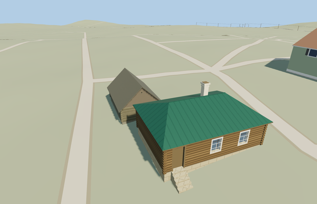

# Icehouse interpretation — Yasnaya Polyana

Reviewed2026-10-25. **Complete photo-specific gabled service exterior; icehouse function and aerial placement remain inferred. The estate remains incomplete.**

## Built and inspected

Inspected 48 current portable/shared/medium-fi/native frames in the same author/inspect/fix pass. Complete low weathered log shell, steep board roof with opaque undersides/edge thickness, horizontal boarded gables, genuinely recessed low door with diagonal wooden brace, triangular vent with timber reveals/dark recessed back, trimmed corner-log ends and one supported threshold. Fixed upper corner ends protruding through the roof and moved the close camera outside the companion kitchen. The actual paired view preserves the passage and shows the corrected kitchen separately.

## Shared materials and LODs

Five existing 256px graphs: wood_log, wood_plain, wood_vertical, stone_limestone and metal_painted. Six roles merge by graph, with restrained gray/brown linear tints and metric UVs. No embedded image, copied photo pixels, private atlas or new material. Separate position/normal streams prevent duplicate GPU uploads; at most five near draws. The paired scene reads eight shared graphs once each, and unload releases all model geometry.

| Level | Triangles | Bytes | Draws |
| --- | ---: | ---: | ---: |
| skyline | 87 | 8964 | 1 |
| district | 119 | 17040 | 6 |
| street | 679 | 65596 | 6 |
| closeup | 955 | 87128 | 6 |

Four authored LODs: 87/119/679/955 triangles. Initial skyline+district 26004 bytes. Skyline retains the full steep gable, door/vent recesses and threshold; district adds shared surfaces and diagonal brace, near levels add log relief and horizontal gable-board relief. Synthetic lighting/distance/transition views pass; physical phone/laptop timings remain pending.

## Native placement and limits

Approximate roof center[37.526115,54.076448], northeast of the kitchen. X southwest along the inferred ridge, front gable+X toward the courtyard; native east/up/south axes baked, heading0. No invented OSM feature or native building ownership. Levels13/14/15 contain no mapped footprint intersection; occupied ground masks also stay separate from the kitchen. Both models retain all243resident/295wider native buildings, original paths/roads, every DEM sample and40070.675m²water. Independent root heights differ0.253399m. Failure keeps original buildings and restores occupied ground; unload releases both models and restores ground after water unload.

Specific exterior reconstruction from two ordinary courtyard photographs, with an explicitly inferred icehouse role. The photos show the gabled service outbuilding beside the kitchen but do not individually label its function; the assignment and partly tree-covered aerial roof match are not confirmed cadastral identity. Body7.8x5m, low walls1.75m and ridge4.1m are photo-led estimates. Position about5m/facing20degrees are author estimates, not measured bounds. Weathered board finish follows older ground photos; aerial color/date and present maintenance condition are uncertain. Hidden rear, exact elevations and cold-chamber depth remain reconstructed. One low threshold follows coarse standard terrain; no underground room or custom DEM is authored. The woodshed remains unfinished estate inventory.

## Rebuild and checks

Three deterministic source-local programs are registered in source.json and asset-build.json. Targeted generation/import, four derivatives, generator --check, strict medium-fi, scene validation and30-tick simulation passed. Six GLBs: zero Khronos errors/warnings;89 mesh probes and48 inspected frames. Map levels13/14/15 contain no native footprint intersection. The kitchen owns and replaces no native building. Exact pins: [qa.json](qa.json).

## References

[Museum service-group page](https://www.ypmuseum.ru/object/lednik-belaya-kuhnya-drovyanoy-saray). Ordinary close photographs: [Bella-2016 group view](https://commons.wikimedia.org/wiki/File:Хозяйственные_постройки_-_Кухня.jpg), CC BY-SA4.0; [Sergey Galchenkov close view](https://commons.wikimedia.org/wiki/File:Yasnaya_hut.jpg), CC BY-SA3.0/2.5/2.0/1.0. Viewed only; dates and individual role attribution remain as noted in reference-metadata.json. No photograph pixels retained or used as texture. [Viewed aerial reference](https://www.google.com/maps/@54.076364,37.526021,20z/data=!3m1!1e3), Airbus/Maxar attribution as displayed; capture date unstated. Standard OpenStreetMap/Mapzen terrain retained. No aerial pixels or native footprint geometry copied.
