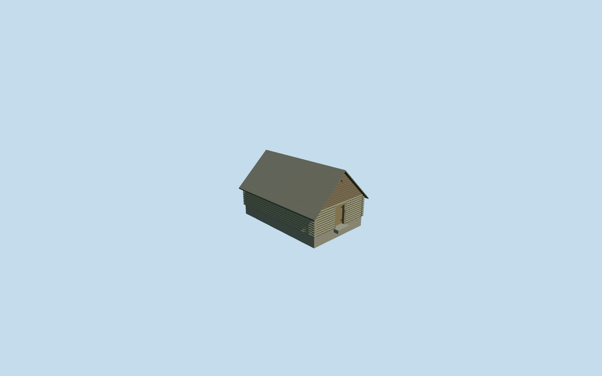

# Icehouse — Yasnaya Polyana

Complete independent icehouse interpretation for the photographed gabled service outbuilding: low weathered log shell, steep gray board roof with closed undersides/edge thickness, horizontal timber gables, genuine recessed low braced door and triangular gable vent, corner log ends and one supported threshold. Function, photo-side assignment and geographic precision remain explicit inferences. No trees, exhibition contents, signs, copied pixels or speculative underground chamber.

## Evidence and reconstruction

Published dimensions and reconstructed details are separated in spec.json. Primary references:

- [Reference](https://commons.wikimedia.org/wiki/File:Хозяйственные_постройки_-_Кухня.jpg)
- [Reference](https://commons.wikimedia.org/wiki/File:Yasnaya_hut.jpg)
- [Reference](https://www.google.com/maps/@54.076364,37.526021,20z/data=!3m1!1e3)

Complete independent icehouse interpretation for the photographed gabled service outbuilding: low weathered log shell, steep gray board roof with closed undersides/edge thickness, horizontal timber gables, genuine recessed low braced door and triangular gable vent, corner log ends and one supported threshold. Function, photo-side assignment and geographic precision remain explicit inferences. No trees, exhibition contents, signs, copied pixels or speculative underground chamber.

## Model and axes

955 triangles; 2,241 vertices; 6 material groups; 95,988 bytes. Native bounds: -5.039, -0.695, -4.834 to 5.039, 4.180, 4.834. Source hash: `sha256:89936361946e15ec6e765a94aa83cc1a0b2cb63dd31ec2d402a7f40f3009c26f`.

{"x":"east","y":"up","z":"south"}

The geographic proposal uses exact-QID OpenStreetMap evidence. Map-derived orientation and estimated architectural details require real-site visual review; preview eligibility is distinct from geographic/fidelity approval. Map attribution: © OpenStreetMap contributors, ODbL-1.0.

## Reproduce

Run `node content/worldgen/source/places/uc/ucd/icehouse_yasnaya_polyana/models/generate-icehouse-yasnaya-polyana.mjs --ids=icehouse_yasnaya_polyana` (or add `--check`). The generator preserves manually edited masters by checking their baseline hashes. Import through the standard authored-model workflow with optimization disabled; then capture all QA cameras, including shared-surface views.

## Pending work

- Complete independent icehouse interpretation for the photographed gabled service outbuilding: low weathered log shell, steep gray board roof with closed undersides/edge thickness, horizontal timber gables, genuine recessed low braced door and triangular gable vent, corner log ends and one supported threshold. Function, photo-side assignment and geographic precision remain explicit inferences. No trees, exhibition contents, signs, copied pixels or speculative underground chamber.
- Two ordinary courtyard photos show the same independent low log outbuilding with steep weathered board gable roof, horizontal timber gable, small triangular vent and braced low door immediately beside the kitchen. The aerial roof northeast of the kitchen supplies approximate center[37.526115,54.076448] and southwest-facing gable axis. Assignment as the icehouse rather than woodshed remains an explicit estate-context inference: the photographs are grouped under kitchen and do not label this outbuilding individually. This is an original specific exterior interpretation, not a generic icehouse preset. Standard PMTiles/current OSM omit its footprint; own or replace no native building. Position about5m/facing20degrees are author estimates, not measured bounds.
- Photo-led7.8x5m plan,1.75m low log walls and4.1m steep ridge above a level entry floor. Door.95x1.55m and small triangular vent. Ground contact follows the outside front entry sample plus.08m, allowing native soil around the low sides rather than raising a large plinth. Exact dimensions, roof material/date, hidden rear and historic cold-chamber depth remain reconstructed; no underground room is authored.
- Retained Protomaps20261020 and standard Mapzen201x201/6m grid. Outside southwest gable control[6,0] gives224.4860703641976m datum. No mapped building ownership. Preserve all243resident/295wider original buildings, courtyard paths, every DEM sample and pond geometry. Cut only the occupied reconstructed footprint; one small supported threshold meets unchanged soil. Coarse side-bank burial is approximate, with no custom terrain or broad yard cut.

This bundle follows the medium-fi standard. Medium-fi appearance and geographic fit are reviewed separately. Hash-bound visual acceptance is recorded separately after capture inspection.
