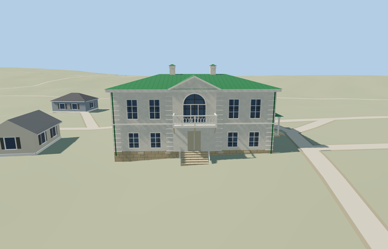

# Kuzminsky House — Yasnaya Polyana

Reviewed2026-10-25. **Complete medium-fi house exterior with approximate native fit. The estate collection remains incomplete. Tolstoy House is independently completed; Volkonsky and the service/garden structures and bridge still need their own models, and visitor-map inventory reconciliation is required before estate completion.**

## Built and inspected

Complete connected Kuzminsky House exterior at Yasnaya Polyana: mapped compact white two-storey block, green standing-seam hip roof and two pale capped chimney stacks. Central shallow risalits and triangular pediments, tall arched upper glazing, supported front balcony with open lattice proxies and brackets, recessed lower front/rear entrances with closed treads/masonry stair sides, and northeast side porch with a low green roof, posts, recessed door and treads. Short approximate rear threshold treads follow the coarse original grade. Long rear elevation and blind side panels follow ordinary pictures with approximate hidden bay inventory. No copied texts, plaques, furnishings, artworks or photograph pixels.

Inspected all48 current portable/shared/medium-fi/native frames in labeled contact sheets, plus full-resolution native front, balcony/entrance, northeast porch and rear views. The compact five-bay white house, green hip roof, two pale chimney caps, central round-headed upper glazing and pediments, supported open balcony/lattice and brackets, recessed doors, closed treads and open side porch read coherently. Ordinary front/northeast pictures and retained standard PMTiles guided one continuous author/inspect/fix pass. The entrance contact pass added short supported rear threshold treads.

## Shared materials and LODs

Six roles reuse five existing256px graphs: stucco, wood_plain, stone_limestone, metal_standing_seam and storefront. Trim and doorway wood share one graph. Metric UVs, linear tints, five nearby draws/one skyline, separate POSITION/NORMAL streams and matching CPU/GPU geometry accounting. No embedded image, private atlas or new graph. Each used graph reads once; unload releases every model geometry.

| Level | Triangles | Bytes | Draws |
| --- | ---: | ---: | ---: |
| skyline | 788 | 71068 | 1 |
| district | 1352 | 112404 | 5 |
| street | 3612 | 288896 | 5 |
| closeup | 3808 | 304688 | 5 |

Four authored LODs788/1352/3612/3808 triangles. Initial skyline+district183472bytes; closeup304688bytes. Skyline retains the complete main/porch roof, two stacks, front/rear pediments, physical balcony/bracket proxies, recessed entrances, supported porch and treads. It omits window/arched glazing and lattice modules. District adds five-bay window rhythm and six-segment arched heads; street/closeup add open lattice, finer arch segments, quoin bands, vents and pipes. Synthetic contexts check style/LOD/tier coherence; native frames establish approximate geographic fit.

## Native location and limits

Named Флигель Кузминских POI and way167382261 identify this house independently from Tolstoy and Volkonsky houses. The mapped long southeast edge fixes+X southwest along the facade and+Z southeast into the front garden; axes baked east/up/south, heading0. Ordinary southeast and northeast photographs confirm the compact five-bay long fronts, central arched upper opening/pediment and northeast side porch. Photo-visible balcony, treads and side porch extend outside the simple map rectangle. Retained standard Protomaps20261020 and Mapzen ground; outside front garden provider[0,7] supplies227.14409009244258m datum. Main boundary grades-0.048..0.944m, floor+1.2m and closed foundation-0.3m. Original garden/approaches, estate neighbors, roads and ponds remain. Coarse exposed plinth, historical thresholds and accessibility approximate; no bespoke terrain or flattening. Inspected initial native front/side views: white mass and green roof align with the mapped garden paths; closed plinth, front stairs and open side porch are supported. One owned house is replaced,242 resident independent buildings and original roads/pond water remain. Rear threshold treads approximate the coarse slope; historic levels and accessibility remain approximate. The one owned house is replaced while242 resident/294 wider independent buildings, original garden/approach ground, roads and40070.675m² pond water remain. Failure retains all243 originals; every LOD/failure/unload case restores ground/water and releases geometry.

Recognizable medium-fi exterior. The mapped17.95m by11.7m envelope fixes horizontal scale; balconies, risalits, northeast porch and stairs are picture-led additions. Main boundary grades-.048..+.944m relative to227.14409009244258m outside-garden datum, floor+1.2m and foundation-.3m support the body with low-side plinth exposure up to about1.25m. Historic heights, hidden rear glazing/balcony/door arrangement, blind side panels, chimney inventory, thresholds and accessibility remain approximate. Map nominal8m is a scale cue, not a survey. Bushes/conifers obscure portions of the reference elevations. Flat synthetic contexts partly bury bases/treads and some close views crop the opposite edge; whole/native views cover the envelope. Other estate houses remain independent procedural context in this isolated fixture. No copied plaques, texts, furnishings, artworks, planting or photo pixels. Physical phone/laptop and dense-city timings remain pending.

## Rebuild and checks

Source-local recipes are inventoried in source.json and registered in asset-build.json. Run `node content/worldgen/source/places/uc/ucd/kuzminsky_house_yasnaya_polyana/models/generate-kuzminsky-house-yasnaya-polyana.mjs --check`. Selected import/placement checks, strict medium-fi, scene validation, sim30 and recipe lint pass. Six GLBs: zero Khronos errors/warnings;184 actual geometry/contact probes and two PMTiles14/15 cases (the zoom13 extract contains no overlapping building feature) cover the detailed owned house. Sim30 sha256:164cf2a9191e5a152fa1c43933c56c12c87db875cb3d516d048dd2266e94a822. Exact pins and concise evidence: [qa.json](qa.json).

## References

- [Front photograph](https://commons.wikimedia.org/wiki/File:Yasnaya_Polyana._Kuzminsky_House_P5131518_2800.jpg), Alexxx1979,2026-05-13,CC BY-SA4.0; viewed only.
- [Northeast photograph](https://commons.wikimedia.org/wiki/File:Yasnaya_Polyana._Kuzminsky_House_P5131489_2800.jpg), Alexxx1979,2026-05-13,CC BY-SA4.0; viewed only.
- [Museum visitor map](https://ypmuseum.ru/map), estate context.
- [Mapped house](https://www.openstreetmap.org/way/167382261), ©OpenStreetMap contributors,ODbL-1.0. Controls and signed axes: [map-frame.json](map-frame.json).
