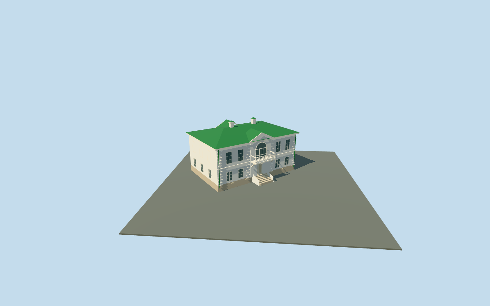

# Kuzminsky House — Yasnaya Polyana

Complete connected Kuzminsky House exterior at Yasnaya Polyana: mapped compact white two-storey block, green standing-seam hip roof and two pale capped chimney stacks. Central shallow risalits and triangular pediments, tall arched upper glazing, supported front balcony with open lattice proxies and brackets, recessed lower front/rear entrances with closed treads/masonry stair sides, and northeast side porch with a low green roof, posts, recessed door and treads. Short approximate rear threshold treads follow the coarse original grade. Long rear elevation and blind side panels follow ordinary pictures with approximate hidden bay inventory. No copied texts, plaques, furnishings, artworks or photograph pixels.

## Evidence and reconstruction

Published dimensions and reconstructed details are separated in spec.json. Primary references:

- [Reference](https://commons.wikimedia.org/wiki/File:Yasnaya_Polyana._Kuzminsky_House_P5131518_2800.jpg)
- [Reference](https://commons.wikimedia.org/wiki/File:Yasnaya_Polyana._Kuzminsky_House_P5131489_2800.jpg)

Complete connected Kuzminsky House exterior at Yasnaya Polyana: mapped compact white two-storey block, green standing-seam hip roof and two pale capped chimney stacks. Central shallow risalits and triangular pediments, tall arched upper glazing, supported front balcony with open lattice proxies and brackets, recessed lower front/rear entrances with closed treads/masonry stair sides, and northeast side porch with a low green roof, posts, recessed door and treads. Short approximate rear threshold treads follow the coarse original grade. Long rear elevation and blind side panels follow ordinary pictures with approximate hidden bay inventory. No copied texts, plaques, furnishings, artworks or photograph pixels.

## Model and axes

3,808 triangles; 8,410 vertices; 5 material groups; 351,860 bytes. Native bounds: -14.982, -0.300, -15.961 to 7.679, 10.870, 6.278. Source hash: `sha256:1bf69b38caaaf4bcafd33ce3c13cfa2aa6c8ab6bbd5bff699b6b8ef493005a06`.

{"x":"east","y":"up","z":"south"}

The geographic proposal uses exact-QID OpenStreetMap evidence. Map-derived orientation and estimated architectural details require real-site visual review; preview eligibility is distinct from geographic/fidelity approval. Map attribution: © OpenStreetMap contributors, ODbL-1.0.

## Reproduce

Run `node content/worldgen/source/places/sr/sr2/kuzminsky_house_yasnaya_polyana/models/generate-kuzminsky-house-yasnaya-polyana.mjs --ids=kuzminsky_house_yasnaya_polyana` (or add `--check`). The generator preserves manually edited masters by checking their baseline hashes. Import through the standard authored-model workflow with optimization disabled; then capture all QA cameras, including shared-surface views.

## Pending work

- Complete connected Kuzminsky House exterior at Yasnaya Polyana: mapped compact white two-storey block, green standing-seam hip roof and two pale capped chimney stacks. Central shallow risalits and triangular pediments, tall arched upper glazing, supported front balcony with open lattice proxies and brackets, recessed lower front/rear entrances with closed treads/masonry stair sides, and northeast side porch with a low green roof, posts, recessed door and treads. Short approximate rear threshold treads follow the coarse original grade. Long rear elevation and blind side panels follow ordinary pictures with approximate hidden bay inventory. No copied texts, plaques, furnishings, artworks or photograph pixels.
- Named Флигель Кузминских POI and way167382261 identify this house independently from Tolstoy and Volkonsky houses. The mapped long southeast edge fixes+X southwest along the facade and+Z southeast into the front garden; axes baked east/up/south, heading0. Ordinary southeast and northeast photographs confirm the compact five-bay long fronts, central arched upper opening/pediment and northeast side porch. Photo-visible balcony, treads and side porch extend outside the simple map rectangle.
- Approximate photo-led medium-fi scale: mapped17.95m by11.7m envelope, lower storey3m and upper storey3.8m, hip roof1.5m rise above6.8m eaves and two chimney caps about9.6m above floor. Map nominal8m is a scale cue, not a survey. Front/rear central panels, historic levels, thresholds, hidden bays and porch dimensions remain approximate.
- Retained standard Protomaps20261020 and Mapzen ground; outside front garden provider[0,7] supplies227.14409009244258m datum. Main boundary grades-0.048..0.944m, floor+1.2m and closed foundation-0.3m. Original garden/approaches, estate neighbors, roads and ponds remain. Coarse exposed plinth, historical thresholds and accessibility approximate; no bespoke terrain or flattening.

This bundle follows the medium-fi standard. Medium-fi appearance and geographic fit are reviewed separately. Hash-bound visual acceptance is recorded separately after capture inspection.
