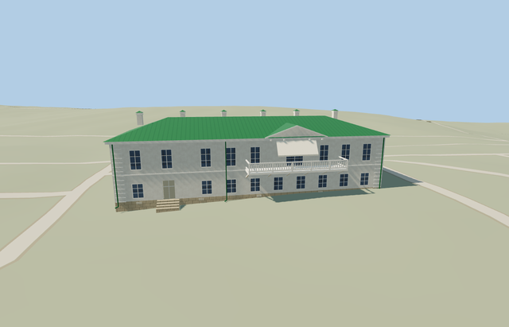

# Leo Tolstoy House — Yasnaya Polyana

Reviewed2026-10-25. **Complete medium-fi house exterior with approximate native fit. The estate collection remains incomplete. Other houses, service/garden structures and bridge have separate identities; the visitor-map inventory must also be reconciled before estate completion.**

## Built and inspected

Complete Leo Tolstoy House exterior at Yasnaya Polyana: actual mapped long house, white two-storey facades, green standing-seam hip roof and six chimneys; front balcony with open rails, supported brackets, triangular pediment and plain light canopy; two physically recessed doors; rear tall arched window above a low polygonal projecting bay, and open wooden porch with supports, lattice rail proxies and treads. Hidden roof/bay inventories and historical thresholds remain approximate. No copied furnishings, inscriptions, artworks, planting or photograph pixels.

Inspected all48 current portable/shared/medium-fi/native frames in labeled contact sheets, plus full-resolution native whole-site, front balcony, rear bay/arched window, porch and entry views. The white long house, green hip roof, six pale chimneys, pediment/canopy, open balcony rails/brackets, low rear bay and open wooden porch read coherently. The native pass led to a closed roof-to-wall joint on the rear bay; final source/runtime/captures share exact pins. Ordinary front/rear pictures and standard PMTiles guided one continuous author/inspect/fix round.

## Shared materials and LODs

Seven roles reuse six existing256px graphs: stucco, wood_plain, stone_limestone, metal_standing_seam, storefront and fabric_canvas. Trim and porch wood share one graph. Metric UVs, linear tints, six nearby draws/one skyline, separate POSITION/NORMAL streams and matching CPU/GPU geometry accounting. No embedded image, private atlas or new graph. Each used graph reads once; unload releases every model geometry.

| Level | Triangles | Bytes | Draws |
| --- | ---: | ---: | ---: |
| skyline | 779 | 70048 | 1 |
| district | 1519 | 127368 | 6 |
| street | 3791 | 304736 | 6 |
| closeup | 4661 | 372812 | 6 |

Four authored LODs779/1519/3791/4661 triangles. Initial skyline+district197416bytes; closeup372812bytes. Skyline retains the main hip roof, six stacks, front pediment/canopy, physical balcony and bracket proxies, two recessed doors, low rear bay, open porch and both supported tread sets. It omits window modules and close lattice/mullion detail. District retains windows and a simplified arched upper window; nearby LODs add lattice, rails, corner bands, vents and pipes. Synthetic contexts test style/LOD/tier coherence; native frames establish approximate geographic fit.

## Native location and limits

Named Дом Толстого museum POI and building way99697450 identify this house separately from Kuzminsky and Volkonsky houses, service/garden buildings and gate towers. X southwest along the southeast front; Z southeast toward the garden. Native east/up/south axes baked into geometry, heading0. Map outline33.13m long by12.22m deep; photo-visible rear bay, porch and balcony are picture-led additions outside the simple map rectangle. Retained standard Protomaps20261020 PMTiles and Mapzen ground, no bespoke terrain or flattening. Outside garden provider[0,6] supplies225.42026112723954m datum. Mapped boundary grades-.358..+.640m; floor+.8m, closed foundation-.55m. Original garden/approach ground, independent estate buildings, roads and ponds remain. Coarse plinth exposure, thresholds and accessibility approximate. Inspected current native front/rear views: mapped house aligns with the garden paths; supported base, both tread sets, low rear bay and open porch read coherently. All242 resident independent buildings and40070.675m² pond water remain unchanged; original garden ground and roads retained. Historic heights, hidden bays and thresholds remain approximate. The one owned mapped house is replaced while242 resident/294 wider independent buildings, original garden/approach ground, roads and40070.675m² pond water remain. Failure keeps all243 originals; every LOD/failure/unload case restores ground/water and releases geometry.

Recognizable medium-fi exterior. Main map rectangle fixes33.13m by12.22m horizontal extent; rear bay/porch and front balcony/pediment are picture-led additions. Original boundary grades-.358..+.640m, floor+.8m and closed foundation-.55m support the house with modest exposed low-side plinth. Heights, hidden bays/roofs, porch enclosure, canopy state, historic thresholds, landscaping and accessibility remain approximate. Map nominal8m is a scale cue, not surveyed height. Trees, furnishings, inscriptions and artwork are not copied. Flat synthetic planes bury some grade-specific base/steps; some detail frames crop the opposite end. Whole/native front/rear views cover the envelope. Other estate structures are still independent procedural context. Physical phone/laptop and dense-city timings remain pending.

## Rebuild and checks

Source-local recipes are inventoried in source.json and registered in asset-build.json. Run `node content/worldgen/source/places/uc/ucd/leo_tolstoy_house_yasnaya_polyana/models/generate-leo-tolstoy-house-yasnaya-polyana.mjs --check`. Selected import/placement checks, strict medium-fi, scene validation, sim30 and recipe lint pass. Six GLBs: zero Khronos errors/warnings;173 actual geometry/contact probes and three PMTiles13/14/15 cases cover the detailed owned house. Sim30 sha256:5e0624c35cf66741e2e2f9b10f30de47955304516821ddc7a5e35893d41d20e9. Exact pins and concise evidence: [qa.json](qa.json).

## References

- [Front photograph](https://commons.wikimedia.org/wiki/File:Tula_YasnayaPolyana_asv2019-09_img11_LNTolstoy_House.jpg), A.Savin,2019-09-13,Free Art License; viewed only.
- [Rear photograph](https://commons.wikimedia.org/wiki/File:Tolstoy_house.jpg), Fuffel777,2016-07-30,CC BY-SA4.0; viewed only.
- [Museum visitor map](https://ypmuseum.ru/map), estate context.
- [Mapped house](https://www.openstreetmap.org/way/99697450), ©OpenStreetMap contributors,ODbL-1.0. Controls and signed axes: [map-frame.json](map-frame.json).
