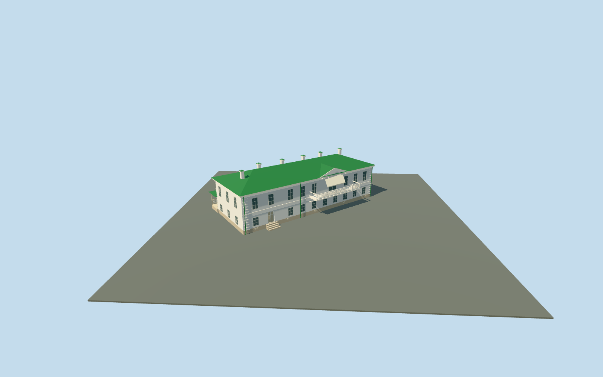

# Leo Tolstoy House — Yasnaya Polyana

Complete Leo Tolstoy House exterior at Yasnaya Polyana: actual mapped long house, white two-storey facades, green standing-seam hip roof and six chimneys; front balcony with open rails, supported brackets, triangular pediment and plain light canopy; two physically recessed doors; rear tall arched window above a low polygonal projecting bay, and open wooden porch with supports, lattice rail proxies and treads. Hidden roof/bay inventories and historical thresholds remain approximate. No copied furnishings, inscriptions, artworks, planting or photograph pixels.

## Evidence and reconstruction

Published dimensions and reconstructed details are separated in spec.json. Primary references:

- [Reference](https://commons.wikimedia.org/wiki/File:Tula_YasnayaPolyana_asv2019-09_img11_LNTolstoy_House.jpg)
- [Reference](https://commons.wikimedia.org/wiki/File:Tolstoy_house.jpg)

Complete Leo Tolstoy House exterior at Yasnaya Polyana: actual mapped long house, white two-storey facades, green standing-seam hip roof and six chimneys; front balcony with open rails, supported brackets, triangular pediment and plain light canopy; two physically recessed doors; rear tall arched window above a low polygonal projecting bay, and open wooden porch with supports, lattice rail proxies and treads. Hidden roof/bay inventories and historical thresholds remain approximate. No copied furnishings, inscriptions, artworks, planting or photograph pixels.

## Model and axes

4,661 triangles; 10,239 vertices; 6 material groups; 428,412 bytes. Native bounds: -22.944, -0.550, -20.599 to 13.542, 10.800, 11.085. Source hash: `sha256:fd97e715b480c159b41576c4d2c49a9733bc66be8552d28b08bb64a46dcfe676`.

{"x":"east","y":"up","z":"south"}

The geographic proposal uses exact-QID OpenStreetMap evidence. Map-derived orientation and estimated architectural details require real-site visual review; preview eligibility is distinct from geographic/fidelity approval. Map attribution: © OpenStreetMap contributors, ODbL-1.0.

## Reproduce

Run `node content/worldgen/source/places/sr/sr2/leo_tolstoy_house_yasnaya_polyana/models/generate-leo-tolstoy-house-yasnaya-polyana.mjs --ids=leo_tolstoy_house_yasnaya_polyana` (or add `--check`). The generator preserves manually edited masters by checking their baseline hashes. Import through the standard authored-model workflow with optimization disabled; then capture all QA cameras, including shared-surface views.

## Pending work

- Complete Leo Tolstoy House exterior at Yasnaya Polyana: actual mapped long house, white two-storey facades, green standing-seam hip roof and six chimneys; front balcony with open rails, supported brackets, triangular pediment and plain light canopy; two physically recessed doors; rear tall arched window above a low polygonal projecting bay, and open wooden porch with supports, lattice rail proxies and treads. Hidden roof/bay inventories and historical thresholds remain approximate. No copied furnishings, inscriptions, artworks, planting or photograph pixels.
- Named Дом Толстого museum POI and building way99697450 identify this house separately from Kuzminsky and Volkonsky houses, service/garden buildings and gate towers. X southwest along the southeast front; Z southeast toward the garden. Native east/up/south axes baked into geometry, heading0. Map outline33.13m long by12.22m deep; photo-visible rear bay, porch and balcony are picture-led additions outside the simple map rectangle.
- Photo-led medium-fi approximation: floor+.8m above the outside provider, body6.8m above floor, green hip roof2.2m rise, six chimney caps about10.3m above floor. Lower storey3m and taller upper storey3.8m; map nominal8m is a scale cue, not a survey. Porch/balcony depth, openings, canvas and roof subdivisions are approximate.
- Retained standard Protomaps20261020 PMTiles and Mapzen ground, no bespoke terrain or flattening. Outside garden provider[0,6] supplies225.42026112723954m datum. Mapped boundary grades-.358..+.640m; floor+.8m, closed foundation-.55m. Original garden/approach ground, independent estate buildings, roads and ponds remain. Coarse plinth exposure, thresholds and accessibility approximate.

This bundle follows the medium-fi standard. Medium-fi appearance and geographic fit are reviewed separately. Hash-bound visual acceptance is recorded separately after capture inspection.
