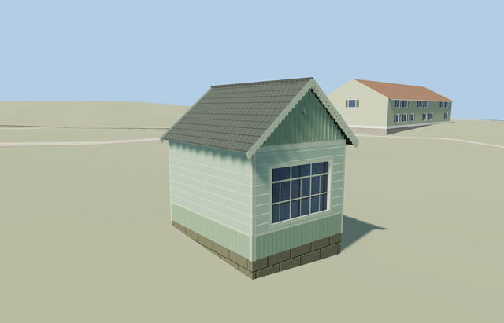

# Pavilion — Yasnaya Polyana

Reviewed2026-10-25. **Complete medium-fi exterior interpretation with approximate native fit and reconstructed hidden entrance. The estate remains incomplete; six other declared members are complete.**

## Built and inspected

Inspected all48 current portable/shared/medium-fi/native frames in labeled sheets, plus full-resolution native gable-window and side-door views. The enclosed mint wooden pavilion reads as a complete small cottage, with a three-part front window, narrow opposite window, actual triangular attic recesses, vertical dado/gables, steep gray roof, toothed verge trim and a recessed side entrance with supported threshold. The continuous pass removed central battens crossing attic vents, replaced a gable-blocking roof closure with two thin closed roof sheets, removed siding trim crossing the door and cooled the shared cedar roof tint. Hidden entrance and native plinth exposure remain approximate.

## Shared materials and LODs

Seven roles reuse five existing256px graphs: wood_plain, wood_vertical, shingle_cedar, storefront and stone_limestone. Mint horizontal walls, pale trim and darker door share wood_plain; dado/gables share wood_vertical. Metric UVs, linear tints, separate POSITION/NORMAL streams, equal CPU/GPU geometry accounting and at most6 nearby draws/one skyline. No embedded image, private atlas or new graph. Every used graph reads once; unload releases all model geometry.

| Level | Triangles | Bytes | Draws |
| --- | ---: | ---: | ---: |
| skyline | 180 | 17412 | 1 |
| district | 306 | 30928 | 6 |
| street | 1218 | 110756 | 6 |
| closeup | 1474 | 133028 | 6 |

Four authored LODs 180/306/1218/1474 triangles. Initial skyline+district 48340bytes; closeup 133028bytes. Skyline retains the complete enclosed body/steep roof, both unequal recessed windows, attic vents, side door and grounded aprons below200triangles. District adds window divisions/corner boards/verges; street/closeup add coarse board seams, gable battens and toothed trim. Synthetic scenes check style/LOD/mode coherence; native views establish approximate geographic fit.

## Native location and limits

Independent pavilion way678672695 matches the small4.3m-long by3.5m-wide map footprint southwest of Tolstoy House. Ordinary front and opposite-gable photographs establish both gables, blank southwest long wall, triangular vents and differing window widths. The Tolstoy House context behind the three-part-window view supports southeast-facing large window and northwest-facing single window. X northeast across width, Z southeast along ridge, baked native axes with heading0 at the unchanged assigned member anchor. Door on hidden northeast side is a plausible reconstruction, not a photographed inventory; absolute gable assignment remains approximate. Retained Protomaps20261020 and Mapzen201x201/6m ground; outside southeast provider[0,4] supplies224.87881894030872m datum. Boundary grades0.011..0.521m, floor+0.7m and foundation-0.2m. Only occupied room and two narrow northeast entry aprons cut ground. Coarse slope exposes a0.18..0.69m plinth, larger than parts of the pictured footing; no terrain flattening or bespoke survey. Original approaches, independent neighbors, roads and ponds remain. Inspected current native whole, large-window/vent, opposite-gable and reconstructed-side-door views. Both gables and the complete mapped envelope read coherently. Removed an inherited sill strip across the recessed door and cooled the shared cedar roof tint. One owned record is replaced while242 resident independent buildings, roads and40070.675m² pond water remain. Gable assignment, unseen entrance, exact historical roof finish and coarse0.18..0.69m exposed footing remain approximate. One owned map record replaced while242 resident/294 wider independent buildings, original approaches, roads and40070.675m² pond water remain. Only occupied room and two side entry aprons cut original ground. Failure retains all243 originals; every LOD/failure/unload restores ground/water and releases geometry. Fixture legacy fields terrainAtUnderCanopy/Center sample ordinary outside grass[-3,0]; this pavilion has no canopy.

Complete enclosed wooden pavilion exterior at Yasnaya Polyana: compact mapped rectangle, pale mint horizontal siding above a vertical-board dado, steep weathered-gray gable roof with overhangs, vertical-board gables, toothed verge and eave trim, three-part southeast window and single northwest window, triangular attic vents and a recessed northeast side entrance. No invented open gazebo, interior exhibit, copied signs, inscriptions, people or photograph pixels. The unseen door and hidden side inventory are explicitly reconstructed. Photo-led approximate dimensions:2.85m wall eaves and1.65m gable rise, roof ridge4.5m above floor, low0.66m vertical-board dado and small attic vents. Three-part front window2.3x1.5m; opposite single window0.62x1.3m. Hidden side entrance0.85x2.03m, support/threshold levels and exact historical material/trim measurements remain approximate. Retained Protomaps20261020 and Mapzen201x201/6m ground; outside southeast provider[0,4] supplies224.87881894030872m datum. Boundary grades0.011..0.521m, floor+0.7m and foundation-0.2m. Only occupied room and two narrow northeast entry aprons cut ground. Coarse slope exposes a0.18..0.69m plinth, larger than parts of the pictured footing; no terrain flattening or bespoke survey. Original approaches, independent neighbors, roads and ponds remain. Ordinary pictures establish the large and small gable windows, blank southwest wall, board pattern and roof/verge silhouette. The unseen northeast door is deliberately reconstructed. Southeast/northwest gable assignment follows Tolstoy House context and remains approximate. Shared cedar roof texture approximates an unresolved weathered-gray roof finish. Signs, fine carvings and interior exhibit are omitted. Fixed synthetic planes partly bury grade-specific plinth/aprons; native views cover the whole envelope. Other estate structures remain procedural context in this isolated fixture. Physical phone/laptop and dense-city timings remain pending.

## Rebuild and checks

Source-local recipes inventoried in source.json and registered in asset-build.json. Source generator --check, targeted import, forced derivative generation, placement, strict medium-fi, scene/sim30 and recipe checks pass. Six GLBs: zero Khronos errors/warnings;120 actual geometry/contact probes. One PMTiles15 case covers the owned way; zoom13/14 have no overlapping building feature. Exact pins: [qa.json](qa.json).

## References

- [Close oblique](https://commons.wikimedia.org/wiki/File:Tula_YasnayaPolyana_asv2019-09_img08_pavilion.jpg), A.Savin, Wikipedia,2019-09-13,Free Art License1.3; viewed only.
- [Opposite gable](https://commons.wikimedia.org/wiki/File:Павильон_в_Ясной_Поляне.jpg), Ted.ns/EXIF OLGA MAKSIMOVA,2021-12-19,CC BY-SA4.0; viewed only.
- [Winter context](https://commons.wikimedia.org/wiki/File:Ясная_Поляна._Фото_20.jpg), Alina Vozna,2018-02-07,CC BY-SA4.0; viewed only.
- [Mapped pavilion](https://www.openstreetmap.org/way/678672695), ©OpenStreetMap contributors,ODbL-1.0. Controls: [map-frame.json](map-frame.json). No copied photograph pixels.
