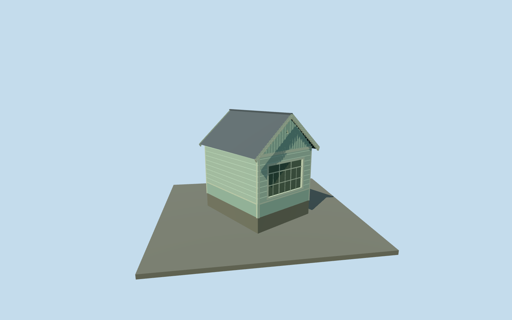

# Pavilion — Yasnaya Polyana

Complete enclosed wooden pavilion exterior at Yasnaya Polyana: compact mapped rectangle, pale mint horizontal siding above a vertical-board dado, steep weathered-gray gable roof with overhangs, vertical-board gables, toothed verge and eave trim, three-part southeast window and single northwest window, triangular attic vents and a recessed northeast side entrance. No invented open gazebo, interior exhibit, copied signs, inscriptions, people or photograph pixels. The unseen door and hidden side inventory are explicitly reconstructed.

## Evidence and reconstruction

Published dimensions and reconstructed details are separated in spec.json. Primary references:

- [Reference](https://commons.wikimedia.org/wiki/File:Tula_YasnayaPolyana_asv2019-09_img08_pavilion.jpg)
- [Reference](https://commons.wikimedia.org/wiki/File:Павильон_в_Ясной_Поляне.jpg)
- [Reference](https://commons.wikimedia.org/wiki/File:Ясная_Поляна._Фото_20.jpg)

Complete enclosed wooden pavilion exterior at Yasnaya Polyana: compact mapped rectangle, pale mint horizontal siding above a vertical-board dado, steep weathered-gray gable roof with overhangs, vertical-board gables, toothed verge and eave trim, three-part southeast window and single northwest window, triangular attic vents and a recessed northeast side entrance. No invented open gazebo, interior exhibit, copied signs, inscriptions, people or photograph pixels. The unseen door and hidden side inventory are explicitly reconstructed.

## Model and axes

1,474 triangles; 3,270 vertices; 6 material groups; 139,264 bytes. Native bounds: -2.982, -0.200, -3.080 to 3.053, 5.255, 3.202. Source hash: `sha256:4677adfc9f2f55f3a8ced46e831ee2cd997ebb539c2d0d5ab5ad5afc32092a6a`.

{"x":"east","y":"up","z":"south"}

The geographic proposal uses exact-QID OpenStreetMap evidence. Map-derived orientation and estimated architectural details require real-site visual review; preview eligibility is distinct from geographic/fidelity approval. Map attribution: © OpenStreetMap contributors, ODbL-1.0.

## Reproduce

Run `node content/worldgen/source/places/uc/ucd/pavilion_yasnaya_polyana/models/generate-pavilion-yasnaya-polyana.mjs --ids=pavilion_yasnaya_polyana` (or add `--check`). The generator preserves manually edited masters by checking their baseline hashes. Import through the standard authored-model workflow with optimization disabled; then capture all QA cameras, including shared-surface views.

## Pending work

- Complete enclosed wooden pavilion exterior at Yasnaya Polyana: compact mapped rectangle, pale mint horizontal siding above a vertical-board dado, steep weathered-gray gable roof with overhangs, vertical-board gables, toothed verge and eave trim, three-part southeast window and single northwest window, triangular attic vents and a recessed northeast side entrance. No invented open gazebo, interior exhibit, copied signs, inscriptions, people or photograph pixels. The unseen door and hidden side inventory are explicitly reconstructed.
- Independent pavilion way678672695 matches the small4.3m-long by3.5m-wide map footprint southwest of Tolstoy House. Ordinary front and opposite-gable photographs establish both gables, blank southwest long wall, triangular vents and differing window widths. The Tolstoy House context behind the three-part-window view supports southeast-facing large window and northwest-facing single window. X northeast across width, Z southeast along ridge, baked native axes with heading0 at the unchanged assigned member anchor. Door on hidden northeast side is a plausible reconstruction, not a photographed inventory; absolute gable assignment remains approximate.
- Photo-led approximate dimensions:2.85m wall eaves and1.65m gable rise, roof ridge4.5m above floor, low0.66m vertical-board dado and small attic vents. Three-part front window2.3x1.5m; opposite single window0.62x1.3m. Hidden side entrance0.85x2.03m, support/threshold levels and exact historical material/trim measurements remain approximate.
- Retained Protomaps20261020 and Mapzen201x201/6m ground; outside southeast provider[0,4] supplies224.87881894030872m datum. Boundary grades0.011..0.521m, floor+0.7m and foundation-0.2m. Only occupied room and two narrow northeast entry aprons cut ground. Coarse slope exposes a0.18..0.69m plinth, larger than parts of the pictured footing; no terrain flattening or bespoke survey. Original approaches, independent neighbors, roads and ponds remain.

This bundle follows the medium-fi standard. Medium-fi appearance and geographic fit are reviewed separately. Hash-bound visual acceptance is recorded separately after capture inspection.
