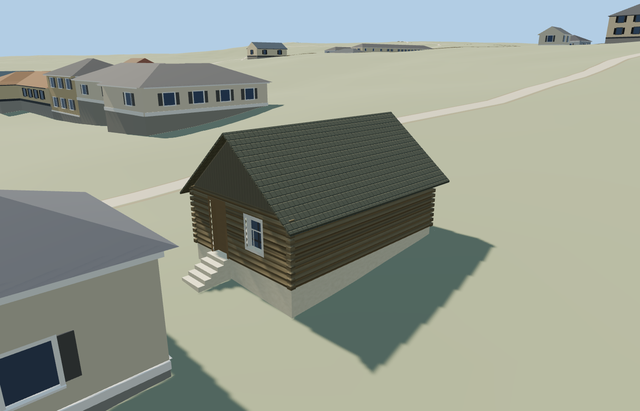

# Poultry House — Yasnaya Polyana

Reviewed2026-10-25. **Complete medium-fi poultry-house interpretation with inferred map/photo assignment and approximate terrain contact. The estate remains incomplete.**

## Built and inspected

Inspected48 current portable/shared/medium-fi/native frames in the continuous author/inspect/fix pass, including full-resolution door/window, log corners, roof/eaves and plinth/stair views. Complete small log shell, closed gray pitched roof and timber gables, genuine recessed brown door at left and white-framed divided window at right, corner log ends, pale plinth and five supported approach treads. Corrected the door trim from white to brown and moved the front review camera out of the retained neighboring shed.

## Shared materials and LODs

Seven roles merge into six existing256px shared graphs: wood_log, wood_plain, wood_vertical, shingle_cedar, plaster_lime and storefront. Brown timber, white window frame, gray roof and pale plinth remain coherent with native procedural buildings. Metric UVs, linear tints, separate vertex streams and at most6draws. No embedded bitmap, private atlas or new graph; each graph reads once and unload releases all geometry.

| Level | Triangles | Bytes | Draws |
| --- | ---: | ---: | ---: |
| skyline | 156 | 15424 | 1 |
| district | 172 | 20688 | 6 |
| street | 710 | 65500 | 6 |
| closeup | 1010 | 90052 | 6 |

Four authored LODs 156/172/710/1010 triangles; initial skyline+district 36112 bytes. Skyline retains the complete roof, gable door/window and stair silhouette below1000triangles. District adds trim; near levels add coarse log relief and corner ends. Mode/distance/lighting frames are synthetic comparisons; physical phone/laptop timings remain pending.

## Native placement and limits

Two adjacent retained one-story shed footprints are candidates for the small gray-gabled poultry house and longer red-hipped equipment shed shown together in the ordinary museum photograph. Sizes and separation support this assignment. The retained long axes are nearly parallel; the photograph may show different faces through perspective/parallax, and no camera position is known. Specific poultry/equipment function and absolute front assignment remain explicit photo/relative-context inferences; the public map names both only as sheds. Use the photographed gray roof on the small building despite the generic map red-roof tag. This small mapped footprint supplies8.46x5.72m scale; localX southeast is the inferred door/window gable. Its mapped neighbor remains independent. Source axes are baked east/up/south, heading0. Retained Protomaps20261020 and standard Mapzen201x201/6m terrain. Outside control[6.198225021976045,0] gives215.71102437248442m datum. Preserve original DEM samples, the separate neighboring equipment shed, paths and all pond geometry. Replace only building35184539471089 and cut only its occupied footprint. Solid steps seat into native ground without flattening or broad yard cuts; exact historic levels/accessibility are reconstructed. Inspected the actual native roof/gables, log corners, white plinth and five supported steps. The coarse terrain exposes a larger plinth and stair than the photograph; exact historical levels remain approximate. Reframed the review cameras to preserve the neighboring shed without placing the camera inside it. Original garden/approach ground stays intact outside the owned footprint. Only native building35184539471089 is replaced; the larger neighboring shed stays independent. All242resident/294wider independent buildings, original garden approaches/roads, DEM samples and40070.675m²water remain. Failure retains all243original buildings; unload restores ground after water unload.

Complete independent small log poultry-house interpretation: slightly irregular mapped walls, white plinth, brown recessed gable door and white-framed divided window, closed timber gables, steep weathered-gray roof with closed eave/fascia thickness, corner log ends and a supported approach stair. Use shared wood_log, wood_plain, wood_vertical, shingle_cedar, plaster_lime and storefront surfaces. The companion red-roof shed remains a separate model; no trees, copied signs, people or photo pixels are baked in. Photo-led wall2.45m, gray pitched ridge4.8m above floor; brown door.98x2.12m at left and white-framed.88x1.13m window at right. Floor 0.9195721926610361m above outside datum and.15m above the highest retained corner. Coarse ground varies.88m across the footprint; exposed white plinth is.15..1.03m and is larger than parts of the photo. 5supported approach treads reconcile the native grade. Roof finish/pitch, course/bay counts, hidden rear and historic thresholds remain approximations. Poultry-house identity and front assignment are inferred from the paired museum photograph, footprint sizes/separation and relative estate context; public map tags name both structures only as sheds. The gray roof follows the photograph despite a generic red-roof map tag. Its shared cedar graph approximates the uncertain historic roof finish. Native ground exposes a larger plinth/stair than the photo; do not treat those levels, course count or thresholds as surveyed. Hidden rear details remain reconstructed; estate service inventory is unfinished.

## Rebuild and checks

Three deterministic source-local programs are registered in source.json and asset-build.json. Targeted generation/import, four derivatives, generator --check, strict medium-fi, scene validation and30-tick simulation passed. Six GLBs: zero Khronos errors/warnings;90 mesh probes and48 inspected frames. Its owned map footprint passes at detailed level15; no overlapping building case occurs at13/14. Exact pins: [qa.json](qa.json).

## References

[Museum poultry-house/equipment-shed photograph](https://www.ypmuseum.ru/object/ptichnik-i-inventarnyy-saray), photographer/date unstated, viewed only. No photograph pixels retained or used as texture. [Mapped independent footprint](https://www.openstreetmap.org/way/167382257), OpenStreetMap contributors,ODbL-1.0. Standard Mapzen terrain retained.
