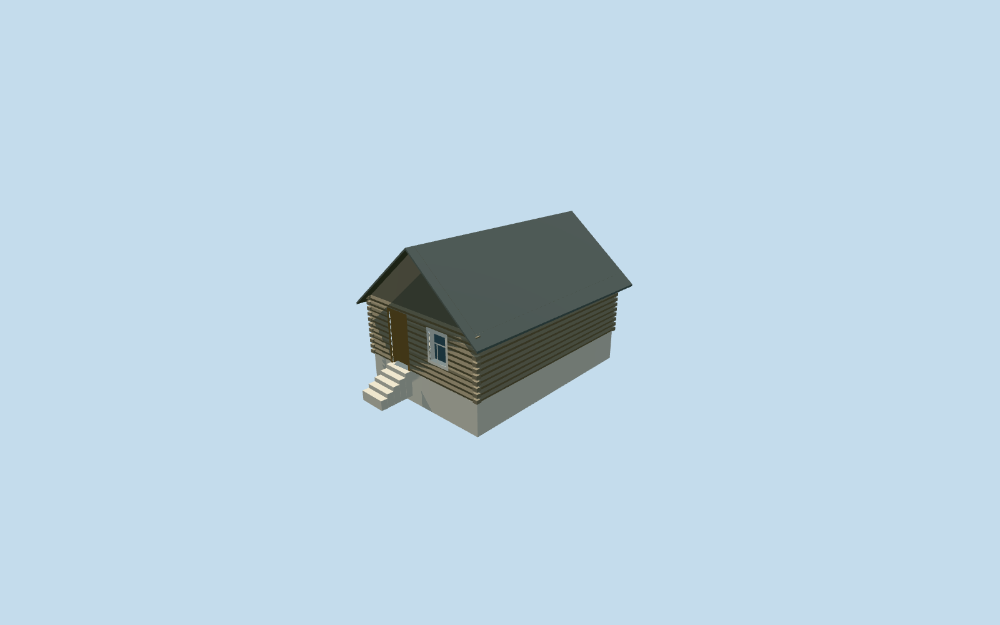

# Poultry House — Yasnaya Polyana

Complete independent small log poultry-house interpretation: slightly irregular mapped walls, white plinth, brown recessed gable door and white-framed divided window, closed timber gables, steep weathered-gray roof with closed eave/fascia thickness, corner log ends and a supported approach stair. Use shared wood_log, wood_plain, wood_vertical, shingle_cedar, plaster_lime and storefront surfaces. The companion red-roof shed remains a separate model; no trees, copied signs, people or photo pixels are baked in.

## Evidence and reconstruction

Published dimensions and reconstructed details are separated in spec.json. Primary references:

- [Reference](https://www.ypmuseum.ru/object/ptichnik-i-inventarnyy-saray)

Complete independent small log poultry-house interpretation: slightly irregular mapped walls, white plinth, brown recessed gable door and white-framed divided window, closed timber gables, steep weathered-gray roof with closed eave/fascia thickness, corner log ends and a supported approach stair. Use shared wood_log, wood_plain, wood_vertical, shingle_cedar, plaster_lime and storefront surfaces. The companion red-roof shed remains a separate model; no trees, copied signs, people or photo pixels are baked in.

## Model and axes

1,010 triangles; 2,226 vertices; 6 material groups; 96,112 bytes. Native bounds: -5.437, -0.364, -5.644 to 5.441, 5.720, 5.562. Source hash: `sha256:5b7f94a50aa1bf7a1aa28d06ce21cd4980c7ee8c3c8c72a081821066039467bc`.

{"x":"east","y":"up","z":"south"}

The geographic proposal uses exact-QID OpenStreetMap evidence. Map-derived orientation and estimated architectural details require real-site visual review; preview eligibility is distinct from geographic/fidelity approval. Map attribution: © OpenStreetMap contributors, ODbL-1.0.

## Reproduce

Run `node content/worldgen/source/places/uc/ucd/poultry_house_yasnaya_polyana/models/generate-poultry-house-yasnaya-polyana.mjs --ids=poultry_house_yasnaya_polyana` (or add `--check`). The generator preserves manually edited masters by checking their baseline hashes. Import through the standard authored-model workflow with optimization disabled; then capture all QA cameras, including shared-surface views.

## Pending work

- Complete independent small log poultry-house interpretation: slightly irregular mapped walls, white plinth, brown recessed gable door and white-framed divided window, closed timber gables, steep weathered-gray roof with closed eave/fascia thickness, corner log ends and a supported approach stair. Use shared wood_log, wood_plain, wood_vertical, shingle_cedar, plaster_lime and storefront surfaces. The companion red-roof shed remains a separate model; no trees, copied signs, people or photo pixels are baked in.
- Two adjacent retained one-story shed footprints are candidates for the small gray-gabled poultry house and longer red-hipped equipment shed shown together in the ordinary museum photograph. Sizes and separation support this assignment. The retained long axes are nearly parallel; the photograph may show different faces through perspective/parallax, and no camera position is known. Specific poultry/equipment function and absolute front assignment remain explicit photo/relative-context inferences; the public map names both only as sheds. Use the photographed gray roof on the small building despite the generic map red-roof tag. This small mapped footprint supplies8.46x5.72m scale; localX southeast is the inferred door/window gable. Its mapped neighbor remains independent. Source axes are baked east/up/south, heading0.
- Photo-led wall2.45m, gray pitched ridge4.8m above floor; brown door.98x2.12m at left and white-framed.88x1.13m window at right. Floor 0.9195721926610361m above outside datum and.15m above the highest retained corner. Coarse ground varies.88m across the footprint; exposed white plinth is.15..1.03m and is larger than parts of the photo. 5supported approach treads reconcile the native grade. Roof finish/pitch, course/bay counts, hidden rear and historic thresholds remain approximations.
- Retained Protomaps20261020 and standard Mapzen201x201/6m terrain. Outside control[6.198225021976045,0] gives215.71102437248442m datum. Preserve original DEM samples, the separate neighboring equipment shed, paths and all pond geometry. Replace only building35184539471089 and cut only its occupied footprint. Solid steps seat into native ground without flattening or broad yard cuts; exact historic levels/accessibility are reconstructed.

This bundle follows the medium-fi standard. Medium-fi appearance and geographic fit are reviewed separately. Hash-bound visual acceptance is recorded separately after capture inspection.
