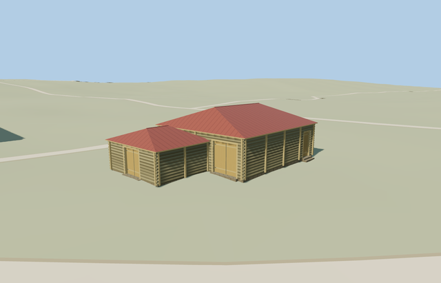

# Riga Threshing Barn — Yasnaya Polyana

Reviewed2026-10-25. **Complete medium-fi barn exterior with confirmed named footprint and photo-led stepped plan. The estate remains incomplete.**

## Built and inspected

Inspected 48 current portable/shared/medium-fi/native frames in the same author/inspect/fix pass. Complete higher log main barn and inset lower annex, two closed red hips with eave undersides, three genuinely recessed timber doors, vertical bracing, coarse log courses/corner ends and four supported threshold treads. Whole, entry-recess, side-door and rear views show the complete exterior; no exhibition contents are implied.

## Shared materials and LODs

Six existing 256px shared graphs: wood_log, wood_plain, wood_vertical, metal_standing_seam, stone_sandstone and metal_painted. Metric UVs, restrained linear tints and separate vertex streams. No embedded images, copied photo pixels, private atlas or new graph. District uses five draws, street/closeup six; every graph reads once in the native scene and unload releases all model geometry.

| Level | Triangles | Bytes | Draws |
| --- | ---: | ---: | ---: |
| skyline | 178 | 17072 | 1 |
| district | 572 | 55380 | 5 |
| street | 1768 | 159632 | 6 |
| closeup | 2412 | 215052 | 6 |

Four source-authored LODs: 178/572/1768/2412 triangles. Initial skyline+district 72452 bytes. Skyline keeps both roof heights and all three recessed entrances; district adds bracing/shared surfaces and near levels add log relief and door hardware. Synthetic lighting/distance/transition views pass; physical laptop/phone timings remain pending.

## Native placement and limits

Confirmed named OSM way167382241, native building35184539471073, at[37.52248004078865,54.074947841126]. Footprint axes are baked east/up/south, heading0; southwest end and southeast side assignments remain photo-led. Two occupied ground masks preserve the open main-entry recess. All242resident/294wider independent buildings, original roads, DEM samples and40070.675m²native water remain. Failed loading retains all243original buildings; unload restores ground and releases geometry. Detailed level15 ownership and generalized level14 clipping pass.

The named map footprint confirms identity. Its17.11x10.76m rectangle generalizes the photo-led stepped main/annex plan; the internal split and inset are reconstructed. Main wall/ridge3.35/5.25m and annex2.6/3.78m, door dimensions, bracing census, hidden rear and historical threshold levels are visual estimates. Standard native ground varies0.23m, so one level floor fits without sloped-floor/roof adaptation. No exact surveyed facade assignment, historical level accuracy or navigable exhibition interior is claimed. The estate inventory remains open for the icehouse/white-kitchen/woodshed group.

## Rebuild and checks

Three deterministic source-local programs are registered in source.json and asset-build.json. Targeted generation/import, four derivatives, generator --check, strict medium-fi, scene validation and30-tick simulation passed. Six GLBs: zero Khronos errors/warnings;112 mesh probes and48 inspected frames. Detailed level15 ownership and generalized level14 area clipping pass; no overlapping case occurs at13. Exact pins: [qa.json](qa.json).

## References

[Museum barn photographs](https://www.ypmuseum.ru/object/riga), photographer/date unstated, viewed only. No photograph pixels retained or used as texture. [Mapped independent footprint](https://www.openstreetmap.org/way/167382241), OpenStreetMap contributors,ODbL-1.0. Standard Mapzen terrain retained.
