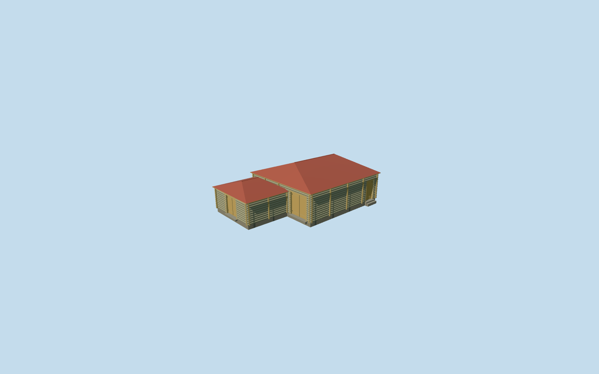

# Riga Threshing Barn — Yasnaya Polyana

Complete independent medium-fi riga/threshing barn: higher braced log main room and inset lower attached bay, two closed red hipped metal roofs, three genuinely recessed boarded entrances, coarse log courses, pale timber vertical bracing, corner ends and supported low thresholds. Existing shared materials only; hidden exterior details are reconstructed. No copied photograph pixels, signage, exhibition contents, trees or people.

## Evidence and reconstruction

Published dimensions and reconstructed details are separated in spec.json. Primary references:

- [Reference](https://www.ypmuseum.ru/object/riga)

Complete independent medium-fi riga/threshing barn: higher braced log main room and inset lower attached bay, two closed red hipped metal roofs, three genuinely recessed boarded entrances, coarse log courses, pale timber vertical bracing, corner ends and supported low thresholds. Existing shared materials only; hidden exterior details are reconstructed. No copied photograph pixels, signage, exhibition contents, trees or people.

## Model and axes

2,412 triangles; 5,414 vertices; 6 material groups; 227,740 bytes. Native bounds: -10.307, -0.245, -9.662 to 10.307, 5.535, 6.535. Source hash: `sha256:1a1651446b625efd21f383984bf344470b6a84efcb43ca3f07c6dc706c003188`.

{"x":"east","y":"up","z":"south"}

The geographic proposal uses exact-QID OpenStreetMap evidence. Map-derived orientation and estimated architectural details require real-site visual review; preview eligibility is distinct from geographic/fidelity approval. Map attribution: © OpenStreetMap contributors, ODbL-1.0.

## Reproduce

Run `node content/worldgen/source/places/uc/ucd/riga_yasnaya_polyana/models/generate-riga-yasnaya-polyana.mjs --ids=riga_yasnaya_polyana` (or add `--check`). The generator preserves manually edited masters by checking their baseline hashes. Import through the standard authored-model workflow with optimization disabled; then capture all QA cameras, including shared-surface views.

## Pending work

- Complete independent medium-fi riga/threshing barn: higher braced log main room and inset lower attached bay, two closed red hipped metal roofs, three genuinely recessed boarded entrances, coarse log courses, pale timber vertical bracing, corner ends and supported low thresholds. Existing shared materials only; hidden exterior details are reconstructed. No copied photograph pixels, signage, exhibition contents, trees or people.
- Public OpenStreetMap way167382241 explicitly names this footprint Рига and tags a one-story building with red roof. Retained PMTiles supplies the independent footprint. The museum exterior photograph shows a higher main log barn with lower attached bay, red hipped roofs, large boarded doors and vertical timber bracing. Native axes are baked east/up/south; the southwest end and southeast side facade assignments are inferred from the photograph and path context, not surveyed. The17.11x10.76m map rectangle generalizes the stepped plan. The photo-led main room and inset lower annex occupy only their individual footprints; the open entry recess keeps its original soil.
- Photo-led main log wall3.35m/red hip ridge5.25m; lower annex wall2.6m/ridge3.78m above one level floor. The internal split, annex inset, door dimensions, bracing census and unseen rear remain reconstructed. Retained ground varies only0.23m across the footprint, so no sloped roof/floor adaptation is used. Floor0.2621166822335397m above outside datum and modest exposed plinth approximate native contact; no surveyed historical threshold claim.
- Retained Protomaps20261020 and standard Mapzen201x201/6m grid. Outside southeast control[0,7.378085874850401] gives datum223.9371359199232m. Replace only named riga building35184539471073. Keep every original DEM sample, road, pond and independent building. Ground cutouts follow the two occupied parts, preserving the entry recess; small solid threshold treads seat into unchanged soil.

This bundle follows the medium-fi standard. Medium-fi appearance and geographic fit are reviewed separately. Hash-bound visual acceptance is recorded separately after capture inspection.
