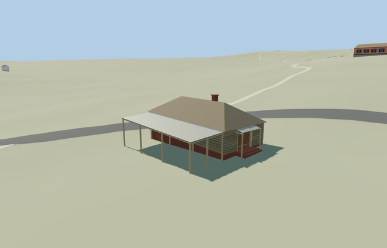

# Smithy and Carpentry — Yasnaya Polyana

Reviewed2026-10-25. **Complete medium-fi exterior interpretation with approximate native fit and map-led hidden rear extent. The estate remains incomplete; five other declared members are complete.**

## Built and inspected

Inspected all48 current portable/shared/medium-fi/native frames in labeled sheets, plus full-resolution native front/hood, open-canopy and rear views. The complete log workshop, weathered-board hip roof, single brick chimney, warm recessed double door, supported shallow hood and adjacent open sheet-roof canopy read coherently. The continuous pass seated pitched canopy crossbeams below the roof and darkened the main roof to fit the reference boards. All11 supports remain in every LOD. Hidden rear extent and coarse downhill plinth exposure remain approximate.

## Shared materials and LODs

Six roles reuse five existing256px graphs: wood_log, wood_vertical, metal_corrugated, wood_plain and brick. Timber frame and darker door share wood_plain; plinth and chimney share brick. Metric UVs, linear tints, separate POSITION/NORMAL streams, equal CPU/GPU geometry accounting and at most5 nearby draws/one skyline. No embedded image, private atlas or new graph. Every used graph reads once; unload releases all model geometry.

| Level | Triangles | Bytes | Draws |
| --- | ---: | ---: | ---: |
| skyline | 252 | 24248 | 1 |
| district | 320 | 32340 | 5 |
| street | 996 | 88556 | 5 |
| closeup | 1096 | 96356 | 5 |

Four authored LODs 252/320/996/1096 triangles. Initial skyline+district 56588bytes; closeup 96356bytes. Skyline retains the full map-led room/roof envelope, brick chimney, physically recessed double door, supported hood, open lean-to and all11 support posts. District adds trim and roof beams; street/closeup add coarse log courses/ends and simple door bands. The multi-part canopy/hood/support silhouette stays below the1k authored-structure ceiling. Synthetic scenes check style/LOD/mode coherence; native views establish approximate geographic fit.

## Native location and limits

Named Кузня и плотницкая POI and way617403594 identify this range independently from the other estate buildings. The mapped10.7m frontage and14.3m depth describe the whole room/canopy envelope. The photo-visible log room occupies the right frontage and the open lean-to the left; hidden depth is reconstructed along the map outline. X northwest across the northeast approach; Z northeast toward the front door, native east/up/south axes baked with heading0 at the unchanged assigned member anchor. This is an explicit photo/map interpretation of the complete mapped exterior, not a survey or claim that every hidden bay has been photographed. Retained Protomaps20261020 and Mapzen201x201/6m ground; outside northeast approach provider[2.3,10] supplies205.2228043360681m datum. Whole boundary grades-1.487..0.038m, floor+0.2m and closed room foundation/support bottoms-1.7m. Original ground remains under the open side canopy; occupied room,11 post feet and two entry aprons alone cut it. Coarse downhill plinth/support exposure can reach about1.7m, higher than the visible front-photo plinth; hidden levels remain approximate. No flattening or bespoke terrain. Independent neighbors, approach, roads and ponds remain. Inspected native whole/front-door/open-canopy/rear views. The road wraps around the northwest and southwest sides; the northeast door approach and valley-facing view remain a photo/map interpretation, rather than being rotated solely toward the nearest road segment. The room/roof, hood, brick chimney and open lean-to read coherently; original ground remains beneath the canopy. One owned record is replaced while242 resident independent buildings, roads and40070.675m² pond water remain. Hidden rear extent and downhill plinth exposure remain approximate. One owned map record is replaced while242 resident/294 wider independent buildings, original approach, roads and40070.675m² pond water remain. Ground stays beneath the open side canopy; only the occupied room,11 timber post feet and two entrance aprons are cut. Failure retains all243 originals; every LOD/failure/unload restores ground/water and releases geometry.

Complete exterior interpretation of the mapped smithy/carpentry range at Yasnaya Polyana: gray log workshop on a low red-brick plinth, broad weathered-board hip roof, single red-brick chimney, recessed warm wooden double door beneath a shallow supported hood, and a genuinely open timber-post lean-to alongside the room. Original map outline anchors the complete envelope; the long rear extent is map-led and hidden in the front photographs. All canopy and hood supports remain present in every LOD. No invented forge interior, machinery, merchandise, copied signs, inscriptions, artwork, people or photograph pixels. Hidden rear doors/windows and exact historical roof/support inventory remain approximate. Approximate photo-led scale: log eaves2.55m, board hip rise2.2m and one capped brick chimney to5.38m above floor. Double doorway2.12m; shallow hood at2.25..2.45m and adjacent lean-to2.2..2.45m. Hidden rear range, canopy depth, post inventory, roof condition, thresholds and accessibility approximate; no exact mapped height is supplied. Retained Protomaps20261020 and Mapzen201x201/6m ground; outside northeast approach provider[2.3,10] supplies205.2228043360681m datum. Whole boundary grades-1.487..0.038m, floor+0.2m and closed room foundation/support bottoms-1.7m. Original ground remains under the open side canopy; occupied room,11 post feet and two entry aprons alone cut it. Coarse downhill plinth/support exposure can reach about1.7m, higher than the visible front-photo plinth; hidden levels remain approximate. No flattening or bespoke terrain. Independent neighbors, approach, roads and ponds remain. Front pictures establish the log room, hip/chimney, double door/hood and left open canopy; trees/fence and perspective conceal rear depth. The mapped14.3m extent is therefore an explicit reconstruction of hidden room/canopy depth, not an exact inventory from a rear photo. Absolute front assignment follows the photographed approach/valley and the retained road wrapping northwest/southwest, not merely the closest road. Hidden doors/windows, roof/post inventory, thresholds and accessibility remain approximate. Fixed synthetic planes partly bury grade-specific plinth/aprons; whole/native views cover the envelope. Other estate structures remain procedural context in this isolated fixture. Physical phone/laptop and dense-city timings remain pending.

## Rebuild and checks

Source-local recipes are inventoried in source.json and registered in asset-build.json. Run the source-local generator with --check; targeted import, forced derivative generation, placement, strict medium-fi, scene/sim30 and recipe checks pass. Six GLBs: zero Khronos errors/warnings;174 actual geometry/contact probes. Two PMTiles14/15 cases cover the owned range; the zoom13 extract has no overlapping building feature. Exact pins: [qa.json](qa.json).

## References

- [Museum smithy page](https://ypmuseum.ru/object/kuznya?lang=en) and its [exterior picture](https://ypmuseum.ru/data/objects/21/objectsi_36_3kai.jpg), photographer/date unspecified; viewed only.
- [Commons front/approach picture](https://commons.wikimedia.org/wiki/File:SqHSexyqV4o.jpg), Алёна Клушина,2018-09-10,CC BY-SA4.0; viewed only.
- [Mapped smithy/carpentry](https://www.openstreetmap.org/way/617403594), ©OpenStreetMap contributors,ODbL-1.0. Controls: [map-frame.json](map-frame.json). No copied photograph pixels.
