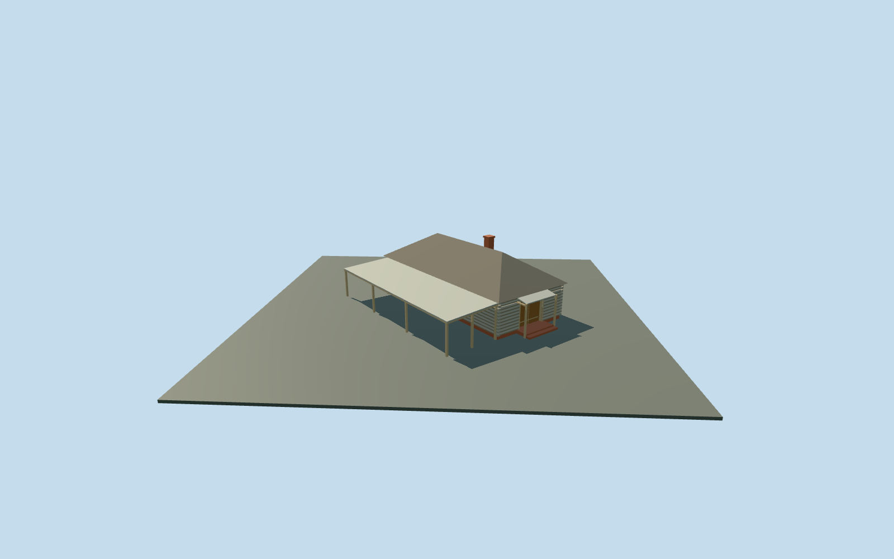

# Smithy and Carpentry — Yasnaya Polyana

Complete exterior interpretation of the mapped smithy/carpentry range at Yasnaya Polyana: gray log workshop on a low red-brick plinth, broad weathered-board hip roof, single red-brick chimney, recessed warm wooden double door beneath a shallow supported hood, and a genuinely open timber-post lean-to alongside the room. Original map outline anchors the complete envelope; the long rear extent is map-led and hidden in the front photographs. All canopy and hood supports remain present in every LOD. No invented forge interior, machinery, merchandise, copied signs, inscriptions, artwork, people or photograph pixels. Hidden rear doors/windows and exact historical roof/support inventory remain approximate.

## Evidence and reconstruction

Published dimensions and reconstructed details are separated in spec.json. Primary references:

- [Reference](https://ypmuseum.ru/object/kuznya?lang=en)
- [Reference](https://commons.wikimedia.org/wiki/File:SqHSexyqV4o.jpg)

Complete exterior interpretation of the mapped smithy/carpentry range at Yasnaya Polyana: gray log workshop on a low red-brick plinth, broad weathered-board hip roof, single red-brick chimney, recessed warm wooden double door beneath a shallow supported hood, and a genuinely open timber-post lean-to alongside the room. Original map outline anchors the complete envelope; the long rear extent is map-led and hidden in the front photographs. All canopy and hood supports remain present in every LOD. No invented forge interior, machinery, merchandise, copied signs, inscriptions, artwork, people or photograph pixels. Hidden rear doors/windows and exact historical roof/support inventory remain approximate.

## Model and axes

1,096 triangles; 2,450 vertices; 5 material groups; 104,732 bytes. Native bounds: -9.355, -1.700, -9.052 to 8.975, 5.580, 8.756. Source hash: `sha256:e2d3472a3ef46760ec01c70c8f15267b07e28bc90804eef479b1853eb5537d73`.

{"x":"east","y":"up","z":"south"}

The geographic proposal uses exact-QID OpenStreetMap evidence. Map-derived orientation and estimated architectural details require real-site visual review; preview eligibility is distinct from geographic/fidelity approval. Map attribution: © OpenStreetMap contributors, ODbL-1.0.

## Reproduce

Run `node content/worldgen/source/places/uc/ucd/smithy_carpentry_yasnaya_polyana/models/generate-smithy-carpentry-yasnaya-polyana.mjs --ids=smithy_carpentry_yasnaya_polyana` (or add `--check`). The generator preserves manually edited masters by checking their baseline hashes. Import through the standard authored-model workflow with optimization disabled; then capture all QA cameras, including shared-surface views.

## Pending work

- Complete exterior interpretation of the mapped smithy/carpentry range at Yasnaya Polyana: gray log workshop on a low red-brick plinth, broad weathered-board hip roof, single red-brick chimney, recessed warm wooden double door beneath a shallow supported hood, and a genuinely open timber-post lean-to alongside the room. Original map outline anchors the complete envelope; the long rear extent is map-led and hidden in the front photographs. All canopy and hood supports remain present in every LOD. No invented forge interior, machinery, merchandise, copied signs, inscriptions, artwork, people or photograph pixels. Hidden rear doors/windows and exact historical roof/support inventory remain approximate.
- Named Кузня и плотницкая POI and way617403594 identify this range independently from the other estate buildings. The mapped10.7m frontage and14.3m depth describe the whole room/canopy envelope. The photo-visible log room occupies the right frontage and the open lean-to the left; hidden depth is reconstructed along the map outline. X northwest across the northeast approach; Z northeast toward the front door, native east/up/south axes baked with heading0 at the unchanged assigned member anchor. This is an explicit photo/map interpretation of the complete mapped exterior, not a survey or claim that every hidden bay has been photographed.
- Approximate photo-led scale: log eaves2.55m, board hip rise2.2m and one capped brick chimney to5.38m above floor. Double doorway2.12m; shallow hood at2.25..2.45m and adjacent lean-to2.2..2.45m. Hidden rear range, canopy depth, post inventory, roof condition, thresholds and accessibility approximate; no exact mapped height is supplied.
- Retained Protomaps20261020 and Mapzen201x201/6m ground; outside northeast approach provider[2.3,10] supplies205.2228043360681m datum. Whole boundary grades-1.487..0.038m, floor+0.2m and closed room foundation/support bottoms-1.7m. Original ground remains under the open side canopy; occupied room,11 post feet and two entry aprons alone cut it. Coarse downhill plinth/support exposure can reach about1.7m, higher than the visible front-photo plinth; hidden levels remain approximate. No flattening or bespoke terrain. Independent neighbors, approach, roads and ponds remain.

This bundle follows the medium-fi standard. Medium-fi appearance and geographic fit are reviewed separately. Hash-bound visual acceptance is recorded separately after capture inspection.
