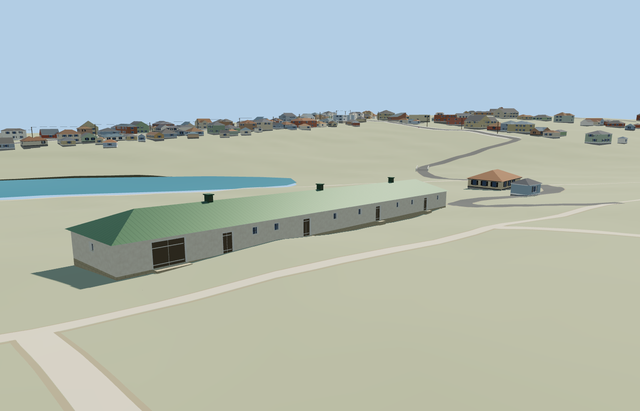

# Stable and Carriage Shed — Yasnaya Polyana

Reviewed2026-10-25. **Complete medium-fi exterior interpretation with explicit coarse-terrain grade adaptation. The estate remains incomplete.**

## Built and inspected

Inspected48 current portable/shared/medium-fi/native frames in one author/inspect/fix pass; full-resolution native courtyard, carriage door, stall windows/thresholds and rear plinth views. Complete one-story plaster shell, genuine recessed openings, broad double carriage leaf, supported thresholds, green hipped roof and three seated ridge vents. No horses, trees or unrelated estate buildings baked into the asset.

## Shared materials and LODs

Six roles merge into five existing256px graphs: stucco, stone_limestone, metal_standing_seam, wood_plain and storefront. The facade remains off-white, green roof and brown timber. Linear tints, metric UVs and separate vertex streams; no embedded bitmap, private atlas or new material graph. Native loading reads each graph once; unload releases every model geometry.

| Level | Triangles | Bytes | Draws |
| --- | ---: | ---: | ---: |
| skyline | 264 | 25440 | 1 |
| district | 824 | 65196 | 5 |
| street | 1136 | 89968 | 5 |
| closeup | 1136 | 89968 | 5 |

Four authored LODs 264/824/1136/1136 triangles; initial skyline+district 90636 bytes. Skyline preserves long hip, vents and stable/carriage door rhythm below1000triangles; district adds high stall windows and frames; near levels add mullions, door bracing and sparse roof seams. Synthetic mode/distance frames show shared style and transitions; physical laptop/phone measurements remain pending.

## Native placement and limits

Inferred from two ordinary museum stable/courtyard photos, the museum visitor-map stable marker, and the separate long rectangular footprint southeast of the three already owned Volkonsky footprints. Retained PMTiles does not label this building by name; keep this inference explicit. Exact retained way167382250 supplies the67.28x9.04m footprint and native axes; local negativeZ faces the inferred Volkonsky courtyard. No other Volkonsky building is owned. Front/rear assignment, opening census, roof vents and heights are photo-led approximations. Retained Protomaps20261020 and standard Mapzen201x201/6m grid. Outside courtyard control[0,-7] gives datum210.59747242081775m. Preserve every DEM sample, independent building, road and pond. The building occupies only its own footprint; thresholds use small supported aprons. No whole-yard ground cut, custom terrain or historic level claim. Inspected native carriage/stall thresholds, rear plinth, whole courtyard-facing building and roof vents. The approximate long-axis grade avoids an invented multi-storey foundation. Original ground remains throughout the courtyard; only this building footprint is cut. The source explicitly records the terrain adaptation and photo-led facade assignment. Only native building35184539471082 is replaced. All242 resident/294 wider independent buildings, original roads/courtyard and40070.675m² native water remain. Failure retains all243 original buildings; unload restores ground after water unload. Synthetic flat-ground previews expose the declared footprint hole and are not the native terrain fit evidence.

Complete independent long stable/carriage building: plaster shell, pale plinth, green hipped standing-seam roof, three seated ridge vents, real recessed stall/window/door apertures, separate wide double carriage door and supported threshold aprons. Use shared stucco, stone_limestone, metal_standing_seam, wood_plain and storefront surfaces. Hidden rear details and exact roof/threshold layout are approximate; terrain grade adaptation remains draft until inspected. One-story photo-led white plaster stable and carriage shed: wall3.05m above local floor, hipped green metal roof2.2m above eave, three ridge vents, four stable doors, wider3.7m carriage opening and high stall windows. Coarse native front-corner levels differ 3.296m over67.28m. This draft applies a 0.04899 long-axis grade to the floor/roof to fit retained terrain; this is an explicit terrain adaptation, not surveyed historical building geometry. Inspected native front/rear/threshold views retain the one-story silhouette and seat the plinth/thresholds. The mild long-axis floor/roof grade remains an approximation from coarse terrain, not surveyed historical construction. Exact historical construction, roof pitch, door/window census and concealed rear remain approximate. Stable identity/front assignment are inferred from ordinary museum views and separate map footprint; PMTiles has no building name. The0.04899 long-axis grade follows coarse terrain and is explicitly a visualization adaptation, not a surveyed historical floor/roof. Estate greenhouse/service inventory remains unfinished.

## Rebuild and checks

Three deterministic source-local programs are registered in source.json and asset-build.json. Targeted generation/import, four derivatives, generator --check, strict medium-fi, scene validation and30-tick simulation passed. Six GLBs: zero Khronos errors/warnings;137 mesh probes and48 inspected frames. Map overlap cases pass at levels13/14/15. Exact pins: [qa.json](qa.json).

## References

[Museum stable and courtyard photographs](https://www.ypmuseum.ru/object/konyushnya), photographer/date unstated, viewed only. No photograph pixels retained or used as texture. [Mapped independent footprint](https://www.openstreetmap.org/way/167382250), OpenStreetMap contributors,ODbL-1.0. Standard Mapzen terrain retained.
