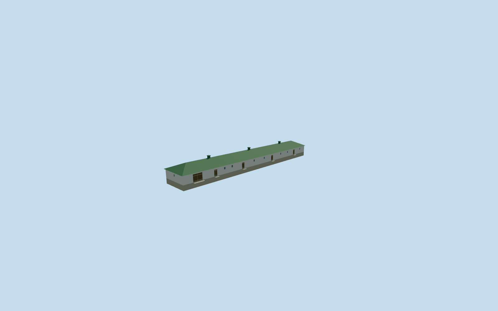

# Stable and Carriage Shed — Yasnaya Polyana

Complete independent long stable/carriage building: plaster shell, pale plinth, green hipped standing-seam roof, three seated ridge vents, real recessed stall/window/door apertures, separate wide double carriage door and supported threshold aprons. Use shared stucco, stone_limestone, metal_standing_seam, wood_plain and storefront surfaces. Hidden rear details and exact roof/threshold layout are approximate; terrain grade adaptation remains draft until inspected.

## Evidence and reconstruction

Published dimensions and reconstructed details are separated in spec.json. Primary references:

- [Reference](https://www.ypmuseum.ru/object/konyushnya)

Complete independent long stable/carriage building: plaster shell, pale plinth, green hipped standing-seam roof, three seated ridge vents, real recessed stall/window/door apertures, separate wide double carriage door and supported threshold aprons. Use shared stucco, stone_limestone, metal_standing_seam, wood_plain and storefront surfaces. Hidden rear details and exact roof/threshold layout are approximate; terrain grade adaptation remains draft until inspected.

## Model and axes

1,136 triangles; 2,396 vertices; 5 material groups; 103,296 bytes. Native bounds: -27.812, -3.214, -27.282 to 27.812, 7.296, 27.282. Source hash: `sha256:f528d6d6c5d670b69996a82841ee91c761e05c2bb8336ae7c529bd6e5aec3932`.

{"x":"east","y":"up","z":"south"}

The geographic proposal uses exact-QID OpenStreetMap evidence. Map-derived orientation and estimated architectural details require real-site visual review; preview eligibility is distinct from geographic/fidelity approval. Map attribution: © OpenStreetMap contributors, ODbL-1.0.

## Reproduce

Run `node content/worldgen/source/places/uc/ucd/stable_carriage_shed_yasnaya_polyana/models/generate-stable-carriage-shed-yasnaya-polyana.mjs --ids=stable_carriage_shed_yasnaya_polyana` (or add `--check`). The generator preserves manually edited masters by checking their baseline hashes. Import through the standard authored-model workflow with optimization disabled; then capture all QA cameras, including shared-surface views.

## Pending work

- Complete independent long stable/carriage building: plaster shell, pale plinth, green hipped standing-seam roof, three seated ridge vents, real recessed stall/window/door apertures, separate wide double carriage door and supported threshold aprons. Use shared stucco, stone_limestone, metal_standing_seam, wood_plain and storefront surfaces. Hidden rear details and exact roof/threshold layout are approximate; terrain grade adaptation remains draft until inspected.
- Inferred from two ordinary museum stable/courtyard photos, the museum visitor-map stable marker, and the separate long rectangular footprint southeast of the three already owned Volkonsky footprints. Retained PMTiles does not label this building by name; keep this inference explicit. Exact retained way167382250 supplies the67.28x9.04m footprint and native axes; local negativeZ faces the inferred Volkonsky courtyard. No other Volkonsky building is owned. Front/rear assignment, opening census, roof vents and heights are photo-led approximations.
- One-story photo-led white plaster stable and carriage shed: wall3.05m above local floor, hipped green metal roof2.2m above eave, three ridge vents, four stable doors, wider3.7m carriage opening and high stall windows. Coarse native front-corner levels differ 3.296m over67.28m. This draft applies a 0.04899 long-axis grade to the floor/roof to fit retained terrain; this is an explicit terrain adaptation, not surveyed historical building geometry. Inspected native front/rear/threshold views retain the one-story silhouette and seat the plinth/thresholds. The mild long-axis floor/roof grade remains an approximation from coarse terrain, not surveyed historical construction.
- Retained Protomaps20261020 and standard Mapzen201x201/6m grid. Outside courtyard control[0,-7] gives datum210.59747242081775m. Preserve every DEM sample, independent building, road and pond. The building occupies only its own footprint; thresholds use small supported aprons. No whole-yard ground cut, custom terrain or historic level claim.

This bundle follows the medium-fi standard. Medium-fi appearance and geographic fit are reviewed separately. Hash-bound visual acceptance is recorded separately after capture inspection.
