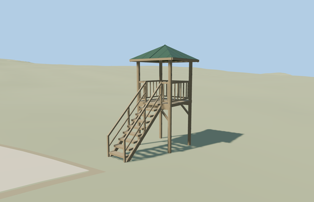

# Tower Gazebo — Yasnaya Polyana

Reviewed2026-10-25. **Complete medium-fi exterior interpretation with approximate point-based placement, photo-led scale and inferred stair facing. The estate remains incomplete; bathhouse shoreline approval and service inventory reconciliation remain outstanding.**

## Built and inspected

Inspected48 current portable/shared/medium-fi/native frames and full-resolution native stair, undercroft, platform entry and roof-bearing views during one author/inspect/fix pass. Four exposed timber posts support the open square platform, steep nine-tread stair, two stringers/handrails, vertical balusters and shallow green pyramidal roof. The underside stays open; there is a real gap in the front rail for the stair. An inner bearing ring seats the roof on the posts and near-level hip rafters follow its pitch. No unrelated tree/canopy is baked into the structure.

## Shared materials and LODs

Three roles use two existing256px graphs: wood_plain for timber and restrained bark accents, metal_standing_seam for the green roof. Linear tints, metric UVs, separate POSITION/NORMAL streams and equal CPU/GPU geometry accounting. At most2nearby draws/one skyline draw. No embedded bitmap, private atlas or new graph. Each graph reads once; unload releases all model geometry.

| Level | Triangles | Bytes | Draws |
| --- | ---: | ---: | ---: |
| skyline | 552 | 52912 | 1 |
| district | 848 | 73032 | 2 |
| street | 1160 | 98532 | 2 |
| closeup | 1260 | 105612 | 2 |

Four authored LODs 552/848/1160/1260triangles; initial skyline+district125944bytes; closeup105612bytes. Skyline retains the full four-post/open-platform/green-roof/stair silhouette within the1k structure ceiling; district adds vertical balusters and stair midrails; street/closeup add restrained bark, plank seams and hip rafters. Synthetic scenes compare style/LOD/modes. Physical laptop/phone measurements remain pending.

## Geographic fit and limits

Named Беседка-вышка node6338741862 at unchanged assigned anchor[37.53197110790589,54.07432543327198]. No retained building footprint within40m. Map evidence is the named point only: the2.15m platform/2.6m roof and5.4m approximate height are photo-led, not mapped or surveyed dimensions. LocalX southeast, localZ southwest toward the nearest retained path point6.897m away; native axes baked with heading0. Stair faces the inferred approach, with30-degree orientation uncertainty. The small unrepresented foot trail between stair and mapped path is not invented as source map geometry. The gazebo is independent from the pavilion and entrance towers. Retained Protomaps20261020/Mapzen201x201/6m standard extract. Outside control[-2.5,0] sets datum198.23757107381198m. Four post ground offsets[-0.07934965518876425,-0.106392250622946,0.018416897355848505,0.04679499927158304]m; whole platform sits about2.4m above the highest sampled post foot. Original ground remains beneath platform, stair, supports and approaches; solid posts/stringer ends seat into soil without cutouts. No flattening, new water or bespoke terrain. The map lacks this small footprint and final trail connection; exact orientation, scale and soil/footing details remain approximate. Inspected native whole tower, platform entry, roof-bearing frame and grounded posts/open stair. Original terrain stays beneath every open area; all independent buildings, paths and water remain. Approximate stair direction follows the nearest retained path; map point alone does not certify compass facing or dimensions. The30-degree uncertainty is an authoring estimate, not a surveyed angular bound. No missing-map trail was added. The named map point—not an invented building outline—anchors this reconstruction. All243 resident/295 wider independent buildings, original path inputs and40070.675m² pond water remain unchanged. Ground stays beneath the raised platform, stair, solid supports and outside approaches. Failure retains all original map objects; unload releases geometry without changing ground/water. Legacy fixture groundOutsideResidentTile samples an arbitrary point outside this shifted grid; it is not used as geographic proof.

Complete small timber tower gazebo: four tall exposed posts, open raised square platform, steep stair with separate treads/stringers/handrails, vertical platform balusters with a real stair entry, bracing and green pyramidal sheet-metal roof with underside rafters. Shared wood_plain and metal_standing_seam graphs, four authored LODs and no private texture atlas, copied photograph pixels or attached tree geometry. Hidden joinery and exact scale remain original photo-led approximations. Photo-led platform2.15m square, upper floor modelY2.45m, eave4.65m and roof peak5.4m. Four main posts follow individually sampled ground and extend.18m into it. Stair run2.6m, width.95m, 9open treads from original soil modelY0.25112494991566336m to platform. Handrails/platform rail1.0m above walking surfaces. Exact post diameters, tread/log/baluster census, roof pitch and historical levels/accessibility are approximate. The inner roof-bearing ring is seated on post tops at modelY4.773076923076924m, above the lower overhanging eave, and hip rafters follow the actual roof pitch. Retained Protomaps20261020/Mapzen201x201/6m standard extract. Outside control[-2.5,0] sets datum198.23757107381198m. Four post ground offsets[-0.07934965518876425,-0.106392250622946,0.018416897355848505,0.04679499927158304]m; whole platform sits about2.4m above the highest sampled post foot. Original ground remains beneath platform, stair, supports and approaches; solid posts/stringer ends seat into soil without cutouts. No flattening, new water or bespoke terrain. The map lacks this small footprint and final trail connection; exact orientation, scale and soil/footing details remain approximate. Museum and Commons photos establish the exterior silhouette. The map provides only a named point and a path about6.9m away; it does not establish footprint, dimensions or compass facing. Front assignment and scale are deliberately approximate;30degrees is an authoring uncertainty estimate, not a measured angular bound. The small final foot trail is not represented in retained data and is not fabricated. Tree-obscured rear details, exact baluster/tread census, joinery, roof section and historical levels/accessibility remain reconstructed. Other estate buildings/trees remain independent context.

## Rebuild and checks

Own three deterministic source-local modules inventoried in source.json and asset-build.json. Targeted generation/import, forced derivatives, recipe lint, source/hash/style checks, scene validation and30-tick simulation pass. Six GLBs have zero Khronos errors/warnings;186 actual mesh/contact probes and48 inspected frames. Point-only map evidence stays explicit. Exact byte/input pins: [qa.json](qa.json).

## References

- [Museum exterior](https://www.ypmuseum.ru/object/besedka-vyshka?lang=en), individual photographer/date unstated; viewed only.
- [Closer oblique](https://commons.wikimedia.org/wiki/File:Любимая_беседка_матери_Л.Н._Толстого.jpg), Котельников,2018-09-19,CC BY-SA4.0; viewed only.
- [Named POI](https://www.openstreetmap.org/node/6338741862), OpenStreetMap contributors,ODbL-1.0. No copied pixels or invented mapped footprint.
