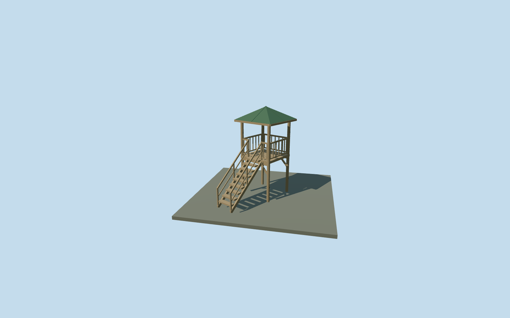

# Tower Gazebo — Yasnaya Polyana

Complete small timber tower gazebo: four tall exposed posts, open raised square platform, steep stair with separate treads/stringers/handrails, vertical platform balusters with a real stair entry, bracing and green pyramidal sheet-metal roof with underside rafters. Shared wood_plain and metal_standing_seam graphs, four authored LODs and no private texture atlas, copied photograph pixels or attached tree geometry. Hidden joinery and exact scale remain original photo-led approximations.

## Evidence and reconstruction

Published dimensions and reconstructed details are separated in spec.json. Primary references:

- [Reference](https://www.ypmuseum.ru/object/besedka-vyshka?lang=en)
- [Reference](https://commons.wikimedia.org/wiki/File:Любимая_беседка_матери_Л.Н._Толстого.jpg)

Complete small timber tower gazebo: four tall exposed posts, open raised square platform, steep stair with separate treads/stringers/handrails, vertical platform balusters with a real stair entry, bracing and green pyramidal sheet-metal roof with underside rafters. Shared wood_plain and metal_standing_seam graphs, four authored LODs and no private texture atlas, copied photograph pixels or attached tree geometry. Hidden joinery and exact scale remain original photo-led approximations.

## Model and axes

1,260 triangles; 2,772 vertices; 2 material groups; 116,924 bytes. Native bounds: -2.161, -0.286, -1.791 to 1.791, 5.417, 3.498. Source hash: `sha256:cf7afdf192de9f4eddc65509b89aba4eff8555d77b59e86c32fa962f88a1938d`.

{"x":"east","y":"up","z":"south"}

The geographic proposal uses exact-QID OpenStreetMap evidence. Map-derived orientation and estimated architectural details require real-site visual review; preview eligibility is distinct from geographic/fidelity approval. Map attribution: © OpenStreetMap contributors, ODbL-1.0.

## Reproduce

Run `node content/worldgen/source/places/uc/ucd/tower_gazebo_yasnaya_polyana/models/generate-tower-gazebo-yasnaya-polyana.mjs --ids=tower_gazebo_yasnaya_polyana` (or add `--check`). The generator preserves manually edited masters by checking their baseline hashes. Import through the standard authored-model workflow with optimization disabled; then capture all QA cameras, including shared-surface views.

## Pending work

- Complete small timber tower gazebo: four tall exposed posts, open raised square platform, steep stair with separate treads/stringers/handrails, vertical platform balusters with a real stair entry, bracing and green pyramidal sheet-metal roof with underside rafters. Shared wood_plain and metal_standing_seam graphs, four authored LODs and no private texture atlas, copied photograph pixels or attached tree geometry. Hidden joinery and exact scale remain original photo-led approximations.
- Named Беседка-вышка node6338741862 at unchanged assigned anchor[37.53197110790589,54.07432543327198]. No retained building footprint within40m. Map evidence is the named point only: the2.15m platform/2.6m roof and5.4m approximate height are photo-led, not mapped or surveyed dimensions. LocalX southeast, localZ southwest toward the nearest retained path point6.897m away; native axes baked with heading0. Stair faces the inferred approach, with30-degree orientation uncertainty. The small unrepresented foot trail between stair and mapped path is not invented as source map geometry. The gazebo is independent from the pavilion and entrance towers.
- Photo-led platform2.15m square, upper floor modelY2.45m, eave4.65m and roof peak5.4m. Four main posts follow individually sampled ground and extend.18m into it. Stair run2.6m, width.95m, 9open treads from original soil modelY0.25112494991566336m to platform. Handrails/platform rail1.0m above walking surfaces. Exact post diameters, tread/log/baluster census, roof pitch and historical levels/accessibility are approximate. The inner roof-bearing ring is seated on post tops at modelY4.773076923076924m, above the lower overhanging eave, and hip rafters follow the actual roof pitch.
- Retained Protomaps20261020/Mapzen201x201/6m standard extract. Outside control[-2.5,0] sets datum198.23757107381198m. Four post ground offsets[-0.07934965518876425,-0.106392250622946,0.018416897355848505,0.04679499927158304]m; whole platform sits about2.4m above the highest sampled post foot. Original ground remains beneath platform, stair, supports and approaches; solid posts/stringer ends seat into soil without cutouts. No flattening, new water or bespoke terrain. The map lacks this small footprint and final trail connection; exact orientation, scale and soil/footing details remain approximate.

This bundle follows the medium-fi standard. Medium-fi appearance and geographic fit are reviewed separately. Hash-bound visual acceptance is recorded separately after capture inspection.
