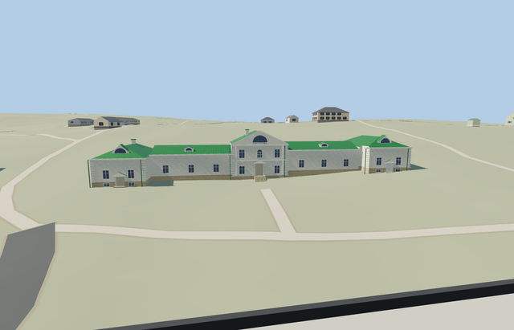

# Volkonsky House and wings — Yasnaya Polyana

Reviewed2026-10-25. **Complete medium-fi house exterior with approximate native fit. The estate collection remains incomplete. Tolstoy and Kuzminsky Houses are independently completed; the service/garden structures and bridge still need their own models, and visitor-map inventory reconciliation is required before estate completion.**

## Built and inspected

Complete connected Volkonsky House and both mapped wings at Yasnaya Polyana: raised central two-storey block with gabled pediment and semicircular attic glazing; lower long connecting ranges and wider end pavilions follow all three actual mapped parts. Green standing-seam pitched/hipped roofs, small arched dormers, two pale chimney proxies, repeated white window frames, shallow pilasters/cornices, two recessed end cellar doors with small pediment hoods, central recessed entrance and side recessed doorway with supported treads. Basement bands preserve the original slope. Hidden rear bays/doors and exact historical levels remain approximate. No copied plaques, inscriptions, furnishings, artworks or photo pixels.

Inspected all48 current portable/shared/medium-fi/native frames in nine labeled contact sheets, plus full-resolution native whole connected house, central pediment/entrance, end cellar door and rear roof views. The raised gabled center, low links, wider end pavilions, four arched dormers, green roofs, two pale chimneys, repeated window bands, cellar pediment hoods and supported entrances read coherently. The continuous author/inspect/fix pass closed dormer backs and roof joints, seated the center chimney in its roof and added doorway aprons; the hidden foundation extends to the placement datum.

## Shared materials and LODs

Six roles reuse five existing256px graphs: stucco, wood_plain, stone_limestone, metal_standing_seam and storefront. Metric UVs, linear tints, five nearby draws/one skyline, separate POSITION/NORMAL streams and matching CPU/GPU geometry accounting. No embedded image, private atlas or new graph. Each used graph reads once; unload releases every model geometry.

| Level | Triangles | Bytes | Draws |
| --- | ---: | ---: | ---: |
| skyline | 773 | 69744 | 1 |
| district | 1967 | 164432 | 5 |
| street | 3187 | 260656 | 5 |
| closeup | 3355 | 276136 | 5 |

Four authored LODs773/1967/3187/3355 triangles. Initial skyline+district234176bytes; closeup276136bytes. Skyline keeps all five connected roof masses, center pediment, four closed dormer housings, two stacks, physical recessed entrances and supported aprons/treads; it omits window/glazed fan modules and close quoin/pipe/medallion proxies. District adds the arched attic/dormer glazing and complete window rhythm; street/closeup add small bands, pipes and original plain medallion proxies. Synthetic contexts check style/LOD/tier coherence; native views establish approximate geographic fit.

## Native location and limits

Named Дом Волконского POI locates central way220075409; touching wing ways220075411 and220075412 form the connected house. All three exact map outlines are retained. X southwest along the long southeast front; Z southeast toward the open lawn. Native east/up/south axes are baked, heading0. The assigned central member reference coordinate is the model origin; no aggregate estate placement or duplicate house identity. Tolstoy/Kuzminsky houses, service buildings, garden structures, roads and ponds remain independent. Retained standard Protomaps20261020 and Mapzen terrain; outside front lawn provider[0,13] supplies214.14446963646515m datum. Full boundary grades0.378..4.195m. Central floor+1.3m and part floors1.7/1.4/2.3/2.9m follow front controls; closed foundation0m. Coarse uphill ground can bury lower rear walls while front basement bands remain exposed; original lawn, paths, neighbors and ponds remain. No bespoke terrain, flattening or copied vegetation; historical levels and accessibility approximate. Inspected native complete/front/cellar/rear views: all three mapped parts align, five roof masses remain connected, central and end entrances have supported aprons/treads, and original lawn/paths remain. Three owned records are replaced while240 resident independent buildings and40070.675m² pond water remain unchanged. Coarse uphill grade partly buries lower rear walls/windows; historic levels and accessibility remain approximate. All three owned mapped records are replaced while240 resident/292 wider independent buildings, original lawn/approaches, roads and40070.675m² pond water remain. Failure retains all243 originals; every LOD/failure/unload case restores ground/water and releases geometry.

Recognizable medium-fi connected exterior on all three exact mapped outlines. Heights, rear bay/door inventory, dormer/chimney details, ornament, basement levels, thresholds and accessibility are approximate. Original boundary grades+.378..+4.195m relative to214.14446963646515m front-lawn datum; central floor+1.3m, link/end floors1.7/1.4/2.3/2.9m and foundation0m follow photo-led front controls. The unchanged coarse uphill ground partly buries lower rear walls/windows (up to roughly3m relative to the lowest local floors); front basement bands remain exposed. Roof joints step with these approximate levels. Hedges obscure the reference center entrance; rear faces are reconstructed, not surveyed. Some fixed shared/style details crop the opposite end and flat synthetic ground buries bases/treads; whole/turntable/native views cover the envelope. Other estate houses stay independent procedural context in this isolated fixture. No copied artworks, inscriptions, plaques, furnishings, plantings or pixels. Physical phone/laptop and dense-city timings remain pending.

## Rebuild and checks

Source-local recipes are inventoried in source.json and registered in asset-build.json. Run `node content/worldgen/source/places/uc/ucd/volkonsky_house_yasnaya_polyana/models/generate-volkonsky-house-yasnaya-polyana.mjs --check`. Selected import/placement checks, strict medium-fi, scene validation, sim30 and recipe lint pass. Six GLBs: zero Khronos errors/warnings;271 actual geometry/contact probes and five PMTiles14/15 cases (the zoom13 extract contains no overlapping building feature) cover all three detailed owned parts. Sim30 sha256:a9370d582f933320a2ff95a66aad6d82ec8cef369fc96f807c76f83ed616a2e1. Exact pins and concise evidence: [qa.json](qa.json).

## References

- [Complete-house photograph](https://commons.wikimedia.org/wiki/File:Tula_YasnayaPolyana_asv2019-09_img05_Volkonsky_House.jpg), A.Savin,2019-09-13,Free Art License; viewed only.
- [Reverse oblique photograph](https://commons.wikimedia.org/wiki/File:Russia._Tula_Oblast._Yasnaya_Polyana._Volkonsky_House_P5131500_2800.jpg), Alexxx1979,2026-05-13,CC BY-SA4.0; viewed only.
- [Museum visitor map](https://ypmuseum.ru/map), estate context.
- [Mapped house](https://www.openstreetmap.org/way/220075409), ©OpenStreetMap contributors,ODbL-1.0. Controls and signed axes: [map-frame.json](map-frame.json).

## Combined main-house viewer check

Inspected five current combined viewer frames: district and closeup estate views plus a closer native view of each house. Tolstoy House, Kuzminsky House and all five connected roof masses of Volkonsky House render independently at their map locations; five owned building records are replaced, with all238 resident independent buildings, original terrain, paths/roads and40070.675m² pond water retained. The same six existing shared graphs read once across all three models. Combined skyline+district geometry615064bytes; combined closeup953636bytes. Unload restores ground/water and releases all model geometry. The three houses read coherently together; remaining estate buildings stay procedural context. Historic levels, hidden detail and uphill rear burial retain the individual approximate-fit limitations. Physical laptop/phone and dense-city measurements remain pending.
