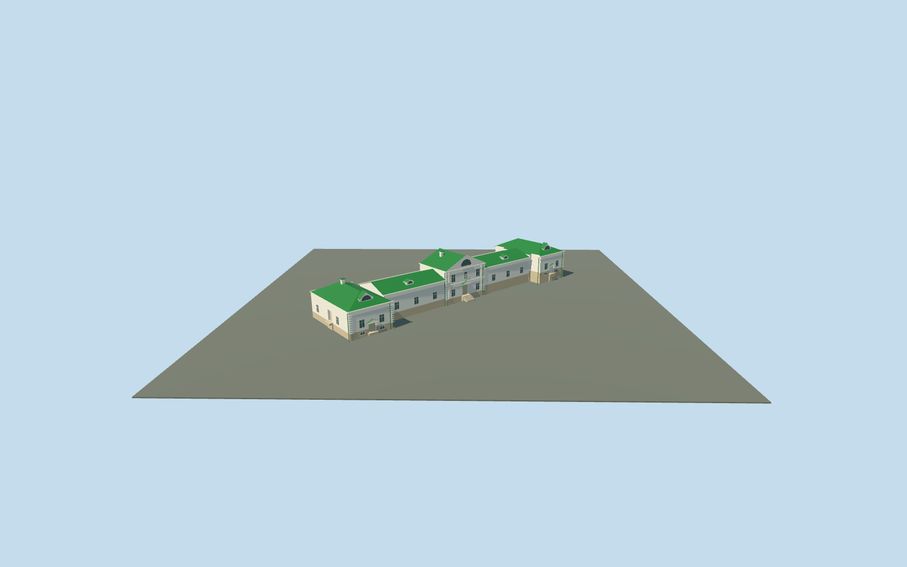

# Volkonsky House and wings — Yasnaya Polyana

Complete connected Volkonsky House and both mapped wings at Yasnaya Polyana: raised central two-storey block with gabled pediment and semicircular attic glazing; lower long connecting ranges and wider end pavilions follow all three actual mapped parts. Green standing-seam pitched/hipped roofs, small arched dormers, two pale chimney proxies, repeated white window frames, shallow pilasters/cornices, two recessed end cellar doors with small pediment hoods, central recessed entrance and side recessed doorway with supported treads. Basement bands preserve the original slope. Hidden rear bays/doors and exact historical levels remain approximate. No copied plaques, inscriptions, furnishings, artworks or photo pixels.

## Evidence and reconstruction

Published dimensions and reconstructed details are separated in spec.json. Primary references:

- [Reference](https://commons.wikimedia.org/wiki/File:Tula_YasnayaPolyana_asv2019-09_img05_Volkonsky_House.jpg)
- [Reference](https://commons.wikimedia.org/wiki/File:Russia._Tula_Oblast._Yasnaya_Polyana._Volkonsky_House_P5131500_2800.jpg)

Complete connected Volkonsky House and both mapped wings at Yasnaya Polyana: raised central two-storey block with gabled pediment and semicircular attic glazing; lower long connecting ranges and wider end pavilions follow all three actual mapped parts. Green standing-seam pitched/hipped roofs, small arched dormers, two pale chimney proxies, repeated white window frames, shallow pilasters/cornices, two recessed end cellar doors with small pediment hoods, central recessed entrance and side recessed doorway with supported treads. Basement bands preserve the original slope. Hidden rear bays/doors and exact historical levels remain approximate. No copied plaques, inscriptions, furnishings, artworks or photo pixels.

## Model and axes

3,355 triangles; 7,759 vertices; 5 material groups; 322,980 bytes. Native bounds: -29.664, 0.000, -27.817 to 29.138, 10.882, 26.951. Source hash: `sha256:d9af3b261b2ea2d0a30e634691fa1c5c4964752426cc04377b788d05df28c91c`.

{"x":"east","y":"up","z":"south"}

The geographic proposal uses exact-QID OpenStreetMap evidence. Map-derived orientation and estimated architectural details require real-site visual review; preview eligibility is distinct from geographic/fidelity approval. Map attribution: © OpenStreetMap contributors, ODbL-1.0.

## Reproduce

Run `node content/worldgen/source/places/sr/sr2/volkonsky_house_yasnaya_polyana/models/generate-volkonsky-house-yasnaya-polyana.mjs --ids=volkonsky_house_yasnaya_polyana` (or add `--check`). The generator preserves manually edited masters by checking their baseline hashes. Import through the standard authored-model workflow with optimization disabled; then capture all QA cameras, including shared-surface views.

## Pending work

- Complete connected Volkonsky House and both mapped wings at Yasnaya Polyana: raised central two-storey block with gabled pediment and semicircular attic glazing; lower long connecting ranges and wider end pavilions follow all three actual mapped parts. Green standing-seam pitched/hipped roofs, small arched dormers, two pale chimney proxies, repeated white window frames, shallow pilasters/cornices, two recessed end cellar doors with small pediment hoods, central recessed entrance and side recessed doorway with supported treads. Basement bands preserve the original slope. Hidden rear bays/doors and exact historical levels remain approximate. No copied plaques, inscriptions, furnishings, artworks or photo pixels.
- Named Дом Волконского POI locates central way220075409; touching wing ways220075411 and220075412 form the connected house. All three exact map outlines are retained. X southwest along the long southeast front; Z southeast toward the open lawn. Native east/up/south axes are baked, heading0. The assigned central member reference coordinate is the model origin; no aggregate estate placement or duplicate house identity. Tolstoy/Kuzminsky houses, service buildings, garden structures, roads and ponds remain independent.
- Photo-led approximate medium-fi vertical scale: central wall6.6m plus2.7m gable rise; links/end walls4.25m plus1.65/2.2m green roofs, attic dormers and two simple pale chimney proxies. Recessed end cellar door floors-.85m relative to house floor. Map8m center/5m wings are scale cues, not surveys. Basements, hidden roof/bay/door inventory, treads, thresholds and accessibility approximate.
- Retained standard Protomaps20261020 and Mapzen terrain; outside front lawn provider[0,13] supplies214.14446963646515m datum. Full boundary grades0.378..4.195m. Central floor+1.3m and part floors1.7/1.4/2.3/2.9m follow front controls; closed foundation0m. Coarse uphill ground can bury lower rear walls while front basement bands remain exposed; original lawn, paths, neighbors and ponds remain. No bespoke terrain, flattening or copied vegetation; historical levels and accessibility approximate.

This bundle follows the medium-fi standard. Medium-fi appearance and geographic fit are reviewed separately. Hash-bound visual acceptance is recorded separately after capture inspection.
